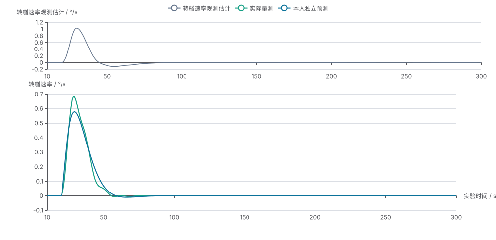

# 实验01 055型驱逐舰航向控制

课程版本 seven-vessel-2026.11.14，指导书版本 2026.11.16。

## 课程卡

船舶与海洋工程、自动化本科学生，自动控制原理与船舶控制实验

先修知识包括传递函数与一、二阶响应、时域性能指标、P、PD和PID反馈。

设计用时为预习15分钟、操作分析80分钟、报告25分钟，合计120分钟。

用时为教学设计起点。任课教师结合学校课时长度、课前课后安排和实际试教学记录登记课表。七个实验分别启动、完成和复核，可按课程安排组合使用。

- 解释指令、执行器、量测与船体运动的因果链。认知层级为理解与分析，通过第1、2、3步形成证据。
- 建立局部模型并以独立记录检验适用域。认知层级为应用与分析，通过第4、5、6、7、8步形成证据。
- 比较控制方案、饱和和现实因素下的性能。认知层级为设计与评价，通过第9、10、11、12、13、14、15、16、17、18步形成证据。
- 在未见条件中验证并形成有证据的工程结论。认知层级为评价与工程判断，通过第19、20步形成证据。

## 原型、物理对象与参数

双轴推进、双舵、真实轴系与舵机，船体六自由度及风浪流共同作用。舵角指令、实际舵角和船体转艏响应分别记录。

物理对象保留纵荡、横荡、升沉、横摇、纵摇与艏摇。世界坐标为北、东、下，船体坐标为艏、右舷、下。正航向为俯视顺时针。力矩按实际作用点的叉积计算。

| 默认教学参数 | 数值 | 单位 | 来源等级 |
| --- | --- | --- | --- |
| 教学排水质量 | 13000000.0000 | kg | T / 同一冻结装配 |
| 默认吃水 | 6.6000 | m | T / 同一冻结装配 |
| 默认有效横稳心高 | 1.5000 | m | T / 同一冻结装配 |

P表示公开原型资料，B表示公开基准，D表示计算与校准，T表示教学设定。上表为冻结装配的默认教学值。装载、姿态和工况变化后的参数按本次运行显示并记录。原始数值残差、参数来源和有效域随版本保存。

研究标称船形与教学设备参数适用于本课程工况。局部线性模型的工作航速、舵角、训练窗和独立验证窗随作品保存。

## 本人理想模型与独立对照

先辨识舵机的一阶惯性与延迟，再以实际舵角辨识局部Nomoto一阶或二阶模型。K的单位为1/s，时间常数与延迟单位为s。

使用本人冻结模型计算P、PD及PID初值，再依据实际舵角、饱和与波浪下的量测修正。

三维船体由物理对象的实际受力推进。仪器提供带采样时刻、延迟和质量标志的量测，观测器据此形成状态估计。本人理想模型从所选量测窗口辨识，并独立生成预测曲线。

A模式以实际执行器量测检验局部模型。B模式使用指令和声明的执行器模型，或已包含执行器的联合模型。C模式以本人模型的独立反馈预测闭环。每种对照均保存模型版本、输入通道、单位和窗口，训练与独立验证分别取证。

图1采用同课程版本的软件验收记录，并保留原始预测偏差。图中量测、观测估计及预测按各自标签读取。

## 二十步目录

| 步骤 | 名称 | 页码 |
| --- | --- | --- |
| 1 | [认识控制通道](#destroyer-step-1) | 3 |
| 2 | [测量舵机动态](#destroyer-step-2) | 4 |
| 3 | [观察阶跃响应](#destroyer-step-3) | 4 |
| 4 | [辨识局部模型](#destroyer-step-4) | 5 |
| 5 | [独立留出验证](#destroyer-step-5) | 5 |
| 6 | [检验大幅值边界](#destroyer-step-6) | 6 |
| 7 | [比较不同航速](#destroyer-step-7) | 6 |
| 8 | [绘制模型特征](#destroyer-step-8) | 7 |
| 9 | [设计比例控制](#destroyer-step-9) | 8 |
| 10 | [设计比例微分控制](#destroyer-step-10) | 8 |
| 11 | [分析积分抗扰](#destroyer-step-11) | 9 |
| 12 | [比较抗饱和](#destroyer-step-12) | 9 |
| 13 | [区分航向与航迹](#destroyer-step-13) | 10 |
| 14 | [识别波频运动](#destroyer-step-14) | 11 |
| 15 | [选择微分滤波](#destroyer-step-15) | 11 |
| 16 | [形成综合方案](#destroyer-step-16) | 12 |
| 17 | [比较第二方案](#destroyer-step-17) | 12 |
| 18 | [验证未见航速](#destroyer-step-18) | 13 |
| 19 | [检验与修正边界](#destroyer-step-19) | 13 |
| 20 | [完成实验报告](#destroyer-step-20) | 14 |

## 二十步操作、证据与评价

### 第1步 认识控制通道

| 项目 | 本步要求 |
| --- | --- |
| 目标与认知 | 输入/状态/输出与单位，不把姿态等同舵角；保存标注，理解 |
| 能力证据 | 解释指令、执行器、量测与船体运动的因果链 |
| 初态与条件 | 初始对水航速 / m/s 8，随机种子 20261106，初始航向 / ° 0 |
| 本步启用因素 | P0、N0 |
| 合同参数范围 | 手操舵角 -35-35° |
| 事件与操作 | 开始独立运行 |
| 时长与结束 | 60s，运行至60秒，或由学生结束并保留记录 |
| 量测与统计窗 | 航向、转艏速率、对水航速、实际舵角、实际轴速、北向位置、东向位置，0-60s |
| 最少运行 | 1组实际记录 |
| 训练与验证 | 训练或方案设计 |
| 提交工件 | 运行前预测、实际运行记录、信号与受力标注、证据解释 |
| 评价 | 预测0.9分，证据1.2分，性能0分，解释0.9分，输入/状态/输出与单位，不把姿态等同舵角；保存标注 |
| 观察问题 | 在受力图中标识舵指令、实际舵、r、psi、v、phi并切换显示 |
| 常见误判与核对 | 区分舵机惯性、船体惯性、量测滤波和真实纯时延。将超调、持续误差与输入饱和分别联系到对应证据。 |

先记录自己的预测，再操作、读数并解释差异。实际未达目标、缺测或保护退出的记录与分析继续保存。

### 第2步 测量舵机动态

| 项目 | 本步要求 |
| --- | --- |
| 目标与认知 | 执行器动态与指令/实际差异；提交Ta及两点依据，理解 |
| 能力证据 | 解释指令、执行器、量测与船体运动的因果链 |
| 初态与条件 | 初始对水航速 / m/s 8，随机种子 20261106，初始航向 / ° 0 |
| 本步启用因素 | P0、N0 |
| 合同参数范围 | 手操舵角 -35-35° |
| 事件与操作 | 开始独立运行。20s {"timeS":20,"rudderDeg":5}。60s {"timeS":60,"rudderDeg":0} |
| 时长与结束 | 120s，运行至120秒，或由学生结束并保留记录 |
| 量测与统计窗 | 航向、转艏速率、对水航速、实际舵角、实际轴速、北向位置、东向位置，0-120s |
| 最少运行 | 1组实际记录 |
| 训练与验证 | 训练或方案设计 |
| 提交工件 | 运行前预测、实际运行记录、执行器时间常数、本人量测窗口、证据解释 |
| 评价 | 预测0.9分，证据1.2分，性能0分，解释0.9分，执行器动态与指令/实际差异；提交Ta及两点依据 |
| 观察问题 | 选择测量窗口，在曲线上估计舵机Ta和速率上限 |
| 常见误判与核对 | 区分舵机惯性、船体惯性、量测滤波和真实纯时延。将超调、持续误差与输入饱和分别联系到对应证据。 |

先记录自己的预测，再操作、读数并解释差异。实际未达目标、缺测或保护退出的记录与分析继续保存。

### 第3步 观察阶跃响应

| 项目 | 本步要求 |
| --- | --- |
| 目标与认知 | 一阶转艏率与积分航向区别；完整轨迹和预测，理解 |
| 能力证据 | 解释指令、执行器、量测与船体运动的因果链 |
| 初态与条件 | 初始对水航速 / m/s 8，随机种子 20261106，初始航向 / ° 0 |
| 本步启用因素 | P0、N0 |
| 合同参数范围 | 手操舵角 -35-35° |
| 事件与操作 | 开始独立运行。20s {"timeS":20,"rudderDeg":5} |
| 时长与结束 | 300s，运行至300秒，或由学生结束并保留记录 |
| 量测与统计窗 | 航向、转艏速率、对水航速、实际舵角、实际轴速、北向位置、东向位置，0-300s |
| 最少运行 | 1组实际记录 |
| 训练与验证 | 训练或方案设计 |
| 提交工件 | 运行前预测、实际运行记录、证据解释 |
| 评价 | 预测0.9分，证据1.2分，性能0分，解释0.9分，一阶转艏率与积分航向区别；完整轨迹和预测 |
| 观察问题 | 先预测r与psi形态，再选择实际舵作为辨识输入 |
| 常见误判与核对 | 区分舵机惯性、船体惯性、量测滤波和真实纯时延。将超调、持续误差与输入饱和分别联系到对应证据。 |

先记录自己的预测，再操作、读数并解释差异。实际未达目标、缺测或保护退出的记录与分析继续保存。

### 第4步 辨识局部模型

| 项目 | 本步要求 |
| --- | --- |
| 目标与认知 | 物理输入选择、参数量纲；拟合模型/残差，不抄默认数，分析 |
| 能力证据 | 建立局部模型并以独立记录检验适用域 |
| 初态与条件 | 初始对水航速 / m/s 8，随机种子 20261106，初始航向 / ° 0 |
| 本步启用因素 | P0、N0 |
| 合同参数范围 | 分析窗口起点 0-300s |
| 事件与操作 | 整理本人已有证据 |
| 时长与结束 | 分析步骤，提交所需分析工件 |
| 量测与统计窗 | 航向、转艏速率、对水航速、实际舵角、实际轴速、北向位置、东向位置，0-300s |
| 最少运行 | 0组已有证据，按本步工件要求引用 |
| 训练与验证 | 汇总分析 |
| 提交工件 | 训练运行、本人量测窗口、本人辨识模型、拟合残差、证据解释 |
| 评价 | 预测0.9分，证据1.2分，性能0分，解释0.9分，物理输入选择、参数量纲；拟合模型/残差，不抄默认数 |
| 观察问题 | 拖选t20后有效窗，拟合K、T；剔除启动伺服段或明确串联辨识 |
| 常见误判与核对 | 区分舵机惯性、船体惯性、量测滤波和真实纯时延。将超调、持续误差与输入饱和分别联系到对应证据。 |

先记录自己的预测，再操作、读数并解释差异。实际未达目标、缺测或保护退出的记录与分析继续保存。

### 第5步 独立留出验证

| 项目 | 本步要求 |
| --- | --- |
| 目标与认知 | 训练/验证分离、正负输入；明确是否通过有效域判断，分析 |
| 能力证据 | 建立局部模型并以独立记录检验适用域 |
| 初态与条件 | 初始对水航速 / m/s 8，随机种子 20261106，初始航向 / ° 0 |
| 本步启用因素 | P0、N0 |
| 合同参数范围 | 手操舵角 -35-35° |
| 事件与操作 | 开始独立运行。20s {"timeS":20,"rudderDeg":-3} |
| 时长与结束 | 300s，运行至300秒，或由学生结束并保留记录 |
| 量测与统计窗 | 航向、转艏速率、对水航速、实际舵角、实际轴速、北向位置、东向位置，0-300s |
| 最少运行 | 1组实际记录 |
| 训练与验证 | 独立验证 |
| 提交工件 | 运行前预测、实际运行记录、冻结模型、独立验证、证据解释 |
| 评价 | 预测1.2分，证据1.6分，性能0分，解释1.2分，训练/验证分离、正负输入；明确是否通过有效域判断 |
| 观察问题 | 将步骤4模型冻结，叠加预测/测量并给出验证RMSE |
| 常见误判与核对 | 区分舵机惯性、船体惯性、量测滤波和真实纯时延。将超调、持续误差与输入饱和分别联系到对应证据。 |

先记录自己的预测，再操作、读数并解释差异。实际未达目标、缺测或保护退出的记录与分析继续保存。

### 第6步 检验大幅值边界

| 项目 | 本步要求 |
| --- | --- |
| 目标与认知 | 大幅值非线性、耦合/速率；指出至少一个模型假设失效，分析 |
| 能力证据 | 建立局部模型并以独立记录检验适用域 |
| 初态与条件 | 初始对水航速 / m/s 8，随机种子 20261106，初始航向 / ° 0 |
| 本步启用因素 | P0、N0 |
| 合同参数范围 | 手操舵角 -35-35° |
| 事件与操作 | 开始独立运行。20s {"timeS":20,"rudderDeg":20} |
| 时长与结束 | 300s，运行至300秒，或由学生结束并保留记录 |
| 量测与统计窗 | 航向、转艏速率、对水航速、实际舵角、实际轴速、北向位置、东向位置，0-300s |
| 最少运行 | 1组实际记录 |
| 训练与验证 | 训练或方案设计 |
| 提交工件 | 运行前预测、实际运行记录、冻结模型、实际对照、证据解释 |
| 评价 | 预测1.2分，证据1.6分，性能0分，解释1.2分，大幅值非线性、耦合/速率；指出至少一个模型假设失效 |
| 观察问题 | 预测小信号模型误差方向，再比较真值事后层、测量与模型 |
| 常见误判与核对 | 区分舵机惯性、船体惯性、量测滤波和真实纯时延。将超调、持续误差与输入饱和分别联系到对应证据。 |

先记录自己的预测，再操作、读数并解释差异。实际未达目标、缺测或保护退出的记录与分析继续保存。

### 第7步 比较不同航速

| 项目 | 本步要求 |
| --- | --- |
| 目标与认知 | 航速影响舵效/时间常数；三工况参数表，分析 |
| 能力证据 | 建立局部模型并以独立记录检验适用域 |
| 初态与条件 | 初始对水航速 / m/s 8，随机种子 20261106，初始航向 / ° 0 |
| 本步启用因素 | P0、N0 |
| 合同参数范围 | 手操舵角 -35-35° |
| 事件与操作 | 开始独立运行。20s {"timeS":20,"rudderDeg":5} |
| 时长与结束 | 300s，运行至300秒，或由学生结束并保留记录 |
| 量测与统计窗 | 航向、转艏速率、对水航速、实际舵角、实际轴速、北向位置、东向位置，0-300s |
| 最少运行 | 2组实际记录 |
| 训练与验证 | 训练或方案设计 |
| 提交工件 | 运行前预测、两个工作点的实际运行、本人局部模型组、参数比较表、证据解释 |
| 评价 | 预测1.2分，证据1.6分，性能0分，解释1.2分，航速影响舵效/时间常数；三工况参数表 |
| 观察问题 | 先用同一K/T预测，再分别辨识新工况 |
| 常见误判与核对 | 区分舵机惯性、船体惯性、量测滤波和真实纯时延。将超调、持续误差与输入饱和分别联系到对应证据。 |

先记录自己的预测，再操作、读数并解释差异。实际未达目标、缺测或保护退出的记录与分析继续保存。

### 第8步 绘制模型特征

| 项目 | 本步要求 |
| --- | --- |
| 目标与认知 | G_r与G_psi不同；关键数值由模型计算核对，图种识别不计正确性，分析 |
| 能力证据 | 建立局部模型并以独立记录检验适用域 |
| 初态与条件 | 初始对水航速 / m/s 8，随机种子 20261106，初始航向 / ° 0 |
| 本步启用因素 | P0、N0 |
| 合同参数范围 | 分析窗口起点 0-300s |
| 事件与操作 | 整理本人已有证据 |
| 时长与结束 | 分析步骤，提交所需分析工件 |
| 量测与统计窗 | 航向、转艏速率、对水航速、实际舵角、实际轴速、北向位置、东向位置，0-300s |
| 最少运行 | 0组已有证据，按本步工件要求引用 |
| 训练与验证 | 汇总分析 |
| 提交工件 | 冻结模型、本人手绘分析、模型特征分析、证据解释 |
| 评价 | 预测1.2分，证据1.6分，性能0分，解释1.2分，G_r与G_psi不同；关键数值由模型计算核对，图种识别不计正确性 |
| 观察问题 | 手绘/交互标注开环极点、积分环节和频率特征 |
| 常见误判与核对 | 区分舵机惯性、船体惯性、量测滤波和真实纯时延。将超调、持续误差与输入饱和分别联系到对应证据。 |

先记录自己的预测，再操作、读数并解释差异。实际未达目标、缺测或保护退出的记录与分析继续保存。

### 第9步 设计比例控制

| 项目 | 本步要求 |
| --- | --- |
| 目标与认知 | 增益-速度-超调关系；两组完整闭环证据，设计 |
| 能力证据 | 比较控制方案、饱和和现实因素下的性能 |
| 初态与条件 | 初始对水航速 / m/s 8，随机种子 20261106，初始航向 / ° 0 |
| 本步启用因素 | P0、N0 |
| 合同参数范围 | 比例增益相对建议值 0.2-3倍，积分增益相对Kp/30 0-1倍，微分增益相对建议值 0-3倍 |
| 事件与操作 | 开始独立运行。20s {"timeS":20,"headingDeg":10} |
| 时长与结束 | 300s，运行至300秒，或由学生结束并保留记录 |
| 量测与统计窗 | 航向、转艏速率、对水航速、实际舵角、实际轴速、北向位置、东向位置，0-300s |
| 最少运行 | 2组实际记录 |
| 训练与验证 | 训练或方案设计 |
| 提交工件 | 运行前预测、实际运行记录、证据解释 |
| 评价 | 预测1.5分，证据1分，性能1分，解释1.5分，增益-速度-超调关系；两组完整闭环证据 |
| 观察问题 | 跑P控制基线，选择Kp为.5/1/2倍初值中的至少两种 |
| 常见误判与核对 | 区分舵机惯性、船体惯性、量测滤波和真实纯时延。将超调、持续误差与输入饱和分别联系到对应证据。 |

先记录自己的预测，再操作、读数并解释差异。实际未达目标、缺测或保护退出的记录与分析继续保存。

### 第10步 设计比例微分控制

| 项目 | 本步要求 |
| --- | --- |
| 目标与认知 | 极点设计与实际非线性差距；禁止两模型共享控制误差信号，设计 |
| 能力证据 | 比较控制方案、饱和和现实因素下的性能 |
| 初态与条件 | 初始对水航速 / m/s 8，随机种子 20261106，初始航向 / ° 0 |
| 本步启用因素 | P0、N0 |
| 合同参数范围 | 比例增益相对建议值 0.2-3倍，积分增益相对Kp/30 0-1倍，微分增益相对建议值 0-3倍 |
| 事件与操作 | 开始独立运行。20s {"timeS":20,"headingDeg":10} |
| 时长与结束 | 300s，运行至300秒，或由学生结束并保留记录 |
| 量测与统计窗 | 航向、转艏速率、对水航速、实际舵角、实际轴速、北向位置、东向位置，0-300s |
| 最少运行 | 1组实际记录 |
| 训练与验证 | 训练或方案设计 |
| 提交工件 | 运行前预测、实际运行记录、冻结模型、独立闭环对照、证据解释 |
| 评价 | 预测1.5分，证据1分，性能1分，解释1.5分，极点设计与实际非线性差距；禁止两模型共享控制误差信号 |
| 观察问题 | 按ζ/ωn设计PD，先在理想侧预测，再在物理侧独立闭环 |
| 常见误判与核对 | 区分舵机惯性、船体惯性、量测滤波和真实纯时延。将超调、持续误差与输入饱和分别联系到对应证据。 |

先记录自己的预测，再操作、读数并解释差异。实际未达目标、缺测或保护退出的记录与分析继续保存。

### 第11步 分析积分抗扰

| 项目 | 本步要求 |
| --- | --- |
| 目标与认知 | 恒/慢变扰动抑制、积分作用；同时记录风力矩，设计 |
| 能力证据 | 比较控制方案、饱和和现实因素下的性能 |
| 初态与条件 | 初始对水航速 / m/s 8，随机种子 20261106，初始航向 / ° 0 |
| 本步启用因素 | W1、N0 |
| 合同参数范围 | 比例增益相对建议值 0.2-3倍，积分增益相对Kp/30 0-1倍，微分增益相对建议值 0-3倍 |
| 事件与操作 | 开始独立运行。0s {"timeS":0,"headingDeg":10} |
| 时长与结束 | 400s，运行至400秒，或由学生结束并保留记录 |
| 量测与统计窗 | 航向、转艏速率、对水航速、实际舵角、实际轴速、北向位置、东向位置，0-400s |
| 最少运行 | 2组实际记录 |
| 训练与验证 | 训练或方案设计 |
| 提交工件 | 运行前预测、实际运行记录、证据解释 |
| 评价 | 预测1.5分，证据1分，性能1分，解释1.5分，恒/慢变扰动抑制、积分作用；同时记录风力矩 |
| 观察问题 | 开启/调整Ki，比较PD与PID末120s误差 |
| 常见误判与核对 | 区分舵机惯性、船体惯性、量测滤波和真实纯时延。将超调、持续误差与输入饱和分别联系到对应证据。 |

先记录自己的预测，再操作、读数并解释差异。实际未达目标、缺测或保护退出的记录与分析继续保存。

### 第12步 比较抗饱和

| 项目 | 本步要求 |
| --- | --- |
| 目标与认知 | 饱和及恢复；饱和占比/恢复时间，不仅末值，设计 |
| 能力证据 | 比较控制方案、饱和和现实因素下的性能 |
| 初态与条件 | 初始对水航速 / m/s 8，随机种子 20261106，初始航向 / ° 0 |
| 本步启用因素 | P0、N0 |
| 合同参数范围 | 比例增益相对建议值 0.2-3倍，积分增益相对Kp/30 0-1倍，微分增益相对建议值 0-3倍 |
| 事件与操作 | 开始独立运行。20s {"timeS":20,"headingDeg":60}。250s {"timeS":250,"headingDeg":0} |
| 时长与结束 | 500s，运行至500秒，或由学生结束并保留记录 |
| 量测与统计窗 | 航向、转艏速率、对水航速、实际舵角、实际轴速、北向位置、东向位置，0-500s |
| 最少运行 | 2组实际记录 |
| 训练与验证 | 训练或方案设计 |
| 提交工件 | 运行前预测、实际运行记录、证据解释 |
| 评价 | 预测1.5分，证据1分，性能1分，解释1.5分，饱和及恢复；饱和占比/恢复时间，不仅末值 |
| 观察问题 | 比较抗饱和关/开，调整积分回算时间 |
| 常见误判与核对 | 区分舵机惯性、船体惯性、量测滤波和真实纯时延。将超调、持续误差与输入饱和分别联系到对应证据。 |

先记录自己的预测，再操作、读数并解释差异。实际未达目标、缺测或保护退出的记录与分析继续保存。

### 第13步 区分航向与航迹

| 项目 | 本步要求 |
| --- | --- |
| 目标与认知 | 航向正确仍可能横漂；提交对水/对地速度及横偏，设计 |
| 能力证据 | 比较控制方案、饱和和现实因素下的性能 |
| 初态与条件 | 初始对水航速 / m/s 8，随机种子 20261106，初始航向 / ° 0 |
| 本步启用因素 | C1、N0 |
| 合同参数范围 | 比例增益相对建议值 0.2-3倍，积分增益相对Kp/30 0-1倍，微分增益相对建议值 0-3倍 |
| 事件与操作 | 开始独立运行 |
| 时长与结束 | 400s，运行至400秒，或由学生结束并保留记录 |
| 量测与统计窗 | 航向、转艏速率、对水航速、实际舵角、实际轴速、北向位置、东向位置，0-400s |
| 最少运行 | 1组实际记录 |
| 训练与验证 | 训练或方案设计 |
| 提交工件 | 运行前预测、实际运行记录、证据解释 |
| 评价 | 预测1.8分，证据1.2分，性能1.2分，解释1.8分，航向正确仍可能横漂；提交对水/对地速度及横偏 |
| 观察问题 | 维持航向后观察对地轨迹，选择“航向保持/航迹保持”解释 |
| 常见误判与核对 | 区分舵机惯性、船体惯性、量测滤波和真实纯时延。将超调、持续误差与输入饱和分别联系到对应证据。 |

先记录自己的预测，再操作、读数并解释差异。实际未达目标、缺测或保护退出的记录与分析继续保存。

### 第14步 识别波频运动

| 项目 | 本步要求 |
| --- | --- |
| 目标与认知 | 波浪激励与多自由度响应；不能把视觉摇摆当证据，设计 |
| 能力证据 | 比较控制方案、饱和和现实因素下的性能 |
| 初态与条件 | 初始对水航速 / m/s 8，随机种子 20261106，初始航向 / ° 0 |
| 本步启用因素 | V1、N0 |
| 合同参数范围 | 比例增益相对建议值 0.2-3倍，积分增益相对Kp/30 0-1倍，微分增益相对建议值 0-3倍 |
| 事件与操作 | 开始独立运行 |
| 时长与结束 | 600s，运行至600秒，或由学生结束并保留记录 |
| 量测与统计窗 | 航向、转艏速率、对水航速、实际舵角、实际轴速、北向位置、东向位置，0-600s |
| 最少运行 | 2组实际记录 |
| 训练与验证 | 训练或方案设计 |
| 提交工件 | 运行前预测、实际运行记录、证据解释 |
| 评价 | 预测1.8分，证据1.2分，性能1.2分，解释1.8分，波浪激励与多自由度响应；不能把视觉摇摆当证据 |
| 观察问题 | 同一控制器与P0比较；在横摇/艏摇/舵角曲线上标波频分量 |
| 常见误判与核对 | 区分舵机惯性、船体惯性、量测滤波和真实纯时延。将超调、持续误差与输入饱和分别联系到对应证据。 |

先记录自己的预测，再操作、读数并解释差异。实际未达目标、缺测或保护退出的记录与分析继续保存。

### 第15步 选择微分滤波

| 项目 | 本步要求 |
| --- | --- |
| 目标与认知 | 噪声放大与滤波相位代价；舵总变差和跟踪RMSE，设计 |
| 能力证据 | 比较控制方案、饱和和现实因素下的性能 |
| 初态与条件 | 初始对水航速 / m/s 8，随机种子 20261106，初始航向 / ° 0 |
| 本步启用因素 | P0、N1 |
| 合同参数范围 | 比例增益相对建议值 0.2-3倍，积分增益相对Kp/30 0-1倍，微分增益相对建议值 0-3倍 |
| 事件与操作 | 开始独立运行。20s {"timeS":20,"headingDeg":10} |
| 时长与结束 | 400s，运行至400秒，或由学生结束并保留记录 |
| 量测与统计窗 | 航向、转艏速率、对水航速、实际舵角、实际轴速、北向位置、东向位置，0-400s |
| 最少运行 | 2组实际记录 |
| 训练与验证 | 训练或方案设计 |
| 提交工件 | 运行前预测、实际运行记录、证据解释 |
| 评价 | 预测1.8分，证据1.2分，性能1.2分，解释1.8分，噪声放大与滤波相位代价；舵总变差和跟踪RMSE |
| 观察问题 | 比较原始微分与tau=.2/1/3s过滤，至少两档 |
| 常见误判与核对 | 区分舵机惯性、船体惯性、量测滤波和真实纯时延。将超调、持续误差与输入饱和分别联系到对应证据。 |

先记录自己的预测，再操作、读数并解释差异。实际未达目标、缺测或保护退出的记录与分析继续保存。

### 第16步 形成综合方案

| 项目 | 本步要求 |
| --- | --- |
| 目标与认知 | 单因子认识迁移；保存修改理由和参数快照，评价 |
| 能力证据 | 比较控制方案、饱和和现实因素下的性能 |
| 初态与条件 | 初始对水航速 / m/s 8，随机种子 20261106，初始航向 / ° 0 |
| 本步启用因素 | E1、N1 |
| 合同参数范围 | 比例增益相对建议值 0.2-3倍，积分增益相对Kp/30 0-1倍，微分增益相对建议值 0-3倍 |
| 事件与操作 | 开始独立运行。20s {"timeS":20,"headingDeg":10} |
| 时长与结束 | 600s，运行至600秒，或由学生结束并保留记录 |
| 量测与统计窗 | 航向、转艏速率、对水航速、实际舵角、实际轴速、北向位置、东向位置，0-600s |
| 最少运行 | 1组实际记录 |
| 训练与验证 | 训练或方案设计 |
| 提交工件 | 运行前预测、实际运行记录、证据解释 |
| 评价 | 预测1.8分，证据1.2分，性能1.2分，解释1.8分，单因子认识迁移；保存修改理由和参数快照 |
| 观察问题 | 只调整Kp/Ki/Kd与滤波，完成第一版综合方案 |
| 常见误判与核对 | 区分舵机惯性、船体惯性、量测滤波和真实纯时延。将超调、持续误差与输入饱和分别联系到对应证据。 |

先记录自己的预测，再操作、读数并解释差异。实际未达目标、缺测或保护退出的记录与分析继续保存。

### 第17步 比较第二方案

| 项目 | 本步要求 |
| --- | --- |
| 目标与认知 | 误差、超调、舵动作、功耗权衡，不用单一最高分替代解释，评价 |
| 能力证据 | 比较控制方案、饱和和现实因素下的性能 |
| 初态与条件 | 初始对水航速 / m/s 8，随机种子 20261106，初始航向 / ° 0 |
| 本步启用因素 | E1、N1 |
| 合同参数范围 | 比例增益相对建议值 0.2-3倍，积分增益相对Kp/30 0-1倍，微分增益相对建议值 0-3倍 |
| 事件与操作 | 开始独立运行。20s {"timeS":20,"headingDeg":10} |
| 时长与结束 | 600s，运行至600秒，或由学生结束并保留记录 |
| 量测与统计窗 | 航向、转艏速率、对水航速、实际舵角、实际轴速、北向位置、东向位置，0-600s |
| 最少运行 | 1组实际记录 |
| 训练与验证 | 训练或方案设计 |
| 提交工件 | 运行前预测、实际运行记录、冻结控制方案、同条件方案对比、证据解释 |
| 评价 | 预测1.8分，证据1.2分，性能1.2分，解释1.8分，误差、超调、舵动作、功耗权衡，不用单一最高分替代解释 |
| 观察问题 | 在约束内提出第二方案，与步骤16公平比较 |
| 常见误判与核对 | 区分舵机惯性、船体惯性、量测滤波和真实纯时延。将超调、持续误差与输入饱和分别联系到对应证据。 |

先记录自己的预测，再操作、读数并解释差异。实际未达目标、缺测或保护退出的记录与分析继续保存。

### 第18步 验证未见航速

| 项目 | 本步要求 |
| --- | --- |
| 目标与认知 | 泛化/鲁棒性，明确模型有效范围，评价 |
| 能力证据 | 比较控制方案、饱和和现实因素下的性能 |
| 初态与条件 | 初始对水航速 / m/s 6，随机种子 17，初始航向 / ° 0 |
| 本步启用因素 | E1、N1 |
| 合同参数范围 | 比例增益相对建议值 0.2-3倍，积分增益相对Kp/30 0-1倍，微分增益相对建议值 0-3倍 |
| 事件与操作 | 开始独立运行。20s {"timeS":20,"headingDeg":10} |
| 时长与结束 | 600s，运行至600秒，或由学生结束并保留记录 |
| 量测与统计窗 | 航向、转艏速率、对水航速、实际舵角、实际轴速、北向位置、东向位置，0-600s |
| 最少运行 | 1组实际记录 |
| 训练与验证 | 独立验证 |
| 提交工件 | 运行前预测、实际运行记录、冻结控制方案、未见工况验证、证据解释 |
| 评价 | 预测1.8分，证据1.2分，性能1.2分，解释1.8分，泛化/鲁棒性，明确模型有效范围 |
| 观察问题 | 冻结选定方案运行未知验证，不允许看完后覆盖原记录 |
| 常见误判与核对 | 区分舵机惯性、船体惯性、量测滤波和真实纯时延。将超调、持续误差与输入饱和分别联系到对应证据。 |

先记录自己的预测，再操作、读数并解释差异。实际未达目标、缺测或保护退出的记录与分析继续保存。

### 第19步 检验与修正边界

| 项目 | 本步要求 |
| --- | --- |
| 目标与认知 | 超出有效域时的工程修正；保留失败和修正两次，评价 |
| 能力证据 | 在未见条件中验证并形成有证据的工程结论 |
| 初态与条件 | 初始对水航速 / m/s 10，随机种子 29，初始航向 / ° 0 |
| 本步启用因素 | W2、V1、C1、N1 |
| 合同参数范围 | 比例增益相对建议值 0.2-3倍，积分增益相对Kp/30 0-1倍，微分增益相对建议值 0-3倍 |
| 事件与操作 | 开始独立运行。20s {"timeS":20,"headingDeg":10} |
| 时长与结束 | 600s，运行至600秒，或由学生结束并保留记录 |
| 量测与统计窗 | 航向、转艏速率、对水航速、实际舵角、实际轴速、北向位置、东向位置，0-600s |
| 最少运行 | 2组实际记录 |
| 训练与验证 | 独立验证 |
| 提交工件 | 运行前预测、实际运行记录、实际约束核验、边界判断、证据解释 |
| 评价 | 预测1.8分，证据1.2分，性能1.2分，解释1.8分，超出有效域时的工程修正；保留失败和修正两次 |
| 观察问题 | 判断是否仍满足约束；允许选择降速至8并重新验证 |
| 常见误判与核对 | 区分舵机惯性、船体惯性、量测滤波和真实纯时延。将超调、持续误差与输入饱和分别联系到对应证据。 |

先记录自己的预测，再操作、读数并解释差异。实际未达目标、缺测或保护退出的记录与分析继续保存。

### 第20步 完成实验报告

| 项目 | 本步要求 |
| --- | --- |
| 目标与认知 | 证据引用正确、因果解释和适用性；独立实验报告，综合设计 |
| 能力证据 | 在未见条件中验证并形成有证据的工程结论 |
| 初态与条件 | 初始对水航速 / m/s 8，随机种子 20261106，初始航向 / ° 0 |
| 本步启用因素 | P0、N0 |
| 合同参数范围 | 分析窗口起点 0-600s |
| 事件与操作 | 整理本人已有证据 |
| 时长与结束 | 分析步骤，提交所需分析工件 |
| 量测与统计窗 | 航向、转艏速率、对水航速、实际舵角、实际轴速、北向位置、东向位置，0-600s |
| 最少运行 | 4组已有证据，按本步工件要求引用 |
| 训练与验证 | 汇总分析 |
| 提交工件 | 模型假设、至少四组本人运行、至少两种控制方案比较、适用边界、六部分报告 |
| 评价 | 模型假设3分，本人证据3分，方案比较2分，适用边界2分，证据引用正确、因果解释和适用性；独立实验报告 |
| 观察问题 | 提交结构化报告：辨识验证、理想/物理差异、控制修改及边界 |
| 常见误判与核对 | 区分舵机惯性、船体惯性、量测滤波和真实纯时延。将超调、持续误差与输入饱和分别联系到对应证据。 |

先记录自己的预测，再操作、读数并解释差异。实际未达目标、缺测或保护退出的记录与分析继续保存。

## 现实因素与操作权限

物理后台持续支持执行器、六自由度、风、浪、流和观测链。本步启用情况由课程预置条件和实际开关回执确定，学生在解锁控件的范围内调整参数。

| 步骤 | 启用因素 | 合同调整项 | 固定条件 |
| --- | --- | --- | --- |
| 1 | P0、N0 | 手操舵角 | 船型、参数包和本步预置事件 |
| 2 | P0、N0 | 手操舵角 | 船型、参数包和本步预置事件 |
| 3 | P0、N0 | 手操舵角 | 船型、参数包和本步预置事件 |
| 4 | P0、N0 | 分析窗口起点 | 船型、参数包和本步预置事件 |
| 5 | P0、N0 | 手操舵角 | 船型、参数包和本步预置事件 |
| 6 | P0、N0 | 手操舵角 | 船型、参数包和本步预置事件 |
| 7 | P0、N0 | 手操舵角 | 船型、参数包和本步预置事件 |
| 8 | P0、N0 | 分析窗口起点 | 船型、参数包和本步预置事件 |
| 9 | P0、N0 | 比例增益相对建议值、积分增益相对Kp/30、微分增益相对建议值 | 船型、参数包和本步预置事件 |
| 10 | P0、N0 | 比例增益相对建议值、积分增益相对Kp/30、微分增益相对建议值 | 船型、参数包和本步预置事件 |
| 11 | W1、N0 | 比例增益相对建议值、积分增益相对Kp/30、微分增益相对建议值 | 船型、参数包和本步预置事件 |
| 12 | P0、N0 | 比例增益相对建议值、积分增益相对Kp/30、微分增益相对建议值 | 船型、参数包和本步预置事件 |
| 13 | C1、N0 | 比例增益相对建议值、积分增益相对Kp/30、微分增益相对建议值 | 船型、参数包和本步预置事件 |
| 14 | V1、N0 | 比例增益相对建议值、积分增益相对Kp/30、微分增益相对建议值 | 船型、参数包和本步预置事件 |
| 15 | P0、N1 | 比例增益相对建议值、积分增益相对Kp/30、微分增益相对建议值 | 船型、参数包和本步预置事件 |
| 16 | E1、N1 | 比例增益相对建议值、积分增益相对Kp/30、微分增益相对建议值 | 船型、参数包和本步预置事件 |
| 17 | E1、N1 | 比例增益相对建议值、积分增益相对Kp/30、微分增益相对建议值 | 船型、参数包和本步预置事件 |
| 18 | E1、N1 | 比例增益相对建议值、积分增益相对Kp/30、微分增益相对建议值 | 船型、参数包和本步预置事件 |
| 19 | W2、V1、C1、N1 | 比例增益相对建议值、积分增益相对Kp/30、微分增益相对建议值 | 船型、参数包和本步预置事件 |
| 20 | P0、N0 | 分析窗口起点 | 船型、参数包和本步预置事件 |

P0表示平静环境，N0表示理想仪器等级。W表示风，V表示波浪，C表示流，E表示组合环境，N1/N2表示相应噪声与时延等级。冰区和专项机构按本步工况独立记录。

## 评分与六部分报告

每个实验满分100分，二十步分值依次为3、3、3、3、4、4、4、4、5、5、5、5、6、6、6、6、6、6、6、10分。前19步的预测占30%、操作与证据占40%、解释占30%。设计步骤将40%分为证据与性能各20%。

第20步按模型假设3分、本人证据3分、方案比较2分和适用边界2分复核。缺证据、数值无效、模型失配、性能不足和解释错误分别记录。

1. 问题与限制。引用本人运行、模型、独立对照和修改依据。
2. 局部模型。引用本人运行、模型、独立对照和修改依据。
3. 独立验证。引用本人运行、模型、独立对照和修改依据。
4. 控制方案与比较。引用本人运行、模型、独立对照和修改依据。
5. 修改及迁移。引用本人运行、模型、独立对照和修改依据。
6. 工程结论与边界。引用本人运行、模型、独立对照和修改依据。

报告比较至少两种方案，并保留独立验证与未见工况。页面过程状态帮助检查完整性，教师依据固定量规查看尝试、反馈、退回修改并确认最终成绩。

## 设备准备、恢复与数据

使用支持硬件加速的现代桌面浏览器，先完成页面中的网络与图形检查。三维场景就绪后开始，按需要暂停、折叠面板、调整视图和运行速率。图形接口与质量档由页面统一管理。

普通平台账号和实验空间入口均将实验保存到当前账号。实验空间核验身份后建立专用来源账号并绑定本轮记录，控灵使用同一账号及本页步骤。刷新、重新打开或更换设备后核对原轮次、草稿与运行时间，再继续实验。

网络失败时保留本机结果并按页面入口继续上传。教师确认最终成绩后按实验空间规则回传，附件重试复用已成功成绩。新的独立实验轮次通过“重新开始新一轮实验”建立，历史结果分别保留。

控灵提供本步机理与有来源的观察提示。学生保留本人预测、量测和解释，报告引用实际作品。账号资料、原始答案和私有运行记录按平台访问权限保存，公开示例采用脱敏的软件验收数据。

## 旧版迁移与教学证据

旧版直航、手动打舵和PID观察保留为操作背景。新版增加本人辨识、独立验证、饱和、现实因素与完整报告。

旧步骤的操作背景与新能力目标按本册二十步重新对应，旧成绩保留其原课程版本。新版报告固定引用本次材料版本。旧版PDF可由历史发布标签追溯。

下表按旧、新编号核对替换位置，当前教学目标和需提交的证据以本册各步为准。

| 编号 | 原操作版 | 当前步骤 | 迁移处理 |
| --- | --- | --- | --- |
| 1 | 直航读数 | 认识控制通道 | 替换并增加当前能力证据 |
| 2 | 手操打舵 | 测量舵机动态 | 替换并增加当前能力证据 |
| 3 | 舵回中 | 观察阶跃响应 | 替换并增加当前能力证据 |
| 4 | 小角度转向 | 辨识局部模型 | 替换并增加当前能力证据 |
| 5 | 直角转向 | 独立留出验证 | 替换并增加当前能力证据 |
| 6 | 反向直角 | 检验大幅值边界 | 替换并增加当前能力证据 |
| 7 | 连续变向 | 比较不同航速 | 替换并增加当前能力证据 |
| 8 | 定常回转 | 绘制模型特征 | 替换并增加当前能力证据 |
| 9 | 扰动直航 | 设计比例控制 | 替换并增加当前能力证据 |
| 10 | 直航转艏 | 设计比例微分控制 | 替换并增加当前能力证据 |
| 11 | 直航舵角 | 分析积分抗扰 | 替换并增加当前能力证据 |
| 12 | 航向是否离开零 | 比较抗饱和 | 替换并增加当前能力证据 |
| 13 | 航速是否保持 | 区分航向与航迹 | 替换并增加当前能力证据 |
| 14 | 右舵转艏 | 识别波频运动 | 替换并增加当前能力证据 |
| 15 | 左舵方向 | 选择微分滤波 | 替换并增加当前能力证据 |
| 16 | 短时回中 | 形成综合方案 | 替换并增加当前能力证据 |
| 17 | 右舵航向 | 比较第二方案 | 替换并增加当前能力证据 |
| 18 | 直航航速 | 验证未见航速 | 替换并增加当前能力证据 |
| 19 | 手绘图识别 | 检验与修正边界 | 替换并增加当前能力证据 |
| 20 | 确认报告 | 完成实验报告 | 替换并增加当前能力证据 |

当前图例和脚本记录用于软件验收。正式教学需另外登记实际课表、学生用时、低中高水平报告样例、独立迁移任务、教师交叉评分与改进反馈，相关证据以教学证据索引核验。

## 参考资料

- 船舶六自由度与控制模型。[查看来源](https://fossen.biz/html/marineCraftModel.html)

参数与步骤的详细来源、校准误差和本课程适用域由同版本参数清单及本步运行报告共同保留。
