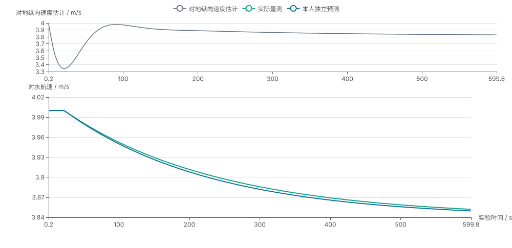

# 实验02 长恒系列LNG运输船大惯性操纵（教学代表船）

课程版本 seven-vessel-2026.11.14，指导书版本 2026.11.16。

## 课程卡

船舶与海洋工程、自动化本科高年级，船舶操纵与控制实验

先修知识包括一、二阶模型、PI与积分饱和、纯时延与距离积分。

设计用时为预习20分钟、操作分析100分钟、报告30分钟，合计150分钟。

用时为教学设计起点。任课教师结合学校课时长度、课前课后安排和实际试教学记录登记课表。七个实验分别启动、完成和复核，可按课程安排组合使用。

- 解释大惯性、液舱、轴系与实际停车距离。认知层级为应用与分析，通过第1、2、3、4、5、6步形成证据。
- 设计本人靠泊速度与制动方案。认知层级为分析与设计，通过第7、8、9、10、11步形成证据。
- 比较填充率、转向、环境和传感条件。认知层级为设计与评价，通过第12、13、14、15、16、17、18步形成证据。
- 进行未见工况验证并论证靠泊边界。认知层级为工程判断，通过第19、20步形成证据。

## 原型、物理对象与参数

真实双轴推进、低速舵效、纵向运动和四个液舱的双向晃荡反作用。载荷、重心、惯量、吃水与有效稳性按同一质量分布建立。

物理对象保留纵荡、横荡、升沉、横摇、纵摇与艏摇。世界坐标为北、东、下，船体坐标为艏、右舷、下。正航向为俯视顺时针。力矩按实际作用点的叉积计算。

| 默认教学参数 | 数值 | 单位 | 来源等级 |
| --- | --- | --- | --- |
| 教学排水质量 | 116512160.0000 | kg | T / 同一冻结装配 |
| 默认吃水 | 11.5000 | m | T / 同一冻结装配 |
| 默认有效横稳心高 | 2.5000 | m | T / 同一冻结装配 |

P表示公开原型资料，B表示公开基准，D表示计算与校准，T表示教学设定。上表为冻结装配的默认教学值。装载、姿态和工况变化后的参数按本次运行显示并记录。原始数值残差、参数来源和有效域随版本保存。

基准有效横稳心高2.5m包含自由液面修正。各填充率与40/200m水深采用已冻结参数包，靠泊条件按实际船艏距离、对地速度、横偏与液面评价。

## 本人理想模型与独立对照

以计程仪量测建立实际轴速或轴速参考至对水航速的局部FOPDT。K的单位为(m/s)/rpm，时间常数和时延单位为s。

本人模型生成IMC PI初值，比较反车、速度节点、制动距离、积分回算、Smith结构、转向计划与滤波。

三维船体由物理对象的实际受力推进。仪器提供带采样时刻、延迟和质量标志的量测，观测器据此形成状态估计。本人理想模型从所选量测窗口辨识，并独立生成预测曲线。

A模式以实际执行器量测检验局部模型。B模式使用指令和声明的执行器模型，或已包含执行器的联合模型。C模式以本人模型的独立反馈预测闭环。每种对照均保存模型版本、输入通道、单位和窗口，训练与独立验证分别取证。

图1采用同课程版本的软件验收记录，并保留原始预测偏差。图中量测、观测估计及预测按各自标签读取。

## 二十步目录

| 步骤 | 名称 | 页码 |
| --- | --- | --- |
| 1 | [标注推进因果链](#lng-step-1) | 3 |
| 2 | [设计小信号激励](#lng-step-2) | 4 |
| 3 | [辨识局部航速模型](#lng-step-3) | 4 |
| 4 | [独立减速验证](#lng-step-4) | 5 |
| 5 | [测量自由停车](#lng-step-5) | 5 |
| 6 | [比较反车制动](#lng-step-6) | 6 |
| 7 | [预测减速距离](#lng-step-7) | 6 |
| 8 | [对齐理想与实际](#lng-step-8) | 7 |
| 9 | [比较靠泊方案](#lng-step-9) | 8 |
| 10 | [设计航速PI](#lng-step-10) | 8 |
| 11 | [检验时延补偿](#lng-step-11) | 9 |
| 12 | [比较不同填充率](#lng-step-12) | 9 |
| 13 | [观察转向与晃荡](#lng-step-13) | 10 |
| 14 | [辨识液舱频率](#lng-step-14) | 10 |
| 15 | [设计平滑转向](#lng-step-15) | 11 |
| 16 | [检验风流干扰](#lng-step-16) | 12 |
| 17 | [选择速度滤波](#lng-step-17) | 12 |
| 18 | [冻结综合靠泊方案](#lng-step-18) | 13 |
| 19 | [验证未见装载](#lng-step-19) | 13 |
| 20 | [完成实验报告](#lng-step-20) | 14 |

## 二十步操作、证据与评价

### 第1步 标注推进因果链

| 项目 | 本步要求 |
| --- | --- |
| 目标与认知 | 输入链和惯性；保存因果标注，理解 |
| 能力证据 | 解释大惯性、液舱、轴系与实际停车距离 |
| 初态与条件 | 初始对水航速 / m/s 4，装载率 0.85，随机种子 20261106 |
| 本步启用因素 | P0、N0 |
| 合同参数范围 | 观测窗口起点 0-120s |
| 事件与操作 | 从平衡初态开始独立运行。P0/N0，120s |
| 时长与结束 | 120s，运行至120s并保留完整记录 |
| 量测与统计窗 | 左轴转速、右轴转速、对水航速、航向、转艏速率、北向位置、东向位置、横摇角速度，0-120s |
| 最少运行 | 1组实际记录 |
| 训练与验证 | 训练或方案设计 |
| 提交工件 | 运行前预测、实际运行记录、证据解释 |
| 评价 | 预测0.9分，证据1.2分，性能0分，解释0.9分，输入链和惯性；保存因果标注 |
| 观察问题 | 标识轴速指令、轴速、推力、航速、距离，给出预期先后顺序 |
| 常见误判与核对 | 船艏距离与船体重心位置分别读取。航速误差小、液面平稳、方向正确和实际靠泊条件逐项核对。 |

先记录自己的预测，再操作、读数并解释差异。实际未达目标、缺测或保护退出的记录与分析继续保存。

### 第2步 设计小信号激励

| 项目 | 本步要求 |
| --- | --- |
| 目标与认知 | 小信号实验设计，不能改实际速度，理解 |
| 能力证据 | 解释大惯性、液舱、轴系与实际停车距离 |
| 初态与条件 | 初始对水航速 / m/s 4，装载率 0.85，随机种子 20261106 |
| 本步启用因素 | P0、N0 |
| 合同参数范围 | 轴速参考阶跃 3-8% |
| 事件与操作 | 从平衡初态开始独立运行。U0=4，P0，600s；t20轴速参考+5% |
| 时长与结束 | 600s，运行至600s并保留完整记录 |
| 量测与统计窗 | 左轴转速、右轴转速、对水航速、航向、转艏速率、北向位置、东向位置、横摇角速度，0-600s |
| 最少运行 | 1组实际记录 |
| 训练与验证 | 训练或方案设计 |
| 提交工件 | 运行前预测、实际运行记录、证据解释 |
| 评价 | 预测0.9分，证据1.2分，性能0分，解释0.9分，小信号实验设计，不能改实际速度 |
| 观察问题 | 选择阶跃幅值3/5/8%之一并记录输入输出 |
| 常见误判与核对 | 船艏距离与船体重心位置分别读取。航速误差小、液面平稳、方向正确和实际靠泊条件逐项核对。 |

先记录自己的预测，再操作、读数并解释差异。实际未达目标、缺测或保护退出的记录与分析继续保存。

### 第3步 辨识局部航速模型

| 项目 | 本步要求 |
| --- | --- |
| 目标与认知 | 执行器与船体惯性区分；模型与残差，分析 |
| 能力证据 | 解释大惯性、液舱、轴系与实际停车距离 |
| 初态与条件 | 初始对水航速 / m/s 4，装载率 0.85，随机种子 20261106 |
| 本步启用因素 | P0、N0 |
| 合同参数范围 | 分析窗口起点 0-600s |
| 事件与操作 | 整理本人已有证据 |
| 时长与结束 | 分析步骤，提交本人分析工件 |
| 量测与统计窗 | 左轴转速、右轴转速、对水航速、航向、转艏速率、北向位置、东向位置、横摇角速度，0-600s |
| 最少运行 | 0组已有证据，按本步工件要求引用 |
| 训练与验证 | 汇总分析 |
| 提交工件 | 训练运行、本人量测窗口、本人辨识模型、拟合残差、证据解释 |
| 评价 | 预测0.9分，证据1.2分，性能0分，解释0.9分，执行器与船体惯性区分；模型与残差 |
| 观察问题 | 拖选窗口拟合Ku/Tu/L，分别显示轴系与船速延迟 |
| 常见误判与核对 | 船艏距离与船体重心位置分别读取。航速误差小、液面平稳、方向正确和实际靠泊条件逐项核对。 |

先记录自己的预测，再操作、读数并解释差异。实际未达目标、缺测或保护退出的记录与分析继续保存。

### 第4步 独立减速验证

| 项目 | 本步要求 |
| --- | --- |
| 目标与认知 | 辨识泛化，不能重新拟合同一验证轨迹，分析 |
| 能力证据 | 解释大惯性、液舱、轴系与实际停车距离 |
| 初态与条件 | 初始对水航速 / m/s 4，装载率 0.85，随机种子 20261106 |
| 本步启用因素 | P0、N0 |
| 合同参数范围 | 观测窗口起点 0-600s |
| 事件与操作 | 从平衡初态开始独立运行。新run，600s，轴速参考-4% |
| 时长与结束 | 600s，运行至600s并保留完整记录 |
| 量测与统计窗 | 左轴转速、右轴转速、对水航速、航向、转艏速率、北向位置、东向位置、横摇角速度，0-600s |
| 最少运行 | 1组实际记录 |
| 训练与验证 | 独立验证 |
| 提交工件 | 运行前预测、实际运行记录、证据解释 |
| 评价 | 预测0.9分，证据1.2分，性能0分，解释0.9分，辨识泛化，不能重新拟合同一验证轨迹 |
| 观察问题 | 冻结模型叠加预测，计算留出误差 |
| 常见误判与核对 | 船艏距离与船体重心位置分别读取。航速误差小、液面平稳、方向正确和实际靠泊条件逐项核对。 |

先记录自己的预测，再操作、读数并解释差异。实际未达目标、缺测或保护退出的记录与分析继续保存。

### 第5步 测量自由停车

| 项目 | 本步要求 |
| --- | --- |
| 目标与认知 | 停车不是瞬停；若窗口未停车按未达到记录，分析 |
| 能力证据 | 解释大惯性、液舱、轴系与实际停车距离 |
| 初态与条件 | 初始对水航速 / m/s 4，装载率 0.85，随机种子 20261106 |
| 本步启用因素 | P0、N0 |
| 合同参数范围 | 观测窗口起点 0-1200s |
| 事件与操作 | 从平衡初态开始独立运行。U0=4，P0，1200s，自由停车 |
| 时长与结束 | 1200s，运行至1200s并保留完整记录 |
| 量测与统计窗 | 左轴转速、右轴转速、对水航速、航向、转艏速率、北向位置、东向位置、横摇角速度，0-1200s |
| 最少运行 | 1组实际记录 |
| 训练与验证 | 训练或方案设计 |
| 提交工件 | 运行前预测、实际运行记录、证据解释 |
| 评价 | 预测1.2分，证据1.6分，性能0分，解释1.2分，停车不是瞬停；若窗口未停车按未达到记录 |
| 观察问题 | t20把驱动扭矩命令设0，测量降到.2m/s的时间/距离 |
| 常见误判与核对 | 船艏距离与船体重心位置分别读取。航速误差小、液面平稳、方向正确和实际靠泊条件逐项核对。 |

先记录自己的预测，再操作、读数并解释差异。实际未达目标、缺测或保护退出的记录与分析继续保存。

### 第6步 比较反车制动

| 项目 | 本步要求 |
| --- | --- |
| 目标与认知 | 四象限、轴系过零、制动力/功率约束，分析 |
| 能力证据 | 解释大惯性、液舱、轴系与实际停车距离 |
| 初态与条件 | 初始对水航速 / m/s 4，装载率 0.85，随机种子 20261106 |
| 本步启用因素 | P0、N0 |
| 合同参数范围 | 反车额定转速比例 0.3-0.6倍 |
| 事件与操作 | 从平衡初态开始独立运行。同初速，t20下达反车，1200s |
| 时长与结束 | 1200s，运行至1200s并保留完整记录 |
| 量测与统计窗 | 左轴转速、右轴转速、对水航速、航向、转艏速率、北向位置、东向位置、横摇角速度，0-1200s |
| 最少运行 | 2组实际记录 |
| 训练与验证 | 训练或方案设计 |
| 提交工件 | 运行前预测、实际运行记录、证据解释 |
| 评价 | 预测1.2分，证据1.6分，性能0分，解释1.2分，四象限、轴系过零、制动力/功率约束 |
| 观察问题 | 比较自由停车与受限倒车制动；选择两种反车强度 |
| 常见误判与核对 | 船艏距离与船体重心位置分别读取。航速误差小、液面平稳、方向正确和实际靠泊条件逐项核对。 |

先记录自己的预测，再操作、读数并解释差异。实际未达目标、缺测或保护退出的记录与分析继续保存。

### 第7步 预测减速距离

| 项目 | 本步要求 |
| --- | --- |
| 目标与认知 | 模型用于决策；保存运行前预测，设计 |
| 能力证据 | 设计本人靠泊速度与制动方案 |
| 初态与条件 | 初始对水航速 / m/s 4，装载率 0.85，随机种子 20261106 |
| 本步启用因素 | P0、N0 |
| 合同参数范围 | 分析窗口起点 0-1200s |
| 事件与操作 | 整理本人已有证据 |
| 时长与结束 | 分析步骤，提交本人分析工件 |
| 量测与统计窗 | 左轴转速、右轴转速、对水航速、航向、转艏速率、北向位置、东向位置、横摇角速度，0-1200s |
| 最少运行 | 0组已有证据，按本步工件要求引用 |
| 训练与验证 | 汇总分析 |
| 提交工件 | 冻结模型、靠泊制动计划、运行前冻结预测、证据解释 |
| 评价 | 预测1.2分，证据0.8分，性能0.8分，解释1.2分，模型用于决策；保存运行前预测 |
| 观察问题 | 用理想局部模型预测起始减速距离，选择减速时刻 |
| 常见误判与核对 | 船艏距离与船体重心位置分别读取。航速误差小、液面平稳、方向正确和实际靠泊条件逐项核对。 |

先记录自己的预测，再操作、读数并解释差异。实际未达目标、缺测或保护退出的记录与分析继续保存。

### 第8步 对齐理想与实际

| 项目 | 本步要求 |
| --- | --- |
| 目标与认知 | 大幅度外推、低速模型/推力差异；不能只改阈值掩盖，设计 |
| 能力证据 | 设计本人靠泊速度与制动方案 |
| 初态与条件 | 初始对水航速 / m/s 4，装载率 0.85，随机种子 20261106 |
| 本步启用因素 | P0、N0 |
| 合同参数范围 | 减速起点 300-1500m |
| 事件与操作 | 从平衡初态开始独立运行。同步骤7真实运行 |
| 时长与结束 | 1200s，完成观察后可结束靠泊，船艏越线或达到1200s时自动停止，保留实际终止原因 |
| 量测与统计窗 | 左轴转速、右轴转速、对水航速、航向、转艏速率、北向位置、东向位置、横摇角速度，0-1200s |
| 最少运行 | 1组实际记录 |
| 训练与验证 | 训练或方案设计 |
| 提交工件 | 运行前预测、实际运行记录、证据解释 |
| 评价 | 预测1.2分，证据0.8分，性能0.8分，解释1.2分，大幅度外推、低速模型/推力差异；不能只改阈值掩盖 |
| 观察问题 | 对齐理想距离/速度与六自由度响应，定位偏差来源 |
| 常见误判与核对 | 船艏距离与船体重心位置分别读取。航速误差小、液面平稳、方向正确和实际靠泊条件逐项核对。 |

先记录自己的预测，再操作、读数并解释差异。实际未达目标、缺测或保护退出的记录与分析继续保存。

### 第9步 比较靠泊方案

| 项目 | 本步要求 |
| --- | --- |
| 目标与认知 | 安全余量/时间权衡，保留失败轨迹，设计 |
| 能力证据 | 设计本人靠泊速度与制动方案 |
| 初态与条件 | 初始对水航速 / m/s 4，装载率 0.85，随机种子 20261106 |
| 本步启用因素 | P0、N0 |
| 合同参数范围 | 减速起点 300-1500m |
| 事件与操作 | 从平衡初态开始独立运行。靠泊P0，两次 |
| 时长与结束 | 1200s，完成观察后可结束靠泊，船艏越线或达到1200s时自动停止，保留实际终止原因 |
| 量测与统计窗 | 左轴转速、右轴转速、对水航速、航向、转艏速率、北向位置、东向位置、横摇角速度，0-1200s |
| 最少运行 | 2组实际记录 |
| 训练与验证 | 训练或方案设计 |
| 提交工件 | 运行前预测、实际运行记录、证据解释 |
| 评价 | 预测1.5分，证据1分，性能1分，解释1.5分，安全余量/时间权衡，保留失败轨迹 |
| 观察问题 | 调整减速起点或分段速度曲线，比较至少两方案 |
| 常见误判与核对 | 船艏距离与船体重心位置分别读取。航速误差小、液面平稳、方向正确和实际靠泊条件逐项核对。 |

先记录自己的预测，再操作、读数并解释差异。实际未达目标、缺测或保护退出的记录与分析继续保存。

### 第10步 设计航速PI

| 项目 | 本步要求 |
| --- | --- |
| 目标与认知 | 闭环性能、真实速度状态；峰值推力和末段误差，设计 |
| 能力证据 | 设计本人靠泊速度与制动方案 |
| 初态与条件 | 初始对水航速 / m/s 4，装载率 0.85，随机种子 20261106 |
| 本步启用因素 | P0、N0 |
| 合同参数范围 | PI比例增益相对建议值 0.2-3倍 |
| 事件与操作 | 从平衡初态开始独立运行。P0，600s，4→3m/s速度参考 |
| 时长与结束 | 600s，运行至600s并保留完整记录 |
| 量测与统计窗 | 左轴转速、右轴转速、对水航速、航向、转艏速率、北向位置、东向位置、横摇角速度，0-600s |
| 最少运行 | 2组实际记录 |
| 训练与验证 | 训练或方案设计 |
| 提交工件 | 运行前预测、实际运行记录、证据解释 |
| 评价 | 预测1.5分，证据1分，性能1分，解释1.5分，闭环性能、真实速度状态；峰值推力和末段误差 |
| 观察问题 | 设计并运行PI，比较原始与抗饱和实现 |
| 常见误判与核对 | 船艏距离与船体重心位置分别读取。航速误差小、液面平稳、方向正确和实际靠泊条件逐项核对。 |

先记录自己的预测，再操作、读数并解释差异。实际未达目标、缺测或保护退出的记录与分析继续保存。

### 第11步 检验时延补偿

| 项目 | 本步要求 |
| --- | --- |
| 目标与认知 | 补偿依赖模型，不承诺消除全部现实误差，设计 |
| 能力证据 | 设计本人靠泊速度与制动方案 |
| 初态与条件 | 初始对水航速 / m/s 4，装载率 0.85，随机种子 20261106 |
| 本步启用因素 | P0、N0 |
| 合同参数范围 | PI比例增益相对建议值 0.2-3倍 |
| 事件与操作 | 从平衡初态开始独立运行。P0，600s，同参考，额外时延0/5s |
| 时长与结束 | 600s，运行至600s并保留完整记录 |
| 量测与统计窗 | 左轴转速、右轴转速、对水航速、航向、转艏速率、北向位置、东向位置、横摇角速度，0-600s |
| 最少运行 | 4组实际记录 |
| 训练与验证 | 训练或方案设计 |
| 提交工件 | 运行前预测、实际运行记录、证据解释 |
| 评价 | 预测1.5分，证据1分，性能1分，解释1.5分，补偿依赖模型，不承诺消除全部现实误差 |
| 观察问题 | 先预测影响，分别运行；比较给定Smith结构开/关 |
| 常见误判与核对 | 船艏距离与船体重心位置分别读取。航速误差小、液面平稳、方向正确和实际靠泊条件逐项核对。 |

先记录自己的预测，再操作、读数并解释差异。实际未达目标、缺测或保护退出的记录与分析继续保存。

### 第12步 比较不同填充率

| 项目 | 本步要求 |
| --- | --- |
| 目标与认知 | 质量/吃水/稳性/参数变化，不能仅改T而不改物理，设计 |
| 能力证据 | 比较填充率、转向、环境和传感条件 |
| 初态与条件 | 初始对水航速 / m/s 4，装载率 0.3，随机种子 20261106 |
| 本步启用因素 | P0、N0 |
| 合同参数范围 | 液舱填充率 0.3-0.95倍 |
| 事件与操作 | 从平衡初态开始独立运行。.30/.70/.95填充各600s，实际轴速相同小激励 |
| 时长与结束 | 600s，运行至600s并保留完整记录 |
| 量测与统计窗 | 左轴转速、右轴转速、对水航速、航向、转艏速率、北向位置、东向位置、横摇角速度，0-600s |
| 最少运行 | 3组实际记录 |
| 训练与验证 | 训练或方案设计 |
| 提交工件 | 运行前预测、实际运行记录、证据解释 |
| 评价 | 预测1.5分，证据1分，性能1分，解释1.5分，质量/吃水/稳性/参数变化，不能仅改T而不改物理 |
| 观察问题 | 使用原模型预测后再估计各载荷局部模型 |
| 常见误判与核对 | 船艏距离与船体重心位置分别读取。航速误差小、液面平稳、方向正确和实际靠泊条件逐项核对。 |

先记录自己的预测，再操作、读数并解释差异。实际未达目标、缺测或保护退出的记录与分析继续保存。

### 第13步 观察转向与晃荡

| 项目 | 本步要求 |
| --- | --- |
| 目标与认知 | 转弯引起横向加速度及液面反作用，设计 |
| 能力证据 | 比较填充率、转向、环境和传感条件 |
| 初态与条件 | 初始对水航速 / m/s 4，装载率 0.7，随机种子 20261106 |
| 本步启用因素 | P0、N0 |
| 合同参数范围 | 航向斜坡时间 5-60s |
| 事件与操作 | 从平衡初态开始独立运行。P0，U0=4，psi_ref+10°，600s，.70填充 |
| 时长与结束 | 600s，运行至600s并保留完整记录 |
| 量测与统计窗 | 左轴转速、右轴转速、对水航速、航向、转艏速率、北向位置、东向位置、横摇角速度，0-600s |
| 最少运行 | 1组实际记录 |
| 训练与验证 | 训练或方案设计 |
| 提交工件 | 运行前预测、实际运行记录、证据解释 |
| 评价 | 预测1.8分，证据1.2分，性能1.2分，解释1.8分，转弯引起横向加速度及液面反作用 |
| 观察问题 | 选择转向斜坡5/20/60s，观察液舱与横摇 |
| 常见误判与核对 | 船艏距离与船体重心位置分别读取。航速误差小、液面平稳、方向正确和实际靠泊条件逐项核对。 |

先记录自己的预测，再操作、读数并解释差异。实际未达目标、缺测或保护退出的记录与分析继续保存。

### 第14步 辨识液舱频率

| 项目 | 本步要求 |
| --- | --- |
| 目标与认知 | 填充率-频率-响应差异；模型量纲，设计 |
| 能力证据 | 比较填充率、转向、环境和传感条件 |
| 初态与条件 | 初始对水航速 / m/s 4，装载率 0.3，随机种子 20261106 |
| 本步启用因素 | P0、N0 |
| 合同参数范围 | 液舱填充率 0.3-0.95倍 |
| 事件与操作 | 从平衡初态开始独立运行。同激励，.30/.70/.95各600s |
| 时长与结束 | 600s，运行至600s并保留完整记录 |
| 量测与统计窗 | 左轴转速、右轴转速、对水航速、航向、转艏速率、北向位置、东向位置、横摇角速度，0-600s |
| 最少运行 | 3组实际记录 |
| 训练与验证 | 训练或方案设计 |
| 提交工件 | 运行前预测、实际运行记录、证据解释 |
| 评价 | 预测1.8分，证据1.2分，性能1.2分，解释1.8分，填充率-频率-响应差异；模型量纲 |
| 观察问题 | 运行前按公式预测模态频率，识别谱峰 |
| 常见误判与核对 | 船艏距离与船体重心位置分别读取。航速误差小、液面平稳、方向正确和实际靠泊条件逐项核对。 |

先记录自己的预测，再操作、读数并解释差异。实际未达目标、缺测或保护退出的记录与分析继续保存。

### 第15步 设计平滑转向

| 项目 | 本步要求 |
| --- | --- |
| 目标与认知 | 平滑操作的收益与代价，末值相同不等于过程相同，设计 |
| 能力证据 | 比较填充率、转向、环境和传感条件 |
| 初态与条件 | 初始对水航速 / m/s 4，装载率 0.7，随机种子 20261106 |
| 本步启用因素 | P0、N0 |
| 合同参数范围 | 航向斜坡时间 5-60s |
| 事件与操作 | 从平衡初态开始独立运行。同填充/同航向终值，两种斜坡600s |
| 时长与结束 | 600s，运行至600s并保留完整记录 |
| 量测与统计窗 | 左轴转速、右轴转速、对水航速、航向、转艏速率、北向位置、东向位置、横摇角速度，0-600s |
| 最少运行 | 2组实际记录 |
| 训练与验证 | 训练或方案设计 |
| 提交工件 | 运行前预测、实际运行记录、证据解释 |
| 评价 | 预测1.8分，证据1.2分，性能1.2分，解释1.8分，平滑操作的收益与代价，末值相同不等于过程相同 |
| 观察问题 | 设计转向过渡，比较晃荡峰值/RMS/转向耗时 |
| 常见误判与核对 | 船艏距离与船体重心位置分别读取。航速误差小、液面平稳、方向正确和实际靠泊条件逐项核对。 |

先记录自己的预测，再操作、读数并解释差异。实际未达目标、缺测或保护退出的记录与分析继续保存。

### 第16步 检验风流干扰

| 项目 | 本步要求 |
| --- | --- |
| 目标与认知 | 横流横偏、风载、低速舵效；轨迹与停止距离，设计 |
| 能力证据 | 比较填充率、转向、环境和传感条件 |
| 初态与条件 | 初始对水航速 / m/s 4，装载率 0.85，随机种子 20261106 |
| 本步启用因素 | W1、C1、N0 |
| 合同参数范围 | 减速起点 300-1500m |
| 事件与操作 | 从平衡初态开始独立运行。靠泊C1+W1、N0 |
| 时长与结束 | 1200s，完成观察后可结束靠泊，船艏越线或达到1200s时自动停止，保留实际终止原因 |
| 量测与统计窗 | 左轴转速、右轴转速、对水航速、航向、转艏速率、北向位置、东向位置、横摇角速度，0-1200s |
| 最少运行 | 2组实际记录 |
| 训练与验证 | 训练或方案设计 |
| 提交工件 | 运行前预测、实际运行记录、证据解释 |
| 评价 | 预测1.8分，证据1.2分，性能1.2分，解释1.8分，横流横偏、风载、低速舵效；轨迹与停止距离 |
| 观察问题 | 冻结静水方案重试，再改一项策略 |
| 常见误判与核对 | 船艏距离与船体重心位置分别读取。航速误差小、液面平稳、方向正确和实际靠泊条件逐项核对。 |

先记录自己的预测，再操作、读数并解释差异。实际未达目标、缺测或保护退出的记录与分析继续保存。

### 第17步 选择速度滤波

| 项目 | 本步要求 |
| --- | --- |
| 目标与认知 | 噪声/波频影响控制，不通过改真值降噪，设计 |
| 能力证据 | 比较填充率、转向、环境和传感条件 |
| 初态与条件 | 初始对水航速 / m/s 4，装载率 0.85，随机种子 20261106 |
| 本步启用因素 | V1、N1 |
| 合同参数范围 | 减速起点 300-1500m |
| 事件与操作 | 从平衡初态开始独立运行。靠泊V1+N1 |
| 时长与结束 | 1200s，完成观察后可结束靠泊，船艏越线或达到1200s时自动停止，保留实际终止原因 |
| 量测与统计窗 | 左轴转速、右轴转速、对水航速、航向、转艏速率、北向位置、东向位置、横摇角速度，0-1200s |
| 最少运行 | 2组实际记录 |
| 训练与验证 | 训练或方案设计 |
| 提交工件 | 运行前预测、实际运行记录、证据解释 |
| 评价 | 预测1.8分，证据1.2分，性能1.2分，解释1.8分，噪声/波频影响控制，不通过改真值降噪 |
| 观察问题 | 选择滤波tau=.2/1/3s，比较测量和实际约束 |
| 常见误判与核对 | 船艏距离与船体重心位置分别读取。航速误差小、液面平稳、方向正确和实际靠泊条件逐项核对。 |

先记录自己的预测，再操作、读数并解释差异。实际未达目标、缺测或保护退出的记录与分析继续保存。

### 第18步 冻结综合靠泊方案

| 项目 | 本步要求 |
| --- | --- |
| 目标与认知 | 综合约束下取舍；参考控制器/任务有解性先验证，评价 |
| 能力证据 | 比较填充率、转向、环境和传感条件 |
| 初态与条件 | 初始对水航速 / m/s 4，装载率 0.85，随机种子 20261106 |
| 本步启用因素 | E1、N1 |
| 合同参数范围 | 减速起点 300-1500m |
| 事件与操作 | 从平衡初态开始独立运行。靠泊E1+N1 |
| 时长与结束 | 1200s，完成观察后可结束靠泊，船艏越线或达到1200s时自动停止，保留实际终止原因 |
| 量测与统计窗 | 左轴转速、右轴转速、对水航速、航向、转艏速率、北向位置、东向位置、横摇角速度，0-1200s |
| 最少运行 | 1组实际记录 |
| 训练与验证 | 训练或方案设计 |
| 提交工件 | 运行前预测、实际运行记录、证据解释 |
| 评价 | 预测1.8分，证据1.2分，性能1.2分，解释1.8分，综合约束下取舍；参考控制器/任务有解性先验证 |
| 观察问题 | 设计最终速度/转向计划并冻结 |
| 常见误判与核对 | 船艏距离与船体重心位置分别读取。航速误差小、液面平稳、方向正确和实际靠泊条件逐项核对。 |

先记录自己的预测，再操作、读数并解释差异。实际未达目标、缺测或保护退出的记录与分析继续保存。

### 第19步 验证未见装载

| 项目 | 本步要求 |
| --- | --- |
| 目标与认知 | 对未见条件的泛化与有效域；两次记录不覆盖，评价 |
| 能力证据 | 进行未见工况验证并论证靠泊边界 |
| 初态与条件 | 初始对水航速 / m/s 4，装载率 0.7，随机种子 17 |
| 本步启用因素 | E1、N1 |
| 合同参数范围 | 液舱填充率 0.3-0.95倍 |
| 事件与操作 | 从平衡初态开始独立运行。seed17/29，.70和.95两加载工况 |
| 时长与结束 | 1200s，完成观察后可结束靠泊，船艏越线或达到1200s时自动停止，保留实际终止原因 |
| 量测与统计窗 | 左轴转速、右轴转速、对水航速、航向、转艏速率、北向位置、东向位置、横摇角速度，0-1200s |
| 最少运行 | 3组实际记录 |
| 训练与验证 | 独立验证 |
| 提交工件 | 运行前预测、实际运行记录、证据解释 |
| 评价 | 预测1.8分，证据1.2分，性能1.2分，解释1.8分，对未见条件的泛化与有效域；两次记录不覆盖 |
| 观察问题 | 不重整定先测试，再提交一次有依据的修正 |
| 常见误判与核对 | 船艏距离与船体重心位置分别读取。航速误差小、液面平稳、方向正确和实际靠泊条件逐项核对。 |

先记录自己的预测，再操作、读数并解释差异。实际未达目标、缺测或保护退出的记录与分析继续保存。

### 第20步 完成实验报告

| 项目 | 本步要求 |
| --- | --- |
| 目标与认知 | 本人证据、误差解释、不能据教学模型宣称实船靠泊许可，综合设计 |
| 能力证据 | 进行未见工况验证并论证靠泊边界 |
| 初态与条件 | 初始对水航速 / m/s 4，装载率 0.85，随机种子 20261106 |
| 本步启用因素 | P0、N0 |
| 合同参数范围 | 分析窗口起点 0-1200s |
| 事件与操作 | 整理本人已有证据 |
| 时长与结束 | 分析步骤，提交本人分析工件 |
| 量测与统计窗 | 左轴转速、右轴转速、对水航速、航向、转艏速率、北向位置、东向位置、横摇角速度，0-1200s |
| 最少运行 | 5组已有证据，按本步工件要求引用 |
| 训练与验证 | 汇总分析 |
| 提交工件 | 至少五组本人运行、冻结模型、独立验证、六部分报告 |
| 评价 | 模型假设3分，本人证据3分，方案比较2分，适用边界2分，本人证据、误差解释、不能据教学模型宣称实船靠泊许可 |
| 观察问题 | 报告辨识、理想对照、制动、晃荡、综合方案 |
| 常见误判与核对 | 船艏距离与船体重心位置分别读取。航速误差小、液面平稳、方向正确和实际靠泊条件逐项核对。 |

先记录自己的预测，再操作、读数并解释差异。实际未达目标、缺测或保护退出的记录与分析继续保存。

## 现实因素与操作权限

物理后台持续支持执行器、六自由度、风、浪、流和观测链。本步启用情况由课程预置条件和实际开关回执确定，学生在解锁控件的范围内调整参数。

| 步骤 | 启用因素 | 合同调整项 | 固定条件 |
| --- | --- | --- | --- |
| 1 | P0、N0 | 观测窗口起点 | 船型、参数包和本步预置事件 |
| 2 | P0、N0 | 轴速参考阶跃 | 船型、参数包和本步预置事件 |
| 3 | P0、N0 | 分析窗口起点 | 船型、参数包和本步预置事件 |
| 4 | P0、N0 | 观测窗口起点 | 船型、参数包和本步预置事件 |
| 5 | P0、N0 | 观测窗口起点 | 船型、参数包和本步预置事件 |
| 6 | P0、N0 | 反车额定转速比例 | 船型、参数包和本步预置事件 |
| 7 | P0、N0 | 分析窗口起点 | 船型、参数包和本步预置事件 |
| 8 | P0、N0 | 减速起点 | 船型、参数包和本步预置事件 |
| 9 | P0、N0 | 减速起点 | 船型、参数包和本步预置事件 |
| 10 | P0、N0 | PI比例增益相对建议值 | 船型、参数包和本步预置事件 |
| 11 | P0、N0 | PI比例增益相对建议值 | 船型、参数包和本步预置事件 |
| 12 | P0、N0 | 液舱填充率 | 船型、参数包和本步预置事件 |
| 13 | P0、N0 | 航向斜坡时间 | 船型、参数包和本步预置事件 |
| 14 | P0、N0 | 液舱填充率 | 船型、参数包和本步预置事件 |
| 15 | P0、N0 | 航向斜坡时间 | 船型、参数包和本步预置事件 |
| 16 | W1、C1、N0 | 减速起点 | 船型、参数包和本步预置事件 |
| 17 | V1、N1 | 减速起点 | 船型、参数包和本步预置事件 |
| 18 | E1、N1 | 减速起点 | 船型、参数包和本步预置事件 |
| 19 | E1、N1 | 液舱填充率 | 船型、参数包和本步预置事件 |
| 20 | P0、N0 | 分析窗口起点 | 船型、参数包和本步预置事件 |

P0表示平静环境，N0表示理想仪器等级。W表示风，V表示波浪，C表示流，E表示组合环境，N1/N2表示相应噪声与时延等级。冰区和专项机构按本步工况独立记录。

## 评分与六部分报告

每个实验满分100分，二十步分值依次为3、3、3、3、4、4、4、4、5、5、5、5、6、6、6、6、6、6、6、10分。前19步的预测占30%、操作与证据占40%、解释占30%。设计步骤将40%分为证据与性能各20%。

第20步按模型假设3分、本人证据3分、方案比较2分和适用边界2分复核。缺证据、数值无效、模型失配、性能不足和解释错误分别记录。

1. 问题与限制。引用本人运行、模型、独立对照和修改依据。
2. 局部模型。引用本人运行、模型、独立对照和修改依据。
3. 独立验证。引用本人运行、模型、独立对照和修改依据。
4. 控制方案与比较。引用本人运行、模型、独立对照和修改依据。
5. 修改及迁移。引用本人运行、模型、独立对照和修改依据。
6. 工程结论与边界。引用本人运行、模型、独立对照和修改依据。

报告比较至少两种方案，并保留独立验证与未见工况。页面过程状态帮助检查完整性，教师依据固定量规查看尝试、反馈、退回修改并确认最终成绩。

## 设备准备、恢复与数据

使用支持硬件加速的现代桌面浏览器，先完成页面中的网络与图形检查。三维场景就绪后开始，按需要暂停、折叠面板、调整视图和运行速率。图形接口与质量档由页面统一管理。

普通平台账号和实验空间入口均将实验保存到当前账号。实验空间核验身份后建立专用来源账号并绑定本轮记录，控灵使用同一账号及本页步骤。刷新、重新打开或更换设备后核对原轮次、草稿与运行时间，再继续实验。

网络失败时保留本机结果并按页面入口继续上传。教师确认最终成绩后按实验空间规则回传，附件重试复用已成功成绩。新的独立实验轮次通过“重新开始新一轮实验”建立，历史结果分别保留。

控灵提供本步机理与有来源的观察提示。学生保留本人预测、量测和解释，报告引用实际作品。账号资料、原始答案和私有运行记录按平台访问权限保存，公开示例采用脱敏的软件验收数据。

## 旧版迁移与教学证据

旧版低速、反车和靠泊读数扩展为真实距离、本人纵向模型、连续速度计划、液舱约束与独立迁移。

旧步骤的操作背景与新能力目标按本册二十步重新对应，旧成绩保留其原课程版本。新版报告固定引用本次材料版本。旧版PDF可由历史发布标签追溯。

下表按旧、新编号核对替换位置，当前教学目标和需提交的证据以本册各步为准。

| 编号 | 原操作版 | 当前步骤 | 迁移处理 |
| --- | --- | --- | --- |
| 1 | 直航读数 | 标注推进因果链 | 替换并增加当前能力证据 |
| 2 | 手操打舵 | 设计小信号激励 | 替换并增加当前能力证据 |
| 3 | 舵回中 | 辨识局部航速模型 | 替换并增加当前能力证据 |
| 4 | 十度超调 | 独立减速验证 | 替换并增加当前能力证据 |
| 5 | 靠泊航速 | 测量自由停车 | 替换并增加当前能力证据 |
| 6 | 剩余距离 | 比较反车制动 | 替换并增加当前能力证据 |
| 7 | 航速响应 | 预测减速距离 | 替换并增加当前能力证据 |
| 8 | 液货晃荡 | 对齐理想与实际 | 替换并增加当前能力证据 |
| 9 | 安全距离 | 比较靠泊方案 | 替换并增加当前能力证据 |
| 10 | 零舵确认 | 设计航速PI | 替换并增加当前能力证据 |
| 11 | 右舵转艏 | 检验时延补偿 | 替换并增加当前能力证据 |
| 12 | 左舵方向 | 比较不同填充率 | 替换并增加当前能力证据 |
| 13 | 靠泊低速 | 观察转向与晃荡 | 替换并增加当前能力证据 |
| 14 | 巡航对比 | 辨识液舱频率 | 替换并增加当前能力证据 |
| 15 | 晃荡读数 | 设计平滑转向 | 替换并增加当前能力证据 |
| 16 | 航向保持 | 检验风流干扰 | 替换并增加当前能力证据 |
| 17 | 剩余距离读数 | 选择速度滤波 | 替换并增加当前能力证据 |
| 18 | 低速判断 | 冻结综合靠泊方案 | 替换并增加当前能力证据 |
| 19 | 手绘图识别 | 验证未见装载 | 替换并增加当前能力证据 |
| 20 | 确认记录 | 完成实验报告 | 替换并增加当前能力证据 |

当前图例和脚本记录用于软件验收。正式教学需另外登记实际课表、学生用时、低中高水平报告样例、独立迁移任务、教师交叉评分与改进反馈，相关证据以教学证据索引核验。

## 参考资料

- 中国船级社长恒系列资料。[查看来源](https://www.ccs.org.cn/ccswz//articleDetail?id=202412241083336948)
- 液体晃荡公开基准。[查看来源](https://ntrs.nasa.gov/citations/19670006555)

参数与步骤的详细来源、校准误差和本课程适用域由同版本参数清单及本步运行报告共同保留。
