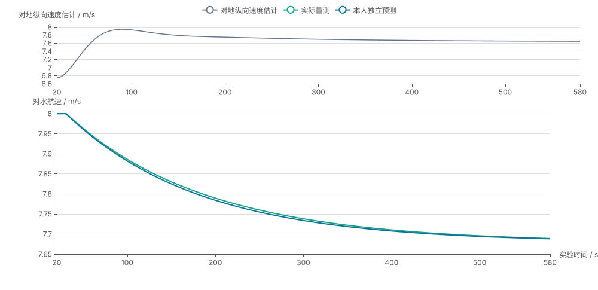

# 实验03 集装箱船航速、准点与燃油

课程版本 seven-vessel-2026.11.14，指导书版本 2026.11.16。

## 课程卡

船舶与海洋工程、自动化本科学生，船舶航速与节能控制实验

先修知识包括局部系统辨识、PI反馈、功率、能量与积分指标。

设计用时为预习15分钟、操作分析80分钟、报告25分钟，合计120分钟。

用时为教学设计起点。任课教师结合学校课时长度、课前课后安排和实际试教学记录登记课表。七个实验分别启动、完成和复核，可按课程安排组合使用。

- 解释装载、工作点与推进响应。认知层级为应用与分析，通过第1、2、3、4、5、6步形成证据。
- 建立三点模型并比较调度与无扰切换。认知层级为分析与设计，通过第7、8、9、10步形成证据。
- 在相同实际航程下比较准点、燃油与环境影响。认知层级为设计与评价，通过第11、12、13、14、15、16、17、18步形成证据。
- 以未见条件检验完整航次方案。认知层级为评价与工程判断，通过第19、20步形成证据。

## 原型、物理对象与参数

五种装载状态、船内与甲板教学配载、实际推进轴系、风浪流阻力和随实际功率累计的教学燃油。

物理对象保留纵荡、横荡、升沉、横摇、纵摇与艏摇。世界坐标为北、东、下，船体坐标为艏、右舷、下。正航向为俯视顺时针。力矩按实际作用点的叉积计算。

| 默认教学参数 | 数值 | 单位 | 来源等级 |
| --- | --- | --- | --- |
| 教学排水质量 | 216000000.0000 | kg | T / 同一冻结装配 |
| 默认吃水 | 13.0473 | m | T / 同一冻结装配 |
| 默认有效横稳心高 | 2.0000 | m | T / 同一冻结装配 |

P表示公开原型资料，B表示公开基准，D表示计算与校准，T表示教学设定。上表为冻结装配的默认教学值。装载、姿态和工况变化后的参数按本次运行显示并记录。原始数值残差、参数来源和有效域随版本保存。

装载质量、GM和风面积来自同一冻结教学配载。第15步的二阶平均附加阻力采用公开短波尺度与T级方向扩展，适用域和残差随实际结果保留。

## 本人理想模型与独立对照

冻结三个工作航速的轴速参考至计程仪航速FOPDT。每个模型保存工作点、输入偏置、残差和独立验证窗。

本人三点模型用于线性增益调度、无扰积分跟踪、速度斜率与四段6000m航次计划。

三维船体由物理对象的实际受力推进。仪器提供带采样时刻、延迟和质量标志的量测，观测器据此形成状态估计。本人理想模型从所选量测窗口辨识，并独立生成预测曲线。

A模式以实际执行器量测检验局部模型。B模式使用指令和声明的执行器模型，或已包含执行器的联合模型。C模式以本人模型的独立反馈预测闭环。每种对照均保存模型版本、输入通道、单位和窗口，训练与独立验证分别取证。

图1采用同课程版本的软件验收记录，并保留原始预测偏差。图中量测、观测估计及预测按各自标签读取。

## 二十步目录

| 步骤 | 名称 | 页码 |
| --- | --- | --- |
| 1 | [区分瞬时与累计量](#container-step-1) | 3 |
| 2 | [比较真实装载状态](#container-step-2) | 3 |
| 3 | [辨识局部航速模型](#container-step-3) | 4 |
| 4 | [独立验证航速模型](#container-step-4) | 5 |
| 5 | [比较装载工作点](#container-step-5) | 5 |
| 6 | [比较航速工作点](#container-step-6) | 6 |
| 7 | [设计航速PI](#container-step-7) | 6 |
| 8 | [检验固定控制器](#container-step-8) | 7 |
| 9 | [建立三点调度表](#container-step-9) | 8 |
| 10 | [比较积分跟踪](#container-step-10) | 8 |
| 11 | [预测与完成航次](#container-step-11) | 9 |
| 12 | [比较分段速度计划](#container-step-12) | 9 |
| 13 | [比较对水与对地反馈](#container-step-13) | 10 |
| 14 | [检验装载与风力](#container-step-14) | 10 |
| 15 | [观察波浪能耗](#container-step-15) | 11 |
| 16 | [选择滤波与航迹保持](#container-step-16) | 12 |
| 17 | [冻结综合速度方案](#container-step-17) | 12 |
| 18 | [比较第二方案](#container-step-18) | 13 |
| 19 | [验证未见装载](#container-step-19) | 13 |
| 20 | [完成实验报告](#container-step-20) | 14 |

## 二十步操作、证据与评价

### 第1步 区分瞬时与累计量

| 项目 | 本步要求 |
| --- | --- |
| 目标与认知 | 单位和瞬时/累计量区别，分析 |
| 能力证据 | 解释装载、工作点与推进响应 |
| 初态与条件 | 初始对水航速 / m/s 8，装载率 0.6，随机种子 20261106 |
| 本步启用因素 | P0、N0 |
| 合同参数范围 | 装载率 0.2-0.9倍 |
| 事件与操作 | P0，60s |
| 时长与结束 | 60s，运行至60s并保存 |
| 量测与统计窗 | 左轴转速、对水航速、航向、北向位置、东向位置，0-60s |
| 最少运行 | 1组实际记录 |
| 训练与验证 | 训练或方案设计 |
| 提交工件 | 运行前预测、实际运行记录、证据解释 |
| 评价 | 预测0.9分，证据1.2分，性能0分，解释0.9分，单位和瞬时/累计量区别 |
| 观察问题 | 配对轴速、推力、对水/对地速度、航程、功率、燃油 |
| 常见误判与核对 | 在同航程及实际到达条件下比较教学燃油、准点和功率。对水航速与对地速度使用各自定义。 |

先记录自己的预测，再操作、读数并解释差异。实际未达目标、缺测或保护退出的记录与分析继续保存。

### 第2步 比较真实装载状态

| 项目 | 本步要求 |
| --- | --- |
| 目标与认知 | 装载具有多条物理作用链，不能只改变时间常数，分析 |
| 能力证据 | 解释装载、工作点与推进响应 |
| 初态与条件 | 初始对水航速 / m/s 0，装载率 0.2，随机种子 20261106 |
| 本步启用因素 | P0、N0 |
| 合同参数范围 | 装载率 0.2-0.9倍 |
| 事件与操作 | lambda=.2/.6/.9静水平衡 |
| 时长与结束 | 20s，运行至20s并保存 |
| 量测与统计窗 | 左轴转速、对水航速、航向、北向位置、东向位置，0-20s |
| 最少运行 | 3组实际记录 |
| 训练与验证 | 训练或方案设计 |
| 提交工件 | 运行前预测、实际运行记录、证据解释 |
| 评价 | 预测0.9分，证据1.2分，性能0分，解释0.9分，装载具有多条物理作用链，不能只改变时间常数 |
| 观察问题 | 选择装载，记录质量/吃水/GM/风面积并预测控制变化 |
| 常见误判与核对 | 在同航程及实际到达条件下比较教学燃油、准点和功率。对水航速与对地速度使用各自定义。 |

先记录自己的预测，再操作、读数并解释差异。实际未达目标、缺测或保护退出的记录与分析继续保存。

### 第3步 辨识局部航速模型

| 项目 | 本步要求 |
| --- | --- |
| 目标与认知 | 增益/惯性、执行器动态，分析 |
| 能力证据 | 解释装载、工作点与推进响应 |
| 初态与条件 | 初始对水航速 / m/s 8，装载率 0.6，随机种子 20261106 |
| 本步启用因素 | P0、N0 |
| 合同参数范围 | 装载率 0.2-0.9倍 |
| 事件与操作 | lambda=.6，+5%轴速，600s |
| 时长与结束 | 600s，运行至600s并保存 |
| 量测与统计窗 | 左轴转速、对水航速、航向、北向位置、东向位置，0-600s |
| 最少运行 | 1组实际记录 |
| 训练与验证 | 训练或方案设计 |
| 提交工件 | 运行前预测、实际运行记录、证据解释 |
| 评价 | 预测0.9分，证据1.2分，性能0分，解释0.9分，增益/惯性、执行器动态 |
| 观察问题 | 选择辨识窗，拟合局部速度模型 |
| 常见误判与核对 | 在同航程及实际到达条件下比较教学燃油、准点和功率。对水航速与对地速度使用各自定义。 |

先记录自己的预测，再操作、读数并解释差异。实际未达目标、缺测或保护退出的记录与分析继续保存。

### 第4步 独立验证航速模型

| 项目 | 本步要求 |
| --- | --- |
| 目标与认知 | 独立验证及残差，分析 |
| 能力证据 | 解释装载、工作点与推进响应 |
| 初态与条件 | 初始对水航速 / m/s 8，装载率 0.6，随机种子 20261106 |
| 本步启用因素 | P0、N0 |
| 合同参数范围 | 装载率 0.2-0.9倍 |
| 事件与操作 | 新run，-4%，600s |
| 时长与结束 | 600s，运行至600s并保存 |
| 量测与统计窗 | 左轴转速、对水航速、航向、北向位置、东向位置，0-600s |
| 最少运行 | 1组实际记录 |
| 训练与验证 | 独立验证 |
| 提交工件 | 运行前预测、实际运行记录、证据解释 |
| 评价 | 预测0.9分，证据1.2分，性能0分，解释0.9分，独立验证及残差 |
| 观察问题 | 冻结模型叠加预测与实际响应 |
| 常见误判与核对 | 在同航程及实际到达条件下比较教学燃油、准点和功率。对水航速与对地速度使用各自定义。 |

先记录自己的预测，再操作、读数并解释差异。实际未达目标、缺测或保护退出的记录与分析继续保存。

### 第5步 比较装载工作点

| 项目 | 本步要求 |
| --- | --- |
| 目标与认知 | 参数随加载改变，辨识误差与工况失配区分，分析 |
| 能力证据 | 解释装载、工作点与推进响应 |
| 初态与条件 | 初始对水航速 / m/s 8，装载率 0.2，随机种子 20261106 |
| 本步启用因素 | P0、N0 |
| 合同参数范围 | 装载率 0.2-0.9倍 |
| 事件与操作 | lambda=.2与.9各600s |
| 时长与结束 | 600s，运行至600s并保存 |
| 量测与统计窗 | 左轴转速、对水航速、航向、北向位置、东向位置，0-600s |
| 最少运行 | 2组实际记录 |
| 训练与验证 | 训练或方案设计 |
| 提交工件 | 运行前预测、实际运行记录、证据解释 |
| 评价 | 预测1.2分，证据1.6分，性能0分，解释1.2分，参数随加载改变，辨识误差与工况失配区分 |
| 观察问题 | 原模型外推后分别辨识，比较K/T |
| 常见误判与核对 | 在同航程及实际到达条件下比较教学燃油、准点和功率。对水航速与对地速度使用各自定义。 |

先记录自己的预测，再操作、读数并解释差异。实际未达目标、缺测或保护退出的记录与分析继续保存。

### 第6步 比较航速工作点

| 项目 | 本步要求 |
| --- | --- |
| 目标与认知 | 非线性阻力与局部线性化，分析 |
| 能力证据 | 解释装载、工作点与推进响应 |
| 初态与条件 | 初始对水航速 / m/s 6，装载率 0.6，随机种子 20261106 |
| 本步启用因素 | P0、N0 |
| 合同参数范围 | 装载率 0.2-0.9倍 |
| 事件与操作 | U0=6与10各600s |
| 时长与结束 | 600s，运行至600s并保存 |
| 量测与统计窗 | 左轴转速、对水航速、航向、北向位置、东向位置，0-600s |
| 最少运行 | 2组实际记录 |
| 训练与验证 | 训练或方案设计 |
| 提交工件 | 运行前预测、实际运行记录、证据解释 |
| 评价 | 预测1.2分，证据1.6分，性能0分，解释1.2分，非线性阻力与局部线性化 |
| 观察问题 | 同载荷小阶跃辨识，绘出工作点参数表 |
| 常见误判与核对 | 在同航程及实际到达条件下比较教学燃油、准点和功率。对水航速与对地速度使用各自定义。 |

先记录自己的预测，再操作、读数并解释差异。实际未达目标、缺测或保护退出的记录与分析继续保存。

### 第7步 设计航速PI

| 项目 | 本步要求 |
| --- | --- |
| 目标与认知 | 从辨识到设计，不能直接套默认参数评分，设计 |
| 能力证据 | 建立三点模型并比较调度与无扰切换 |
| 初态与条件 | 初始对水航速 / m/s 8，装载率 0.6，随机种子 20261106 |
| 本步启用因素 | P0、N0 |
| 合同参数范围 | 装载率 0.2-0.9倍 |
| 事件与操作 | 8→9m/s，600s |
| 时长与结束 | 600s，运行至600s并保存 |
| 量测与统计窗 | 左轴转速、对水航速、航向、北向位置、东向位置，0-600s |
| 最少运行 | 1组实际记录 |
| 训练与验证 | 训练或方案设计 |
| 提交工件 | 运行前预测、实际运行记录、证据解释 |
| 评价 | 预测1.2分，证据0.8分，性能0.8分，解释1.2分，从辨识到设计，不能直接套默认参数评分 |
| 观察问题 | 用模型设计PI，先理想后真实闭环比较 |
| 常见误判与核对 | 在同航程及实际到达条件下比较教学燃油、准点和功率。对水航速与对地速度使用各自定义。 |

先记录自己的预测，再操作、读数并解释差异。实际未达目标、缺测或保护退出的记录与分析继续保存。

### 第8步 检验固定控制器

| 项目 | 本步要求 |
| --- | --- |
| 目标与认知 | 固定控制器鲁棒性边界，设计 |
| 能力证据 | 建立三点模型并比较调度与无扰切换 |
| 初态与条件 | 初始对水航速 / m/s 8，装载率 0.2，随机种子 20261106 |
| 本步启用因素 | P0、N0 |
| 合同参数范围 | 装载率 0.2-0.9倍 |
| 事件与操作 | lambda=.2/.9，600s各 |
| 时长与结束 | 600s，运行至600s并保存 |
| 量测与统计窗 | 左轴转速、对水航速、航向、北向位置、东向位置，0-600s |
| 最少运行 | 2组实际记录 |
| 训练与验证 | 训练或方案设计 |
| 提交工件 | 运行前预测、实际运行记录、证据解释 |
| 评价 | 预测1.2分，证据0.8分，性能0.8分，解释1.2分，固定控制器鲁棒性边界 |
| 观察问题 | 使用同一PI，标记超调/调节差异 |
| 常见误判与核对 | 在同航程及实际到达条件下比较教学燃油、准点和功率。对水航速与对地速度使用各自定义。 |

先记录自己的预测，再操作、读数并解释差异。实际未达目标、缺测或保护退出的记录与分析继续保存。

### 第9步 建立三点调度表

| 项目 | 本步要求 |
| --- | --- |
| 目标与认知 | 增益调度是随工况设计，不是任意随机改参数，设计 |
| 能力证据 | 建立三点模型并比较调度与无扰切换 |
| 初态与条件 | 初始对水航速 / m/s 8，装载率 0.2，随机种子 20261106 |
| 本步启用因素 | P0、N0 |
| 合同参数范围 | 装载率 0.2-0.9倍 |
| 事件与操作 | 同上 |
| 时长与结束 | 600s，运行至600s并保存 |
| 量测与统计窗 | 左轴转速、对水航速、航向、北向位置、东向位置，0-600s |
| 最少运行 | 2组实际记录 |
| 训练与验证 | 训练或方案设计 |
| 提交工件 | 运行前预测、实际运行记录、证据解释 |
| 评价 | 预测1.5分，证据1分，性能1分，解释1.5分，增益调度是随工况设计，不是任意随机改参数 |
| 观察问题 | 填写三点调度表，选择插值并重跑 |
| 常见误判与核对 | 在同航程及实际到达条件下比较教学燃油、准点和功率。对水航速与对地速度使用各自定义。 |

先记录自己的预测，再操作、读数并解释差异。实际未达目标、缺测或保护退出的记录与分析继续保存。

### 第10步 比较积分跟踪

| 项目 | 本步要求 |
| --- | --- |
| 目标与认知 | 切换冲击、执行器限幅、积分状态，设计 |
| 能力证据 | 建立三点模型并比较调度与无扰切换 |
| 初态与条件 | 初始对水航速 / m/s 8，装载率 0.6，随机种子 20261106 |
| 本步启用因素 | P0、N0 |
| 合同参数范围 | 装载率 0.2-0.9倍 |
| 事件与操作 | Uref8→10→8，900s |
| 时长与结束 | 900s，运行至900s并保存 |
| 量测与统计窗 | 左轴转速、对水航速、航向、北向位置、东向位置，0-900s |
| 最少运行 | 2组实际记录 |
| 训练与验证 | 训练或方案设计 |
| 提交工件 | 运行前预测、实际运行记录、证据解释 |
| 评价 | 预测1.5分，证据1分，性能1分，解释1.5分，切换冲击、执行器限幅、积分状态 |
| 观察问题 | 比较直接切换与无扰积分跟踪 |
| 常见误判与核对 | 在同航程及实际到达条件下比较教学燃油、准点和功率。对水航速与对地速度使用各自定义。 |

先记录自己的预测，再操作、读数并解释差异。实际未达目标、缺测或保护退出的记录与分析继续保存。

### 第11步 预测与完成航次

| 项目 | 本步要求 |
| --- | --- |
| 目标与认知 | speed³近似与实际功率/积分燃油差异，设计 |
| 能力证据 | 在相同实际航程下比较准点、燃油与环境影响 |
| 初态与条件 | 初始对水航速 / m/s 8，装载率 0.6，随机种子 20261106 |
| 本步启用因素 | P0、N0 |
| 合同参数范围 | 装载率 0.2-0.9倍 |
| 事件与操作 | 静水航次，恒速8 |
| 时长与结束 | 1200s，实际北向航程达到6000m或运行1200s，保留到达、超时和约束结果 |
| 量测与统计窗 | 左轴转速、对水航速、航向、北向位置、东向位置，0-1200s |
| 最少运行 | 1组实际记录 |
| 训练与验证 | 训练或方案设计 |
| 提交工件 | 运行前预测、实际运行记录、证据解释 |
| 评价 | 预测1.5分，证据1分，性能1分，解释1.5分，speed³近似与实际功率/积分燃油差异 |
| 观察问题 | 运行前预测ETA/油耗，实际完成后对照 |
| 常见误判与核对 | 在同航程及实际到达条件下比较教学燃油、准点和功率。对水航速与对地速度使用各自定义。 |

先记录自己的预测，再操作、读数并解释差异。实际未达目标、缺测或保护退出的记录与分析继续保存。

### 第12步 比较分段速度计划

| 项目 | 本步要求 |
| --- | --- |
| 目标与认知 | 同任务条件下的经济性，初末动能一致，设计 |
| 能力证据 | 在相同实际航程下比较准点、燃油与环境影响 |
| 初态与条件 | 初始对水航速 / m/s 8，装载率 0.6，随机种子 20261106 |
| 本步启用因素 | P0、N0 |
| 合同参数范围 | 装载率 0.2-0.9倍 |
| 事件与操作 | 同航程，分段速度 |
| 时长与结束 | 1200s，实际北向航程达到6000m或运行1200s，保留到达、超时和约束结果 |
| 量测与统计窗 | 左轴转速、对水航速、航向、北向位置、东向位置，0-1200s |
| 最少运行 | 2组实际记录 |
| 训练与验证 | 训练或方案设计 |
| 提交工件 | 运行前预测、实际运行记录、证据解释 |
| 评价 | 预测1.5分，证据1分，性能1分，解释1.5分，同任务条件下的经济性，初末动能一致 |
| 观察问题 | 提交至少两组四段速度计划，比较到达与油耗 |
| 常见误判与核对 | 在同航程及实际到达条件下比较教学燃油、准点和功率。对水航速与对地速度使用各自定义。 |

先记录自己的预测，再操作、读数并解释差异。实际未达目标、缺测或保护退出的记录与分析继续保存。

### 第13步 比较对水与对地反馈

| 项目 | 本步要求 |
| --- | --- |
| 目标与认知 | 流速、准点与经济速度定义，设计 |
| 能力证据 | 在相同实际航程下比较准点、燃油与环境影响 |
| 初态与条件 | 初始对水航速 / m/s 8，装载率 0.6，随机种子 20261106 |
| 本步启用因素 | C1、N0 |
| 合同参数范围 | 装载率 0.2-0.9倍 |
| 事件与操作 | C1航次 |
| 时长与结束 | 1200s，实际北向航程达到6000m或运行1200s，保留到达、超时和约束结果 |
| 量测与统计窗 | 左轴转速、对水航速、航向、北向位置、东向位置，0-1200s |
| 最少运行 | 2组实际记录 |
| 训练与验证 | 训练或方案设计 |
| 提交工件 | 运行前预测、实际运行记录、证据解释 |
| 评价 | 预测1.8分，证据1.2分，性能1.2分，解释1.8分，流速、准点与经济速度定义 |
| 观察问题 | 选择对水或对地速度反馈并比较 |
| 常见误判与核对 | 在同航程及实际到达条件下比较教学燃油、准点和功率。对水航速与对地速度使用各自定义。 |

先记录自己的预测，再操作、读数并解释差异。实际未达目标、缺测或保护退出的记录与分析继续保存。

### 第14步 检验装载与风力

| 项目 | 本步要求 |
| --- | --- |
| 目标与认知 | 装载-风力/力矩-航向/功耗链，设计 |
| 能力证据 | 在相同实际航程下比较准点、燃油与环境影响 |
| 初态与条件 | 初始对水航速 / m/s 8，装载率 0.2，随机种子 20261106 |
| 本步启用因素 | W1、N0 |
| 合同参数范围 | 装载率 0.2-0.9倍 |
| 事件与操作 | W1航次，lambda=.2/.9 |
| 时长与结束 | 1200s，实际北向航程达到6000m或运行1200s，保留到达、超时和约束结果 |
| 量测与统计窗 | 左轴转速、对水航速、航向、北向位置、东向位置，0-1200s |
| 最少运行 | 2组实际记录 |
| 训练与验证 | 训练或方案设计 |
| 提交工件 | 运行前预测、实际运行记录、证据解释 |
| 评价 | 预测1.8分，证据1.2分，性能1.2分，解释1.8分，装载-风力/力矩-航向/功耗链 |
| 观察问题 | 预测风面积变化影响，再保持同计划比较 |
| 常见误判与核对 | 在同航程及实际到达条件下比较教学燃油、准点和功率。对水航速与对地速度使用各自定义。 |

先记录自己的预测，再操作、读数并解释差异。实际未达目标、缺测或保护退出的记录与分析继续保存。

### 第15步 观察波浪能耗

| 项目 | 本步要求 |
| --- | --- |
| 目标与认知 | 波浪引起运动和平均能耗，不能只有画面波浪，设计 |
| 能力证据 | 在相同实际航程下比较准点、燃油与环境影响 |
| 初态与条件 | 初始对水航速 / m/s 8，装载率 0.6，随机种子 20261106 |
| 本步启用因素 | V2、N0 |
| 合同参数范围 | 装载率 0.2-0.9倍 |
| 事件与操作 | V2航次 |
| 时长与结束 | 1200s，实际北向航程达到6000m或运行1200s，保留到达、超时和约束结果 |
| 量测与统计窗 | 左轴转速、对水航速、航向、北向位置、东向位置，0-1200s |
| 最少运行 | 2组实际记录 |
| 训练与验证 | 训练或方案设计 |
| 提交工件 | 运行前预测、实际运行记录、证据解释 |
| 评价 | 预测1.8分，证据1.2分，性能1.2分，解释1.8分，波浪引起运动和平均能耗，不能只有画面波浪 |
| 观察问题 | 固定同一波场、本人模型和速度计划，分别关闭与开启T级教学平均附加阻力，比较实际航次、运动及燃油，并说明假设范围。 |
| 常见误判与核对 | 在同航程及实际到达条件下比较教学燃油、准点和功率。对水航速与对地速度使用各自定义。 |

先记录自己的预测，再操作、读数并解释差异。实际未达目标、缺测或保护退出的记录与分析继续保存。

### 第16步 选择滤波与航迹保持

| 项目 | 本步要求 |
| --- | --- |
| 目标与认知 | 航迹保持、噪声/时延与舵动作代价，设计 |
| 能力证据 | 在相同实际航程下比较准点、燃油与环境影响 |
| 初态与条件 | 初始对水航速 / m/s 8，装载率 0.6，随机种子 20261106 |
| 本步启用因素 | C1、N1 |
| 合同参数范围 | 装载率 0.2-0.9倍 |
| 事件与操作 | C1+N1航次 |
| 时长与结束 | 1200s，实际北向航程达到6000m或运行1200s，保留到达、超时和约束结果 |
| 量测与统计窗 | 左轴转速、对水航速、航向、北向位置、东向位置，0-1200s |
| 最少运行 | 2组实际记录 |
| 训练与验证 | 训练或方案设计 |
| 提交工件 | 运行前预测、实际运行记录、证据解释 |
| 评价 | 预测1.8分，证据1.2分，性能1.2分，解释1.8分，航迹保持、噪声/时延与舵动作代价 |
| 观察问题 | 选滤波tau=.2/1/3s及LOS前视距离 |
| 常见误判与核对 | 在同航程及实际到达条件下比较教学燃油、准点和功率。对水航速与对地速度使用各自定义。 |

先记录自己的预测，再操作、读数并解释差异。实际未达目标、缺测或保护退出的记录与分析继续保存。

### 第17步 冻结综合速度方案

| 项目 | 本步要求 |
| --- | --- |
| 目标与认知 | 到达时限、能耗、横偏约束，评价 |
| 能力证据 | 在相同实际航程下比较准点、燃油与环境影响 |
| 初态与条件 | 初始对水航速 / m/s 8，装载率 0.6，随机种子 20261106 |
| 本步启用因素 | E1、N1 |
| 合同参数范围 | 装载率 0.2-0.9倍 |
| 事件与操作 | E1+N1航次 |
| 时长与结束 | 1200s，实际北向航程达到6000m或运行1200s，保留到达、超时和约束结果 |
| 量测与统计窗 | 左轴转速、对水航速、航向、北向位置、东向位置，0-1200s |
| 最少运行 | 1组实际记录 |
| 训练与验证 | 训练或方案设计 |
| 提交工件 | 运行前预测、实际运行记录、证据解释 |
| 评价 | 预测1.8分，证据1.2分，性能1.2分，解释1.8分，到达时限、能耗、横偏约束 |
| 观察问题 | 冻结第一综合速度/调度方案 |
| 常见误判与核对 | 在同航程及实际到达条件下比较教学燃油、准点和功率。对水航速与对地速度使用各自定义。 |

先记录自己的预测，再操作、读数并解释差异。实际未达目标、缺测或保护退出的记录与分析继续保存。

### 第18步 比较第二方案

| 项目 | 本步要求 |
| --- | --- |
| 目标与认知 | 不同权重的合理取舍，不预设唯一最优，评价 |
| 能力证据 | 在相同实际航程下比较准点、燃油与环境影响 |
| 初态与条件 | 初始对水航速 / m/s 8，装载率 0.6，随机种子 20261106 |
| 本步启用因素 | E1、N1 |
| 合同参数范围 | 装载率 0.2-0.9倍 |
| 事件与操作 | 同seed/初值航次 |
| 时长与结束 | 1200s，实际北向航程达到6000m或运行1200s，保留到达、超时和约束结果 |
| 量测与统计窗 | 左轴转速、对水航速、航向、北向位置、东向位置，0-1200s |
| 最少运行 | 1组实际记录 |
| 训练与验证 | 训练或方案设计 |
| 提交工件 | 运行前预测、实际运行记录、证据解释 |
| 评价 | 预测1.8分，证据1.2分，性能1.2分，解释1.8分，不同权重的合理取舍，不预设唯一最优 |
| 观察问题 | 调整一个设计维度形成第二方案，作Pareto式选择 |
| 常见误判与核对 | 在同航程及实际到达条件下比较教学燃油、准点和功率。对水航速与对地速度使用各自定义。 |

先记录自己的预测，再操作、读数并解释差异。实际未达目标、缺测或保护退出的记录与分析继续保存。

### 第19步 验证未见装载

| 项目 | 本步要求 |
| --- | --- |
| 目标与认知 | 调度插值、环境泛化、保留失败记录，评价 |
| 能力证据 | 以未见条件检验完整航次方案 |
| 初态与条件 | 初始对水航速 / m/s 8，装载率 0.35，随机种子 17 |
| 本步启用因素 | E1、N1 |
| 合同参数范围 | 装载率 0.2-0.9倍 |
| 事件与操作 | seed17/29，lambda=.35/.8航次 |
| 时长与结束 | 1200s，实际北向航程达到6000m或运行1200s，保留到达、超时和约束结果 |
| 量测与统计窗 | 左轴转速、对水航速、航向、北向位置、东向位置，0-1200s |
| 最少运行 | 2组实际记录 |
| 训练与验证 | 独立验证 |
| 提交工件 | 运行前预测、实际运行记录、证据解释 |
| 评价 | 预测1.8分，证据1.2分，性能1.2分，解释1.8分，调度插值、环境泛化、保留失败记录 |
| 观察问题 | 固定方案做未知验证，必要时标注修正版本 |
| 常见误判与核对 | 在同航程及实际到达条件下比较教学燃油、准点和功率。对水航速与对地速度使用各自定义。 |

先记录自己的预测，再操作、读数并解释差异。实际未达目标、缺测或保护退出的记录与分析继续保存。

### 第20步 完成实验报告

| 项目 | 本步要求 |
| --- | --- |
| 目标与认知 | 可复现方案，禁止把代理燃油写成实船节油证据，综合设计 |
| 能力证据 | 以未见条件检验完整航次方案 |
| 初态与条件 | 初始对水航速 / m/s 8，装载率 0.6，随机种子 20261106 |
| 本步启用因素 | P0、N0 |
| 合同参数范围 | 装载率 0.2-0.9倍 |
| 事件与操作 | 整理本人已有证据 |
| 时长与结束 | 分析步骤，运行至1200s并保存 |
| 量测与统计窗 | 左轴转速、对水航速、航向、北向位置、东向位置，0-1200s |
| 最少运行 | 5组已有证据，按本步工件要求引用 |
| 训练与验证 | 训练或方案设计 |
| 提交工件 | 至少五组本人运行、六部分报告 |
| 评价 | 模型假设3分，本人证据3分，方案比较2分，适用边界2分，可复现方案，禁止把代理燃油写成实船节油证据 |
| 观察问题 | 报告模型、调度、计划、实际/理想油耗、边界 |
| 常见误判与核对 | 在同航程及实际到达条件下比较教学燃油、准点和功率。对水航速与对地速度使用各自定义。 |

先记录自己的预测，再操作、读数并解释差异。实际未达目标、缺测或保护退出的记录与分析继续保存。

## 现实因素与操作权限

物理后台持续支持执行器、六自由度、风、浪、流和观测链。本步启用情况由课程预置条件和实际开关回执确定，学生在解锁控件的范围内调整参数。

| 步骤 | 启用因素 | 合同调整项 | 固定条件 |
| --- | --- | --- | --- |
| 1 | P0、N0 | 装载率 | 船型、参数包和本步预置事件 |
| 2 | P0、N0 | 装载率 | 船型、参数包和本步预置事件 |
| 3 | P0、N0 | 装载率 | 船型、参数包和本步预置事件 |
| 4 | P0、N0 | 装载率 | 船型、参数包和本步预置事件 |
| 5 | P0、N0 | 装载率 | 船型、参数包和本步预置事件 |
| 6 | P0、N0 | 装载率 | 船型、参数包和本步预置事件 |
| 7 | P0、N0 | 装载率 | 船型、参数包和本步预置事件 |
| 8 | P0、N0 | 装载率 | 船型、参数包和本步预置事件 |
| 9 | P0、N0 | 装载率 | 船型、参数包和本步预置事件 |
| 10 | P0、N0 | 装载率 | 船型、参数包和本步预置事件 |
| 11 | P0、N0 | 装载率 | 船型、参数包和本步预置事件 |
| 12 | P0、N0 | 装载率 | 船型、参数包和本步预置事件 |
| 13 | C1、N0 | 装载率 | 船型、参数包和本步预置事件 |
| 14 | W1、N0 | 装载率 | 船型、参数包和本步预置事件 |
| 15 | V2、N0 | 装载率 | 船型、参数包和本步预置事件 |
| 16 | C1、N1 | 装载率 | 船型、参数包和本步预置事件 |
| 17 | E1、N1 | 装载率 | 船型、参数包和本步预置事件 |
| 18 | E1、N1 | 装载率 | 船型、参数包和本步预置事件 |
| 19 | E1、N1 | 装载率 | 船型、参数包和本步预置事件 |
| 20 | P0、N0 | 装载率 | 船型、参数包和本步预置事件 |

P0表示平静环境，N0表示理想仪器等级。W表示风，V表示波浪，C表示流，E表示组合环境，N1/N2表示相应噪声与时延等级。冰区和专项机构按本步工况独立记录。

## 评分与六部分报告

每个实验满分100分，二十步分值依次为3、3、3、3、4、4、4、4、5、5、5、5、6、6、6、6、6、6、6、10分。前19步的预测占30%、操作与证据占40%、解释占30%。设计步骤将40%分为证据与性能各20%。

第20步按模型假设3分、本人证据3分、方案比较2分和适用边界2分复核。缺证据、数值无效、模型失配、性能不足和解释错误分别记录。

1. 问题与限制。引用本人运行、模型、独立对照和修改依据。
2. 局部模型。引用本人运行、模型、独立对照和修改依据。
3. 独立验证。引用本人运行、模型、独立对照和修改依据。
4. 控制方案与比较。引用本人运行、模型、独立对照和修改依据。
5. 修改及迁移。引用本人运行、模型、独立对照和修改依据。
6. 工程结论与边界。引用本人运行、模型、独立对照和修改依据。

报告比较至少两种方案，并保留独立验证与未见工况。页面过程状态帮助检查完整性，教师依据固定量规查看尝试、反馈、退回修改并确认最终成绩。

## 设备准备、恢复与数据

使用支持硬件加速的现代桌面浏览器，先完成页面中的网络与图形检查。三维场景就绪后开始，按需要暂停、折叠面板、调整视图和运行速率。图形接口与质量档由页面统一管理。

普通平台账号和实验空间入口均将实验保存到当前账号。实验空间核验身份后建立专用来源账号并绑定本轮记录，控灵使用同一账号及本页步骤。刷新、重新打开或更换设备后核对原轮次、草稿与运行时间，再继续实验。

网络失败时保留本机结果并按页面入口继续上传。教师确认最终成绩后按实验空间规则回传，附件重试复用已成功成绩。新的独立实验轮次通过“重新开始新一轮实验”建立，历史结果分别保留。

控灵提供本步机理与有来源的观察提示。学生保留本人预测、量测和解释，报告引用实际作品。账号资料、原始答案和私有运行记录按平台访问权限保存，公开示例采用脱敏的软件验收数据。

## 旧版迁移与教学证据

旧版经济航速与准点观察扩展为三点辨识、无扰调度、实际航次、燃油积分和未见工况验证。

旧步骤的操作背景与新能力目标按本册二十步重新对应，旧成绩保留其原课程版本。新版报告固定引用本次材料版本。旧版PDF可由历史发布标签追溯。

下表按旧、新编号核对替换位置，当前教学目标和需提交的证据以本册各步为准。

| 编号 | 原操作版 | 当前步骤 | 迁移处理 |
| --- | --- | --- | --- |
| 1 | 高速读数 | 区分瞬时与累计量 | 替换并增加当前能力证据 |
| 2 | 经济航速 | 比较真实装载状态 | 替换并增加当前能力证据 |
| 3 | 油耗对比 | 辨识局部航速模型 | 替换并增加当前能力证据 |
| 4 | 准点航程 | 独立验证航速模型 | 替换并增加当前能力证据 |
| 5 | 空载时间常数 | 比较装载工作点 | 替换并增加当前能力证据 |
| 6 | 满载时间常数 | 比较航速工作点 | 替换并增加当前能力证据 |
| 7 | 横风偏航 | 设计航速PI | 替换并增加当前能力证据 |
| 8 | 舵有没有顶满 | 检验固定控制器 | 替换并增加当前能力证据 |
| 9 | 后半段加速 | 建立三点调度表 | 替换并增加当前能力证据 |
| 10 | 高速复核 | 比较积分跟踪 | 替换并增加当前能力证据 |
| 11 | 经济航速复核 | 预测与完成航次 | 替换并增加当前能力证据 |
| 12 | 先慢后快 | 比较分段速度计划 | 替换并增加当前能力证据 |
| 13 | 空载复核 | 比较对水与对地反馈 | 替换并增加当前能力证据 |
| 14 | 满载复核 | 检验装载与风力 | 替换并增加当前能力证据 |
| 15 | 横风短时 | 观察波浪能耗 | 替换并增加当前能力证据 |
| 16 | 零舵复核 | 选择滤波与航迹保持 | 替换并增加当前能力证据 |
| 17 | 油耗读数 | 冻结综合速度方案 | 替换并增加当前能力证据 |
| 18 | 短时航程 | 比较第二方案 | 替换并增加当前能力证据 |
| 19 | 手绘图识别 | 验证未见装载 | 替换并增加当前能力证据 |
| 20 | 确认记录 | 完成实验报告 | 替换并增加当前能力证据 |

当前图例和脚本记录用于软件验收。正式教学需另外登记实际课表、学生用时、低中高水平报告样例、独立迁移任务、教师交叉评分与改进反馈，相关证据以教学证据索引核验。

## 参考资料

- 交银租赁集装箱船原型资料。[查看来源](https://www.bocommleasing.com/ywb/008003/008003001/20230315/d8b4711a-c654-4617-8e72-073a1681f329.html)
- 集装箱船公开操纵模型。[查看来源](https://github.com/cybergalactic/MSS/blob/master/CRAFT/SHIP/models/container.m)

参数与步骤的详细来源、校准误差和本课程适用域由同版本参数清单及本步运行报告共同保留。
