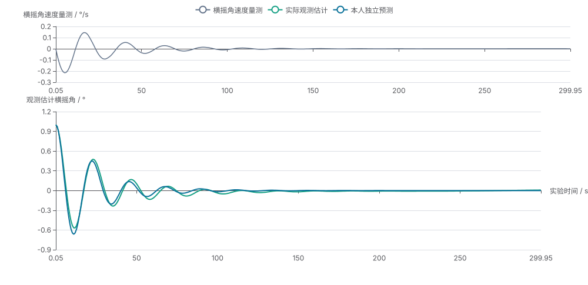

# 实验04 邮轮转向、减摇与舒适性

课程版本 seven-vessel-2026.11.14，指导书版本 2026.11.16。

## 课程卡

船舶与海洋工程、自动化本科高年级，船舶运动控制实验

先修知识包括二阶振荡系统、频率响应、反馈与执行器饱和。

设计用时为预习20分钟、操作分析100分钟、报告30分钟，合计150分钟。

用时为教学设计起点。任课教师结合学校课时长度、课前课后安排和实际试教学记录登记课表。七个实验分别启动、完成和复核，可按课程安排组合使用。

- 建立振荡、鳍效与仪器估计的联系。认知层级为分析，通过第1、2、3、4、5步形成证据。
- 辨析共振、航速与有限鳍控制能力。认知层级为分析与设计，通过第6、7、8、9、10、11、12步形成证据。
- 比较滤波、操纵、舒适性和能量方案。认知层级为设计与评价，通过第13、14、15、16、17、18步形成证据。
- 在新波谱及故障下评价方案和适用域。认知层级为评价与工程判断，通过第19、20步形成证据。

## 原型、物理对象与参数

船体横摇、有限面积减摇鳍、来流相关鳍效、转向耦合与两个客点的真实刚体加速度。

物理对象保留纵荡、横荡、升沉、横摇、纵摇与艏摇。世界坐标为北、东、下，船体坐标为艏、右舷、下。正航向为俯视顺时针。力矩按实际作用点的叉积计算。

| 默认教学参数 | 数值 | 单位 | 来源等级 |
| --- | --- | --- | --- |
| 教学排水质量 | 68000000.0000 | kg | T / 同一冻结装配 |
| 默认吃水 | 8.2600 | m | T / 同一冻结装配 |
| 默认有效横稳心高 | 1.6000 | m | T / 同一冻结装配 |

P表示公开原型资料，B表示公开基准，D表示计算与校准，T表示教学设定。上表为冻结装配的默认教学值。装载、姿态和工况变化后的参数按本次运行显示并记录。原始数值残差、参数来源和有效域随版本保存。

未加权加速度和教学舒适性代理用于本课程比较。鳍低速能力、饱和、姿态适用域与原始失配均按实际记录说明。

## 本人理想模型与独立对照

从本人自由衰减和实际差动鳍角窗口辨识局部横摇振荡模型，以不同记录独立验证估计横摇角。

由本人模型设计理想横摇力矩反馈，再比较实际有限鳍、低通、陷波、速度、波谱和单鳍故障。

三维船体由物理对象的实际受力推进。仪器提供带采样时刻、延迟和质量标志的量测，观测器据此形成状态估计。本人理想模型从所选量测窗口辨识，并独立生成预测曲线。

本实验以A模式的实际差动鳍角和观测横摇角独立验证局部模型，理想力矩反馈另通过频率响应和实际有限鳍方案比较。

图1采用同课程版本的软件验收记录，并保留原始预测偏差。图中量测、观测估计及预测按各自标签读取。

## 二十步目录

| 步骤 | 名称 | 页码 |
| --- | --- | --- |
| 1 | [认识吊舱与减摇鳍](#cruise-step-1) | 3 |
| 2 | [辨识横摇衰减](#cruise-step-2) | 3 |
| 3 | [辨识鳍控制效能](#cruise-step-3) | 4 |
| 4 | [独立验证横摇模型](#cruise-step-4) | 5 |
| 5 | [区分波频与固有频率](#cruise-step-5) | 5 |
| 6 | [检验共振范围](#cruise-step-6) | 6 |
| 7 | [比较低速鳍效](#cruise-step-7) | 6 |
| 8 | [设计横摇速率反馈](#cruise-step-8) | 7 |
| 9 | [比较鳍关与鳍开](#cruise-step-9) | 8 |
| 10 | [检验鳍约束与增益](#cruise-step-10) | 8 |
| 11 | [观察转向舒适性](#cruise-step-11) | 9 |
| 12 | [比较转向斜坡](#cruise-step-12) | 9 |
| 13 | [评价减速收益与代价](#cruise-step-13) | 10 |
| 14 | [选择测量滤波](#cruise-step-14) | 11 |
| 15 | [检验陷波取舍](#cruise-step-15) | 11 |
| 16 | [形成联合控制方案](#cruise-step-16) | 12 |
| 17 | [比较两乘客点](#cruise-step-17) | 12 |
| 18 | [验证变化波谱](#cruise-step-18) | 13 |
| 19 | [应对单鳍失效](#cruise-step-19) | 14 |
| 20 | [完成实验报告](#cruise-step-20) | 14 |

## 二十步操作、证据与评价

### 第1步 认识吊舱与减摇鳍

| 项目 | 本步要求 |
| --- | --- |
| 目标与认知 | 原型与控制通道，不能把吊舱角当舵角，分析 |
| 能力证据 | 建立振荡、鳍效与仪器估计的联系 |
| 初态与条件 | 初始对水航速 / m/s 8，随机种子 20261106 |
| 本步启用因素 | P0、N0 |
| 合同参数范围 | 目标横摇阻尼比 0.3-0.71 |
| 事件与操作 | P0，60s |
| 时长与结束 | 60s，运行至60s并保存 |
| 量测与统计窗 | 横摇角速度、横向比力、垂向比力、左侧翼面角、右侧翼面角、航向、对水航速，0-60s |
| 最少运行 | 1组实际记录 |
| 训练与验证 | 训练或方案设计 |
| 提交工件 | 运行前预测、实际运行记录、证据解释 |
| 评价 | 预测0.9分，证据1.2分，性能0分，解释0.9分，原型与控制通道，不能把吊舱角当舵角 |
| 观察问题 | 在执行器图选双吊舱/减摇鳍及对应六维力矩 |
| 常见误判与核对 | 同时观察横摇角、角速度、客点加速度与能耗。减少某个角度峰值后，继续检查低速效能、饱和与其他评价量。 |

先记录自己的预测，再操作、读数并解释差异。实际未达目标、缺测或保护退出的记录与分析继续保存。

### 第2步 辨识横摇衰减

| 项目 | 本步要求 |
| --- | --- |
| 目标与认知 | 二阶振荡与参数辨识，分析 |
| 能力证据 | 建立振荡、鳍效与仪器估计的联系 |
| 初态与条件 | 初始对水航速 / m/s 8，随机种子 20261106 |
| 本步启用因素 | P0、N0 |
| 合同参数范围 | 目标横摇阻尼比 0.3-0.71 |
| 事件与操作 | P0，初始phi=2°，鳍关，300s |
| 时长与结束 | 300s，运行至300s并保存 |
| 量测与统计窗 | 横摇角速度、横向比力、垂向比力、左侧翼面角、右侧翼面角、航向、对水航速，0-300s |
| 最少运行 | 1组实际记录 |
| 训练与验证 | 训练或方案设计 |
| 提交工件 | 运行前预测、实际运行记录、证据解释 |
| 评价 | 预测0.9分，证据1.2分，性能0分，解释0.9分，二阶振荡与参数辨识 |
| 观察问题 | 测量衰减周期与峰值比，估计自然频率/阻尼 |
| 常见误判与核对 | 同时观察横摇角、角速度、客点加速度与能耗。减少某个角度峰值后，继续检查低速效能、饱和与其他评价量。 |

先记录自己的预测，再操作、读数并解释差异。实际未达目标、缺测或保护退出的记录与分析继续保存。

### 第3步 辨识鳍控制效能

| 项目 | 本步要求 |
| --- | --- |
| 目标与认知 | 控制效能与多通道耦合，分析 |
| 能力证据 | 建立振荡、鳍效与仪器估计的联系 |
| 初态与条件 | 初始对水航速 / m/s 8，随机种子 20261106 |
| 本步启用因素 | P0、N0 |
| 合同参数范围 | 目标横摇阻尼比 0.3-0.71 |
| 事件与操作 | P0，鳍差动±2°脉冲各10s，300s |
| 时长与结束 | 300s，运行至300s并保存 |
| 量测与统计窗 | 横摇角速度、横向比力、垂向比力、左侧翼面角、右侧翼面角、航向、对水航速，0-300s |
| 最少运行 | 1组实际记录 |
| 训练与验证 | 训练或方案设计 |
| 提交工件 | 运行前预测、实际运行记录、证据解释 |
| 评价 | 预测0.9分，证据1.2分，性能0分，解释0.9分，控制效能与多通道耦合 |
| 观察问题 | 选择有效窗辨识K_fin；同时观察yaw/sway响应 |
| 常见误判与核对 | 同时观察横摇角、角速度、客点加速度与能耗。减少某个角度峰值后，继续检查低速效能、饱和与其他评价量。 |

先记录自己的预测，再操作、读数并解释差异。实际未达目标、缺测或保护退出的记录与分析继续保存。

### 第4步 独立验证横摇模型

| 项目 | 本步要求 |
| --- | --- |
| 目标与认知 | 独立验证和局部模型限制，分析 |
| 能力证据 | 建立振荡、鳍效与仪器估计的联系 |
| 初态与条件 | 初始对水航速 / m/s 8，随机种子 20261106 |
| 本步启用因素 | P0、N0 |
| 合同参数范围 | 目标横摇阻尼比 0.3-0.71 |
| 事件与操作 | 新run，初始phi=1°＋小鳍脉冲，300s |
| 时长与结束 | 300s，运行至300s并保存 |
| 量测与统计窗 | 横摇角速度、横向比力、垂向比力、左侧翼面角、右侧翼面角、航向、对水航速，0-300s |
| 最少运行 | 1组实际记录 |
| 训练与验证 | 独立验证 |
| 提交工件 | 运行前预测、实际运行记录、证据解释 |
| 评价 | 预测0.9分，证据1.2分，性能0分，解释0.9分，独立验证和局部模型限制 |
| 观察问题 | 冻结模型叠加预测/物理响应 |
| 常见误判与核对 | 同时观察横摇角、角速度、客点加速度与能耗。减少某个角度峰值后，继续检查低速效能、饱和与其他评价量。 |

先记录自己的预测，再操作、读数并解释差异。实际未达目标、缺测或保护退出的记录与分析继续保存。

### 第5步 区分波频与固有频率

| 项目 | 本步要求 |
| --- | --- |
| 目标与认知 | 激励频率与固有频率并非同一物理量，分析 |
| 能力证据 | 建立振荡、鳍效与仪器估计的联系 |
| 初态与条件 | 初始对水航速 / m/s 8，随机种子 20261106 |
| 本步启用因素 | V1、N0 |
| 合同参数范围 | 目标横摇阻尼比 0.3-0.71 |
| 事件与操作 | V1，鳍关，600s |
| 时长与结束 | 600s，运行至600s并保存 |
| 量测与统计窗 | 横摇角速度、横向比力、垂向比力、左侧翼面角、右侧翼面角、航向、对水航速，120-600s |
| 最少运行 | 1组实际记录 |
| 训练与验证 | 训练或方案设计 |
| 提交工件 | 运行前预测、实际运行记录、证据解释 |
| 评价 | 预测1.2分，证据1.6分，性能0分，解释1.2分，激励频率与固有频率并非同一物理量 |
| 观察问题 | 估计谱峰，标示波浪和横摇主频 |
| 常见误判与核对 | 同时观察横摇角、角速度、客点加速度与能耗。减少某个角度峰值后，继续检查低速效能、饱和与其他评价量。 |

先记录自己的预测，再操作、读数并解释差异。实际未达目标、缺测或保护退出的记录与分析继续保存。

### 第6步 检验共振范围

| 项目 | 本步要求 |
| --- | --- |
| 目标与认知 | 共振，合理承认实际峰值受阻尼/耦合影响，分析 |
| 能力证据 | 辨析共振、航速与有限鳍控制能力 |
| 初态与条件 | 初始对水航速 / m/s 8，随机种子 20261106 |
| 本步启用因素 | V1、N0 |
| 合同参数范围 | 目标横摇阻尼比 0.3-0.71 |
| 事件与操作 | 规则波H=.5m，周期为识别Tphi的.7/1/1.3倍，各600s |
| 时长与结束 | 600s，运行至600s并保存 |
| 量测与统计窗 | 横摇角速度、横向比力、垂向比力、左侧翼面角、右侧翼面角、航向、对水航速，120-600s |
| 最少运行 | 3组实际记录 |
| 训练与验证 | 训练或方案设计 |
| 提交工件 | 运行前预测、实际运行记录、证据解释 |
| 评价 | 预测1.2分，证据1.6分，性能0分，解释1.2分，共振，合理承认实际峰值受阻尼/耦合影响 |
| 观察问题 | 预测幅值排序后运行；画/标幅频响应 |
| 常见误判与核对 | 同时观察横摇角、角速度、客点加速度与能耗。减少某个角度峰值后，继续检查低速效能、饱和与其他评价量。 |

先记录自己的预测，再操作、读数并解释差异。实际未达目标、缺测或保护退出的记录与分析继续保存。

### 第7步 比较低速鳍效

| 项目 | 本步要求 |
| --- | --- |
| 目标与认知 | 常规鳍依赖来流，不能把零速减摇编成常量比例，分析 |
| 能力证据 | 辨析共振、航速与有限鳍控制能力 |
| 初态与条件 | 初始对水航速 / m/s 0，随机种子 20261106 |
| 本步启用因素 | P0、N0 |
| 合同参数范围 | 目标横摇阻尼比 0.3-0.71 |
| 事件与操作 | P0，U0=0/2/8，各120s，鳍+5° |
| 时长与结束 | 120s，运行至120s并保存 |
| 量测与统计窗 | 横摇角速度、横向比力、垂向比力、左侧翼面角、右侧翼面角、航向、对水航速，0-120s |
| 最少运行 | 3组实际记录 |
| 训练与验证 | 训练或方案设计 |
| 提交工件 | 运行前预测、实际运行记录、证据解释 |
| 评价 | 预测1.2分，证据1.6分，性能0分，解释1.2分，常规鳍依赖来流，不能把零速减摇编成常量比例 |
| 观察问题 | 比较实际升力/横摇力矩 |
| 常见误判与核对 | 同时观察横摇角、角速度、客点加速度与能耗。减少某个角度峰值后，继续检查低速效能、饱和与其他评价量。 |

先记录自己的预测，再操作、读数并解释差异。实际未达目标、缺测或保护退出的记录与分析继续保存。

### 第8步 设计横摇速率反馈

| 项目 | 本步要求 |
| --- | --- |
| 目标与认知 | 从二阶指标到物理闭环，设计 |
| 能力证据 | 辨析共振、航速与有限鳍控制能力 |
| 初态与条件 | 初始对水航速 / m/s 8，随机种子 20261106 |
| 本步启用因素 | V1、N0 |
| 合同参数范围 | 目标横摇阻尼比 0.3-0.71 |
| 事件与操作 | V1，U0=8，600s |
| 时长与结束 | 600s，运行至600s并保存 |
| 量测与统计窗 | 横摇角速度、横向比力、垂向比力、左侧翼面角、右侧翼面角、航向、对水航速，120-600s |
| 最少运行 | 1组实际记录 |
| 训练与验证 | 训练或方案设计 |
| 提交工件 | 运行前预测、实际运行记录、证据解释 |
| 评价 | 预测1.2分，证据0.8分，性能0.8分，解释1.2分，从二阶指标到物理闭环 |
| 观察问题 | 按识别模型设计zeta_d=.5的速率反馈，理想侧先预测 |
| 常见误判与核对 | 同时观察横摇角、角速度、客点加速度与能耗。减少某个角度峰值后，继续检查低速效能、饱和与其他评价量。 |

先记录自己的预测，再操作、读数并解释差异。实际未达目标、缺测或保护退出的记录与分析继续保存。

### 第9步 比较鳍关与鳍开

| 项目 | 本步要求 |
| --- | --- |
| 目标与认知 | RMS/峰值/能耗，而非末端过零值，设计 |
| 能力证据 | 辨析共振、航速与有限鳍控制能力 |
| 初态与条件 | 初始对水航速 / m/s 8，随机种子 20261106 |
| 本步启用因素 | V1、N0 |
| 合同参数范围 | 目标横摇阻尼比 0.3-0.71 |
| 事件与操作 | 同种子600s |
| 时长与结束 | 600s，运行至600s并保存 |
| 量测与统计窗 | 横摇角速度、横向比力、垂向比力、左侧翼面角、右侧翼面角、航向、对水航速，120-600s |
| 最少运行 | 2组实际记录 |
| 训练与验证 | 训练或方案设计 |
| 提交工件 | 运行前预测、实际运行记录、证据解释 |
| 评价 | 预测1.5分，证据1分，性能1分，解释1.5分，RMS/峰值/能耗，而非末端过零值 |
| 观察问题 | 鳍关/开公平比较相同统计窗 |
| 常见误判与核对 | 同时观察横摇角、角速度、客点加速度与能耗。减少某个角度峰值后，继续检查低速效能、饱和与其他评价量。 |

先记录自己的预测，再操作、读数并解释差异。实际未达目标、缺测或保护退出的记录与分析继续保存。

### 第10步 检验鳍约束与增益

| 项目 | 本步要求 |
| --- | --- |
| 目标与认知 | 高增益不必更好，有限控制能力，设计 |
| 能力证据 | 辨析共振、航速与有限鳍控制能力 |
| 初态与条件 | 初始对水航速 / m/s 8，随机种子 20261106 |
| 本步启用因素 | V2、N0 |
| 合同参数范围 | 目标横摇阻尼比 0.3-0.71 |
| 事件与操作 | V2，600s，zeta_d=.3/.7 |
| 时长与结束 | 600s，运行至600s并保存 |
| 量测与统计窗 | 横摇角速度、横向比力、垂向比力、左侧翼面角、右侧翼面角、航向、对水航速，120-600s |
| 最少运行 | 2组实际记录 |
| 训练与验证 | 训练或方案设计 |
| 提交工件 | 运行前预测、实际运行记录、证据解释 |
| 评价 | 预测1.5分，证据1分，性能1分，解释1.5分，高增益不必更好，有限控制能力 |
| 观察问题 | 比较两组控制，记录鳍角/速率饱和 |
| 常见误判与核对 | 同时观察横摇角、角速度、客点加速度与能耗。减少某个角度峰值后，继续检查低速效能、饱和与其他评价量。 |

先记录自己的预测，再操作、读数并解释差异。实际未达目标、缺测或保护退出的记录与分析继续保存。

### 第11步 观察转向舒适性

| 项目 | 本步要求 |
| --- | --- |
| 目标与认知 | manoeuvring-roll耦合，不能只研究独立横摇TF，设计 |
| 能力证据 | 辨析共振、航速与有限鳍控制能力 |
| 初态与条件 | 初始对水航速 / m/s 8，随机种子 20261106 |
| 本步启用因素 | P0、N0 |
| 合同参数范围 | 目标横摇阻尼比 0.3-0.71 |
| 事件与操作 | P0，psi_ref20°，转向斜坡10s，400s |
| 时长与结束 | 400s，运行至400s并保存 |
| 量测与统计窗 | 横摇角速度、横向比力、垂向比力、左侧翼面角、右侧翼面角、航向、对水航速，0-400s |
| 最少运行 | 1组实际记录 |
| 训练与验证 | 训练或方案设计 |
| 提交工件 | 运行前预测、实际运行记录、证据解释 |
| 评价 | 预测1.5分，证据1分，性能1分，解释1.5分，manoeuvring-roll耦合，不能只研究独立横摇TF |
| 观察问题 | 观察吊舱转向与横摇/乘客点加速度 |
| 常见误判与核对 | 同时观察横摇角、角速度、客点加速度与能耗。减少某个角度峰值后，继续检查低速效能、饱和与其他评价量。 |

先记录自己的预测，再操作、读数并解释差异。实际未达目标、缺测或保护退出的记录与分析继续保存。

### 第12步 比较转向斜坡

| 项目 | 本步要求 |
| --- | --- |
| 目标与认知 | 快速响应与平稳操作冲突，设计 |
| 能力证据 | 辨析共振、航速与有限鳍控制能力 |
| 初态与条件 | 初始对水航速 / m/s 8，随机种子 20261106 |
| 本步启用因素 | P0、N0 |
| 合同参数范围 | 目标横摇阻尼比 0.3-0.71 |
| 事件与操作 | 相同终航向，转向斜坡40/80s |
| 时长与结束 | 400s，运行至400s并保存 |
| 量测与统计窗 | 横摇角速度、横向比力、垂向比力、左侧翼面角、右侧翼面角、航向、对水航速，0-400s |
| 最少运行 | 2组实际记录 |
| 训练与验证 | 训练或方案设计 |
| 提交工件 | 运行前预测、实际运行记录、证据解释 |
| 评价 | 预测1.5分，证据1分，性能1分，解释1.5分，快速响应与平稳操作冲突 |
| 观察问题 | 自选一组斜坡并比较完成时间/舒适性 |
| 常见误判与核对 | 同时观察横摇角、角速度、客点加速度与能耗。减少某个角度峰值后，继续检查低速效能、饱和与其他评价量。 |

先记录自己的预测，再操作、读数并解释差异。实际未达目标、缺测或保护退出的记录与分析继续保存。

### 第13步 评价减速收益与代价

| 项目 | 本步要求 |
| --- | --- |
| 目标与认知 | 航速改变遭遇频率、鳍力和能耗；避免“越慢必越好”，设计 |
| 能力证据 | 比较滤波、操纵、舒适性和能量方案 |
| 初态与条件 | 初始对水航速 / m/s 4，随机种子 20261106 |
| 本步启用因素 | V2、N0 |
| 合同参数范围 | 目标横摇阻尼比 0.3-0.71 |
| 事件与操作 | V2，U0=4/8/10，各600s |
| 时长与结束 | 600s，运行至600s并保存 |
| 量测与统计窗 | 横摇角速度、横向比力、垂向比力、左侧翼面角、右侧翼面角、航向、对水航速，120-600s |
| 最少运行 | 3组实际记录 |
| 训练与验证 | 训练或方案设计 |
| 提交工件 | 运行前预测、实际运行记录、证据解释 |
| 评价 | 预测1.8分，证据1.2分，性能1.2分，解释1.8分，航速改变遭遇频率、鳍力和能耗；避免“越慢必越好” |
| 观察问题 | 先预测减速收益与鳍效损失，再运行 |
| 常见误判与核对 | 同时观察横摇角、角速度、客点加速度与能耗。减少某个角度峰值后，继续检查低速效能、饱和与其他评价量。 |

先记录自己的预测，再操作、读数并解释差异。实际未达目标、缺测或保护退出的记录与分析继续保存。

### 第14步 选择测量滤波

| 项目 | 本步要求 |
| --- | --- |
| 目标与认知 | 噪声放大、相位延迟，设计 |
| 能力证据 | 比较滤波、操纵、舒适性和能量方案 |
| 初态与条件 | 初始对水航速 / m/s 8，随机种子 20261106 |
| 本步启用因素 | V2、N1 |
| 合同参数范围 | 目标横摇阻尼比 0.3-0.71 |
| 事件与操作 | V2+N1，600s |
| 时长与结束 | 600s，运行至600s并保存 |
| 量测与统计窗 | 横摇角速度、横向比力、垂向比力、左侧翼面角、右侧翼面角、航向、对水航速，120-600s |
| 最少运行 | 2组实际记录 |
| 训练与验证 | 训练或方案设计 |
| 提交工件 | 运行前预测、实际运行记录、证据解释 |
| 评价 | 预测1.8分，证据1.2分，性能1.2分，解释1.8分，噪声放大、相位延迟 |
| 观察问题 | 调整测量滤波截止并对比鳍总变差与横摇 |
| 常见误判与核对 | 同时观察横摇角、角速度、客点加速度与能耗。减少某个角度峰值后，继续检查低速效能、饱和与其他评价量。 |

先记录自己的预测，再操作、读数并解释差异。实际未达目标、缺测或保护退出的记录与分析继续保存。

### 第15步 检验陷波取舍

| 项目 | 本步要求 |
| --- | --- |
| 目标与认知 | 滤除干扰同时可能损失控制信息，按实际结果判断，设计 |
| 能力证据 | 比较滤波、操纵、舒适性和能量方案 |
| 初态与条件 | 初始对水航速 / m/s 8，随机种子 20261106 |
| 本步启用因素 | V2、N1 |
| 合同参数范围 | 目标横摇阻尼比 0.3-0.71 |
| 事件与操作 | 同上600s |
| 时长与结束 | 600s，运行至600s并保存 |
| 量测与统计窗 | 横摇角速度、横向比力、垂向比力、左侧翼面角、右侧翼面角、航向、对水航速，120-600s |
| 最少运行 | 2组实际记录 |
| 训练与验证 | 训练或方案设计 |
| 提交工件 | 运行前预测、实际运行记录、证据解释 |
| 评价 | 预测1.8分，证据1.2分，性能1.2分，解释1.8分，滤除干扰同时可能损失控制信息，按实际结果判断 |
| 观察问题 | 由谱选择陷波中心/带宽，开关对照 |
| 常见误判与核对 | 同时观察横摇角、角速度、客点加速度与能耗。减少某个角度峰值后，继续检查低速效能、饱和与其他评价量。 |

先记录自己的预测，再操作、读数并解释差异。实际未达目标、缺测或保护退出的记录与分析继续保存。

### 第16步 形成联合控制方案

| 项目 | 本步要求 |
| --- | --- |
| 目标与认知 | 航向与舒适性双任务，评价 |
| 能力证据 | 比较滤波、操纵、舒适性和能量方案 |
| 初态与条件 | 初始对水航速 / m/s 8，随机种子 20261106 |
| 本步启用因素 | E1、N1 |
| 合同参数范围 | 目标横摇阻尼比 0.3-0.71 |
| 事件与操作 | E1+N1，400s，20°转向 |
| 时长与结束 | 400s，运行至400s并保存 |
| 量测与统计窗 | 横摇角速度、横向比力、垂向比力、左侧翼面角、右侧翼面角、航向、对水航速，0-400s |
| 最少运行 | 1组实际记录 |
| 训练与验证 | 训练或方案设计 |
| 提交工件 | 运行前预测、实际运行记录、证据解释 |
| 评价 | 预测1.8分，证据1.2分，性能1.2分，解释1.8分，航向与舒适性双任务 |
| 观察问题 | 联合选择转向斜坡/鳍阻尼/滤波第一方案 |
| 常见误判与核对 | 同时观察横摇角、角速度、客点加速度与能耗。减少某个角度峰值后，继续检查低速效能、饱和与其他评价量。 |

先记录自己的预测，再操作、读数并解释差异。实际未达目标、缺测或保护退出的记录与分析继续保存。

### 第17步 比较两乘客点

| 项目 | 本步要求 |
| --- | --- |
| 目标与认知 | 空间位置差异与多目标权衡，评价 |
| 能力证据 | 比较滤波、操纵、舒适性和能量方案 |
| 初态与条件 | 初始对水航速 / m/s 8，随机种子 20261106 |
| 本步启用因素 | E1、N1 |
| 合同参数范围 | 目标横摇阻尼比 0.3-0.71 |
| 事件与操作 | 同工况另一方案 |
| 时长与结束 | 400s，运行至400s并保存 |
| 量测与统计窗 | 横摇角速度、横向比力、垂向比力、左侧翼面角、右侧翼面角、航向、对水航速，0-400s |
| 最少运行 | 1组实际记录 |
| 训练与验证 | 训练或方案设计 |
| 提交工件 | 运行前预测、实际运行记录、证据解释 |
| 评价 | 预测1.8分，证据1.2分，性能1.2分，解释1.8分，空间位置差异与多目标权衡 |
| 观察问题 | 调整一项策略并比较两乘客点响应 |
| 常见误判与核对 | 同时观察横摇角、角速度、客点加速度与能耗。减少某个角度峰值后，继续检查低速效能、饱和与其他评价量。 |

先记录自己的预测，再操作、读数并解释差异。实际未达目标、缺测或保护退出的记录与分析继续保存。

### 第18步 验证变化波谱

| 项目 | 本步要求 |
| --- | --- |
| 目标与认知 | 频率变化与鲁棒性，评价 |
| 能力证据 | 比较滤波、操纵、舒适性和能量方案 |
| 初态与条件 | 初始对水航速 / m/s 8，随机种子 17 |
| 本步启用因素 | E1、N1 |
| 合同参数范围 | 目标横摇阻尼比 0.3-0.71 |
| 事件与操作 | seed17、Tp=10s、Hs1.5m，600s |
| 时长与结束 | 600s，运行至600s并保存 |
| 量测与统计窗 | 横摇角速度、横向比力、垂向比力、左侧翼面角、右侧翼面角、航向、对水航速，120-600s |
| 最少运行 | 1组实际记录 |
| 训练与验证 | 独立验证 |
| 提交工件 | 运行前预测、实际运行记录、证据解释 |
| 评价 | 预测1.8分，证据1.2分，性能1.2分，解释1.8分，频率变化与鲁棒性 |
| 观察问题 | 冻结方案验证不同谱峰，不许重新拟合后覆盖 |
| 常见误判与核对 | 同时观察横摇角、角速度、客点加速度与能耗。减少某个角度峰值后，继续检查低速效能、饱和与其他评价量。 |

先记录自己的预测，再操作、读数并解释差异。实际未达目标、缺测或保护退出的记录与分析继续保存。

### 第19步 应对单鳍失效

| 项目 | 本步要求 |
| --- | --- |
| 目标与认知 | 剩余执行能力，保留失效事件和恢复过程，评价 |
| 能力证据 | 在新波谱及故障下评价方案和适用域 |
| 初态与条件 | 初始对水航速 / m/s 8，随机种子 29 |
| 本步启用因素 | E1、N1 |
| 合同参数范围 | 目标横摇阻尼比 0.3-0.71 |
| 事件与操作 | seed29，E1+N1；一片鳍t180卡零，600s |
| 时长与结束 | 600s，运行至600s并保存 |
| 量测与统计窗 | 横摇角速度、横向比力、垂向比力、左侧翼面角、右侧翼面角、航向、对水航速，120-600s |
| 最少运行 | 1组实际记录 |
| 训练与验证 | 独立验证 |
| 提交工件 | 运行前预测、实际运行记录、证据解释 |
| 评价 | 预测1.8分，证据1.2分，性能1.2分，解释1.8分，剩余执行能力，保留失效事件和恢复过程 |
| 观察问题 | 选择降速/延长转向/保持策略，实际执行并分析 |
| 常见误判与核对 | 同时观察横摇角、角速度、客点加速度与能耗。减少某个角度峰值后，继续检查低速效能、饱和与其他评价量。 |

先记录自己的预测，再操作、读数并解释差异。实际未达目标、缺测或保护退出的记录与分析继续保存。

### 第20步 完成实验报告

| 项目 | 本步要求 |
| --- | --- |
| 目标与认知 | 不把教学舒适性代理当医学预测，综合设计 |
| 能力证据 | 在新波谱及故障下评价方案和适用域 |
| 初态与条件 | 初始对水航速 / m/s 8，随机种子 20261106 |
| 本步启用因素 | P0、N0 |
| 合同参数范围 | 目标横摇阻尼比 0.3-0.71 |
| 事件与操作 | 整理本人已有证据 |
| 时长与结束 | 分析步骤，提交六部分报告 |
| 量测与统计窗 | 横摇角速度、横向比力、垂向比力、左侧翼面角、右侧翼面角、航向、对水航速，0-600s |
| 最少运行 | 5组已有证据，按本步工件要求引用 |
| 训练与验证 | 训练或方案设计 |
| 提交工件 | 至少五组本人运行、六部分报告 |
| 评价 | 模型假设3分，本人证据3分，方案比较2分，适用边界2分，不把教学舒适性代理当医学预测 |
| 观察问题 | 报告理想模型、实际共振/饱和、方案及边界 |
| 常见误判与核对 | 同时观察横摇角、角速度、客点加速度与能耗。减少某个角度峰值后，继续检查低速效能、饱和与其他评价量。 |

先记录自己的预测，再操作、读数并解释差异。实际未达目标、缺测或保护退出的记录与分析继续保存。

## 现实因素与操作权限

物理后台持续支持执行器、六自由度、风、浪、流和观测链。本步启用情况由课程预置条件和实际开关回执确定，学生在解锁控件的范围内调整参数。

| 步骤 | 启用因素 | 合同调整项 | 固定条件 |
| --- | --- | --- | --- |
| 1 | P0、N0 | 目标横摇阻尼比 | 船型、参数包和本步预置事件 |
| 2 | P0、N0 | 目标横摇阻尼比 | 船型、参数包和本步预置事件 |
| 3 | P0、N0 | 目标横摇阻尼比 | 船型、参数包和本步预置事件 |
| 4 | P0、N0 | 目标横摇阻尼比 | 船型、参数包和本步预置事件 |
| 5 | V1、N0 | 目标横摇阻尼比 | 船型、参数包和本步预置事件 |
| 6 | V1、N0 | 目标横摇阻尼比 | 船型、参数包和本步预置事件 |
| 7 | P0、N0 | 目标横摇阻尼比 | 船型、参数包和本步预置事件 |
| 8 | V1、N0 | 目标横摇阻尼比 | 船型、参数包和本步预置事件 |
| 9 | V1、N0 | 目标横摇阻尼比 | 船型、参数包和本步预置事件 |
| 10 | V2、N0 | 目标横摇阻尼比 | 船型、参数包和本步预置事件 |
| 11 | P0、N0 | 目标横摇阻尼比 | 船型、参数包和本步预置事件 |
| 12 | P0、N0 | 目标横摇阻尼比 | 船型、参数包和本步预置事件 |
| 13 | V2、N0 | 目标横摇阻尼比 | 船型、参数包和本步预置事件 |
| 14 | V2、N1 | 目标横摇阻尼比 | 船型、参数包和本步预置事件 |
| 15 | V2、N1 | 目标横摇阻尼比 | 船型、参数包和本步预置事件 |
| 16 | E1、N1 | 目标横摇阻尼比 | 船型、参数包和本步预置事件 |
| 17 | E1、N1 | 目标横摇阻尼比 | 船型、参数包和本步预置事件 |
| 18 | E1、N1 | 目标横摇阻尼比 | 船型、参数包和本步预置事件 |
| 19 | E1、N1 | 目标横摇阻尼比 | 船型、参数包和本步预置事件 |
| 20 | P0、N0 | 目标横摇阻尼比 | 船型、参数包和本步预置事件 |

P0表示平静环境，N0表示理想仪器等级。W表示风，V表示波浪，C表示流，E表示组合环境，N1/N2表示相应噪声与时延等级。冰区和专项机构按本步工况独立记录。

## 评分与六部分报告

每个实验满分100分，二十步分值依次为3、3、3、3、4、4、4、4、5、5、5、5、6、6、6、6、6、6、6、10分。前19步的预测占30%、操作与证据占40%、解释占30%。设计步骤将40%分为证据与性能各20%。

第20步按模型假设3分、本人证据3分、方案比较2分和适用边界2分复核。缺证据、数值无效、模型失配、性能不足和解释错误分别记录。

1. 问题与限制。引用本人运行、模型、独立对照和修改依据。
2. 局部模型。引用本人运行、模型、独立对照和修改依据。
3. 独立验证。引用本人运行、模型、独立对照和修改依据。
4. 控制方案与比较。引用本人运行、模型、独立对照和修改依据。
5. 修改及迁移。引用本人运行、模型、独立对照和修改依据。
6. 工程结论与边界。引用本人运行、模型、独立对照和修改依据。

报告比较至少两种方案，并保留独立验证与未见工况。页面过程状态帮助检查完整性，教师依据固定量规查看尝试、反馈、退回修改并确认最终成绩。

## 设备准备、恢复与数据

使用支持硬件加速的现代桌面浏览器，先完成页面中的网络与图形检查。三维场景就绪后开始，按需要暂停、折叠面板、调整视图和运行速率。图形接口与质量档由页面统一管理。

普通平台账号和实验空间入口均将实验保存到当前账号。实验空间核验身份后建立专用来源账号并绑定本轮记录，控灵使用同一账号及本页步骤。刷新、重新打开或更换设备后核对原轮次、草稿与运行时间，再继续实验。

网络失败时保留本机结果并按页面入口继续上传。教师确认最终成绩后按实验空间规则回传，附件重试复用已成功成绩。新的独立实验轮次通过“重新开始新一轮实验”建立，历史结果分别保留。

控灵提供本步机理与有来源的观察提示。学生保留本人预测、量测和解释，报告引用实际作品。账号资料、原始答案和私有运行记录按平台访问权限保存，公开示例采用脱敏的软件验收数据。

## 旧版迁移与教学证据

旧版减摇开关与舒适性读数扩展为本人振荡模型、独立对照、频率响应、有限鳍与完整方案评价。

旧步骤的操作背景与新能力目标按本册二十步重新对应，旧成绩保留其原课程版本。新版报告固定引用本次材料版本。旧版PDF可由历史发布标签追溯。

下表按旧、新编号核对替换位置，当前教学目标和需提交的证据以本册各步为准。

| 编号 | 原操作版 | 当前步骤 | 迁移处理 |
| --- | --- | --- | --- |
| 1 | 减摇开启直航 | 认识吊舱与减摇鳍 | 替换并增加当前能力证据 |
| 2 | 关掉减摇鳍 | 辨识横摇衰减 | 替换并增加当前能力证据 |
| 3 | 再打开减摇鳍 | 辨识鳍控制效能 | 替换并增加当前能力证据 |
| 4 | 转向中的横摇 | 独立验证横摇模型 | 替换并增加当前能力证据 |
| 5 | 不适指数 | 区分波频与固有频率 | 替换并增加当前能力证据 |
| 6 | 航速保持 | 检验共振范围 | 替换并增加当前能力证据 |
| 7 | 减摇鳍功率 | 比较低速鳍效 | 替换并增加当前能力证据 |
| 8 | 终点横摇 | 设计横摇速率反馈 | 替换并增加当前能力证据 |
| 9 | 海况读数 | 比较鳍关与鳍开 | 替换并增加当前能力证据 |
| 10 | 海况复核 | 检验鳍约束与增益 | 替换并增加当前能力证据 |
| 11 | 巡航航速 | 观察转向舒适性 | 替换并增加当前能力证据 |
| 12 | 减摇功率复核 | 比较转向斜坡 | 替换并增加当前能力证据 |
| 13 | 减摇关闭 | 评价减速收益与代价 | 替换并增加当前能力证据 |
| 14 | 航向保持 | 选择测量滤波 | 替换并增加当前能力证据 |
| 15 | 转艏读数 | 检验陷波取舍 | 替换并增加当前能力证据 |
| 16 | 横摇读数 | 形成联合控制方案 | 替换并增加当前能力证据 |
| 17 | 海况判断 | 比较两乘客点 | 替换并增加当前能力证据 |
| 18 | 航速判断 | 验证变化波谱 | 替换并增加当前能力证据 |
| 19 | 手绘图识别 | 应对单鳍失效 | 替换并增加当前能力证据 |
| 20 | 确认记录 | 完成实验报告 | 替换并增加当前能力证据 |

当前图例和脚本记录用于软件验收。正式教学需另外登记实际课表、学生用时、低中高水平报告样例、独立迁移任务、教师交叉评分与改进反馈，相关证据以教学证据索引核验。

## 参考资料

- 中国船舶邮轮原型资料。[查看来源](https://www.cssc.net.cn/n135/n171/n177/c27674/content.html)
- 船舶减摇控制研究。[查看来源](https://doi.org/10.1016/j.arcontrol.2012.03.010)

参数与步骤的详细来源、校准误差和本课程适用域由同版本参数清单及本步运行报告共同保留。
