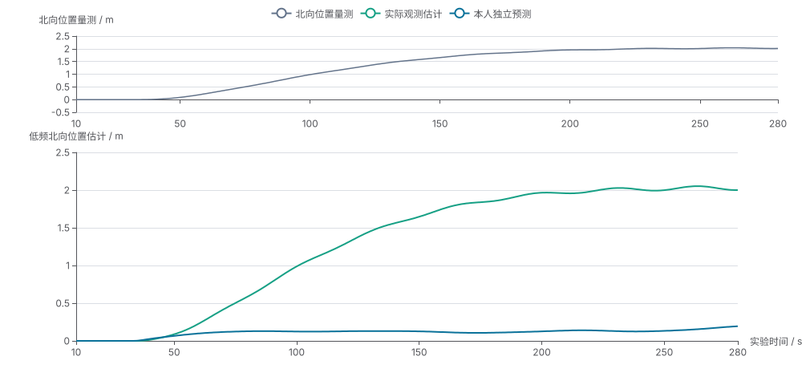

# 实验05 海洋石油981动力定位

课程版本 seven-vessel-2026.11.14，指导书版本 2026.11.25。

## 课程卡

船舶与海洋工程、自动化本科高年级，动力定位综合设计实验

先修知识包括PID、向量与坐标变换、基本矩阵运算。

设计用时为预习25分钟、操作分析120分钟、报告35分钟，合计180分钟。

用时为教学设计起点。任课教师结合学校课时长度、课前课后安排和实际试教学记录登记课表。七个实验分别启动、完成和复核，可按课程安排组合使用。

- 辨析推进器符号、耦合和量测分离。认知层级为分析，通过第1、2、3、4、5步形成证据。
- 用本人模型比较定位与前馈方案。认知层级为综合设计，通过第6、7、8、9、10、11步形成证据。
- 评价分配、功率、观测与失效可行性。认知层级为设计与评价，通过第12、13、14、15、16、17、18步形成证据。
- 在未见环境中评价完整定位方案。认知层级为工程判断，通过第19、20步形成证据。

## 原型、物理对象与参数

半潜式平台六自由度、八台真实推进器、32MW共享正机械功预算、一阶波浪和冻结代表差频慢漂数据。

物理对象保留纵荡、横荡、升沉、横摇、纵摇与艏摇。世界坐标为北、东、下，船体坐标为艏、右舷、下。正航向为俯视顺时针。力矩按实际作用点的叉积计算。

| 默认教学参数 | 数值 | 单位 | 来源等级 |
| --- | --- | --- | --- |
| 教学排水质量 | 53095000.0000 | kg | T / 同一冻结装配 |
| 默认吃水 | 19.0000 | m | T / 同一冻结装配 |
| 默认有效横稳心高 | 2.0000 | m | T / 同一冻结装配 |

P表示公开原型资料，B表示公开基准，D表示计算与校准，T表示教学设定。上表为冻结装配的默认教学值。装载、姿态和工况变化后的参数按本次运行显示并记录。原始数值残差、参数来源和有效域随版本保存。

教学差频数据来自已算出的代表频率和波向。完整频带与原型精度误差保持明确，动态轴速、方位、射流及总功率约束按实际运行评价。

## 本人理想模型与独立对照

以三个独立低频激励记录建立3×3局部模型，分别保留量测、低频估计和本人独立预测。

使用既定低频观测器与受约束分配模板，选择带宽、解耦、风前馈、轴权重、重分配和导航丢失策略。

三维船体由物理对象的实际受力推进。仪器提供带采样时刻、延迟和质量标志的量测，观测器据此形成状态估计。本人理想模型从所选量测窗口辨识，并独立生成预测曲线。

本实验以A模式的三通道低频记录检验本人模型，保留北、东和航向的独立预测，再比较实际受约束定位方案。

图1采用同课程版本的软件验收记录，并保留原始预测偏差。图中量测、观测估计及预测按各自标签读取。

## 二十步目录

| 步骤 | 名称 | 页码 |
| --- | --- | --- |
| 1 | [认识运动与控制通道](#drilling-step-1) | 3 |
| 2 | [检验推进器力矩臂](#drilling-step-2) | 4 |
| 3 | [设计组合激励](#drilling-step-3) | 5 |
| 4 | [辨识三通道模型](#drilling-step-4) | 6 |
| 5 | [独立验证低频模型](#drilling-step-5) | 7 |
| 6 | [整定定位PID](#drilling-step-6) | 8 |
| 7 | [比较模型解耦](#drilling-step-7) | 9 |
| 8 | [检验积分抵流](#drilling-step-8) | 10 |
| 9 | [比较测量风前馈](#drilling-step-9) | 11 |
| 10 | [观察波频运动](#drilling-step-10) | 12 |
| 11 | [识别二阶慢漂](#drilling-step-11) | 13 |
| 12 | [比较原始与低频反馈](#drilling-step-12) | 14 |
| 13 | [比较控制分配](#drilling-step-13) | 15 |
| 14 | [选择参考斜坡](#drilling-step-14) | 16 |
| 15 | [应对推进器故障](#drilling-step-15) | 17 |
| 16 | [设计故障恢复](#drilling-step-16) | 18 |
| 17 | [应对定位缺测](#drilling-step-17) | 19 |
| 18 | [估计电力能力边界](#drilling-step-18) | 20 |
| 19 | [验证综合方案](#drilling-step-19) | 21 |
| 20 | [完成实验报告](#drilling-step-20) | 22 |

## 二十步操作、证据与评价

### 第1步 认识运动与控制通道

| 项目 | 本步要求 |
| --- | --- |
| 目标与认知 | 区分半潜式平台实际六自由度运动与动力定位主动控制三通道，并识别八台全回转推进器布局（分析） |
| 能力证据 | 辨析推进器符号、耦合和量测分离 |
| 初态与条件 | 平静海况（无风无浪无流）、理想量测、零推力命令基线，仿真时长 120 秒（初始对水航速 / m/s 0，随机种子 20261106） |
| 本步启用因素 | P0、N0 |
| 合同参数范围 | 定位闭环带宽 0.015-0.04rad/s |
| 三阶段操作流程 | 1. 运行前先预测主动定位控制通道与自由运动通道的对应关系 2. 点击「开始」运行 120 秒静水零推力基线，观察左侧推进器矢量雷达与六自由度读数 3. 在下方通道配对卡依次标定纵荡、横荡、艏摇与升沉、横摇、纵摇所属类别，完成解释后提交 |
| 阶段一 · 运行前预测 | 定向选择判断：半潜式钻井平台在水面运动包含 6 个自由度，本实验动力定位系统主动闭环控制的是哪组通道？；候选项：六个自由度全部由八台推进器主动闭环控制；仅水平三自由度（纵荡、横荡、艏摇）主动控制，垂向与横纵倾靠静水回复；仅闭环控制航向角，位置完全由系泊锚链固定 |
| 阶段二 · 观测与提取 | 通道物理角色配对：结合左侧六自由度状态读数与推进器布置图，逐项配对各自由度的控制归属：；配对项目：纵荡（前后平移）、横荡（左右横移）、艏摇（绕垂轴转艏）、升沉（垂向起伏）、横摇（左右倾斜）、纵摇（前后俯仰） |
| 阶段三 · 解释核对 | 1. 区分主动控制三通道与静水自回复三通道 2. 描述八台全回转推进器四立柱对称布置特征 3. 记录静水零激励下的收敛状态 |
| 评估工作台要点 | 评估工作台：按本船教学流程依次完成物理激励采样、局部模型冻结与独立验证对照。 |
| 事件与操作 | P0，120s |
| 时长与结束 | 120s，运行至120s并保存 |
| 量测与统计窗 | 北向位置、东向位置、航向、转艏速率、相对风速、相对风向，0-120s |
| 最少运行 | 1组实际记录 |
| 训练与验证 | 训练或方案设计 |
| 提交工件 | 运行前预测、实际运行记录、证据解释 |
| 评价 | 预测0.9分，证据1.2分，性能0分，解释0.9分，控制自由度与实际运动自由度不同 |
| 观察问题 | 匹配6自由度与本实验控制3通道，查看8推进器布局 |
| 常见误判与核对 | 将静态分配可行性、动态执行器响应与实际守位误差分别验证。风浪下的原始运动与低频估计使用各自时间轴。 |

先完成阶段一预测（含必需的坐标轴多模态手绘），再运行仿真并用阶段二结构化观测/一键提取记录实测证据，最后按阶段三核对清单解释差异。实际未达目标、缺测或保护退出的记录与分析继续保存。

### 第2步 检验推进器力矩臂

| 项目 | 本步要求 |
| --- | --- |
| 目标与认知 | 检验单台全回转推进器施加正向脉冲后的平移方向与转艏力矩臂符号关系（分析） |
| 能力证据 | 辨析推进器符号、耦合和量测分离 |
| 初态与条件 | 平静海况、理想量测，单台推进器于第 30-60 秒输出 50 千牛等效正向命令脉冲，总长 300 秒（初始对水航速 / m/s 0，随机种子 20261106） |
| 本步启用因素 | P0、N0 |
| 合同参数范围 | 定位闭环带宽 0.015-0.04rad/s |
| 三阶段操作流程 | 1. 在控制区任选一台推进器（建议对比左舷与右舷推进器），运行前预测北向位移与航向角符号 2. 点击「开始」完成 300 秒脉冲激励（第 30-60 秒施加 50 千牛等效正向脉冲） 3. 在下方指标卡读取并填入推进器编号与 30-60 秒前后北向、东向及航向峰值，总结力矩臂机理后提交 |
| 阶段一 · 运行前预测 | 定向选择判断：若选择左舷或右舷单台推进器向前施加 50 千牛推力脉冲，平台除了向前平移外，转艏航向角将如何偏转？；候选项：左舷推进器引起正航向（右偏顺时针），右舷推进器引起负航向（左偏逆时针）；左舷推进器引起负航向（左偏），右舷推进器引起正航向（右偏）；推力仅沿纵向作用，不会产生任何转艏力矩与航向变化 |
| 阶段二 · 观测与提取 | 结构化指标读数（支持从曲线一键提取）：记录所选单台推进器在 30-60 秒脉冲及后续过程中的位置与航向实测峰值（保留正负号）：；读数指标：所选推进器编号、北向位移峰值(m)、东向位移峰值(m)、航向（艏摇）峰值(°) |
| 阶段三 · 解释核对 | 1. 写明所选推进器位置坐标与力矩符号 2. 说明平移与横摇/航向耦合原因 3. 指出轴速爬坡与水动力阻尼对峰值的制约 |
| 评估工作台要点 | 评估工作台：按本船教学流程依次完成物理激励采样、局部模型冻结与独立验证对照。 |
| 事件与操作 | P0，单台50kN等效命令脉冲30s，300s |
| 时长与结束 | 300s，运行至300s并保存 |
| 量测与统计窗 | 北向位置、东向位置、航向、转艏速率、相对风速、相对风向，120-300s |
| 最少运行 | 1组实际记录 |
| 训练与验证 | 训练或方案设计 |
| 提交工件 | 运行前预测、实际运行记录、证据解释 |
| 评价 | 预测0.9分，证据1.2分，性能0分，解释0.9分，F与r×F，正确力矩臂 |
| 观察问题 | 选择前/后/左右推进器，预测并测量位移/艏摇符号 |
| 常见误判与核对 | 将静态分配可行性、动态执行器响应与实际守位误差分别验证。风浪下的原始运动与低频估计使用各自时间轴。 |

先完成阶段一预测（含必需的坐标轴多模态手绘），再运行仿真并用阶段二结构化观测/一键提取记录实测证据，最后按阶段三核对清单解释差异。实际未达目标、缺测或保护退出的记录与分析继续保存。

### 第3步 设计组合激励

| 项目 | 本步要求 |
| --- | --- |
| 目标与认知 | 设计并完成纯纵向、纯横向与纯艏摇三轴组合激励运行，采集多变量交叉耦合响应数据（分析） |
| 能力证据 | 辨析推进器符号、耦合和量测分离 |
| 初态与条件 | 平静海况、理想量测，分别对纯纵向、纯横向、纯艏摇施加交变脉冲组合激励，每组运行 300 秒（初始对水航速 / m/s 0，随机种子 20261106） |
| 本步启用因素 | P0、N0 |
| 合同参数范围 | 定位闭环带宽 0.015-0.04rad/s |
| 三阶段操作流程 | 1. 运行前先预测施加单向组合合力时其余非激励通道是否会出现交叉耦合响应 2. 在控制区依次选择「纯纵向」「纯横向」「纯艏摇」，每完成一次 300 秒运行后立即点击对应槽位「一键提取本工况读数」 3. 确认顶部三轴进度徽章达到 3/3 后，总结耦合特征并提交进入第 4 步模型辨识 |
| 阶段一 · 运行前预测 | 定向选择判断：当八台推进器配合产生纯纵向、纯横向或纯艏摇组合推力命令时，未直接激励的其余水平自由度将如何响应？；候选项：因半潜平台立柱水动力与附加质量不对称，横荡与艏摇间会激发明显交叉耦合响应；三自由度运动完全相互正交独立，非激励通道响应恒为零；仅纵向激励会引起交叉耦合，横向与艏摇激励彼此毫无关联 |
| 阶段二 · 观测与提取 | 多工况槽位对比读数（支持分槽位一键提取）：分别完成纯纵向、纯横向与纯艏摇三组 300 秒物理激励，每组结束后点击提取该组主通道与交叉通道峰值：；工况槽位：纯纵向组合激励[激励轴、主通道北向峰值(m)、交叉东向峰值(m)、交叉航向峰值(°)]；纯横向组合激励[主通道东向峰值(m)、交叉北向峰值(m)、交叉航向峰值(°)]；纯艏摇组合激励[主通道航向峰值(°)、交叉北向峰值(m)、交叉东向峰值(m)] |
| 阶段三 · 解释核对 | 1. 集齐纯纵向、纯横向、纯艏摇三次完整激励 2. 量化记录交叉耦合通道峰值 3. 说明通过八推分配产生组合合力的物理意义 |
| 评估工作台要点 | 第 3 步采集目标：分别完成纯纵向、纯横向与纯艏摇三次物理激励，完成后前往第 4 步冻结模型。 |
| 事件与操作 | P0，分别纯X/Y/N小激励各300s |
| 时长与结束 | 300s，运行至300s并保存 |
| 量测与统计窗 | 北向位置、东向位置、航向、转艏速率、相对风速、相对风向，120-300s |
| 最少运行 | 3组实际记录 |
| 训练与验证 | 训练或方案设计 |
| 提交工件 | 运行前预测、实际运行记录、证据解释 |
| 评价 | 预测0.9分，证据1.2分，性能0分，解释0.9分，多变量耦合和控制分配；不直接注入理想tau绕过执行器 |
| 观察问题 | 设计组合出力，记录交叉响应 |
| 常见误判与核对 | 将静态分配可行性、动态执行器响应与实际守位误差分别验证。风浪下的原始运动与低频估计使用各自时间轴。 |

先完成阶段一预测（含必需的坐标轴多模态手绘），再运行仿真并用阶段二结构化观测/一键提取记录实测证据，最后按阶段三核对清单解释差异。实际未达目标、缺测或保护退出的记录与分析继续保存。

### 第4步 辨识三通道模型

| 项目 | 本步要求 |
| --- | --- |
| 目标与认知 | 基于第 3 步三轴激励数据离线辨识并冻结 3×3 低频耦合模型，辨明主对角与交叉耦合矩阵项（分析） |
| 能力证据 | 辨析推进器符号、耦合和量测分离 |
| 初态与条件 | 离线分析步骤（无需运行新仿真），使用第 3 步三轴物理激励运行记录（初始对水航速 / m/s 0，随机种子 20261106） |
| 本步启用因素 | P0、N0 |
| 合同参数范围 | 定位闭环带宽 0.015-0.04rad/s |
| 三阶段操作流程 | 1. 先在下方完成纯分析预测题，判断 3×3 输入输出矩阵中主对角与非对角项的物理含义 2. 打开右侧「评估」页签，确认导入第 3 步三轴运行与合适分析窗后点击「冻结本人三通道模型」 3. 在矩阵视图核对主通道对角元素与交叉耦合项后，返回此处点击「一键引用已冻结工件摘要」并提交 |
| 阶段一 · 运行前预测 | 定向选择判断：在即将辨识的 3×3 低频离散状态模型中，输入响应矩阵 B 的主对角元素与非对角元素分别代表什么物理含义？；候选项：主对角项反映同轴控制力对本自由度的直接增益，非对角项刻画轴间交叉耦合影响；主对角项表示传感测量噪声，非对角项表示外部一阶波浪载荷；理想对称船体下矩阵 B 严格为对角阵，非对角项仅为数值舍入误差 |
| 阶段二 · 观测与提取 | 模型或独立对照作品绑定：请在「评估」页签冻结本人三通道低频模型后，点击下方按钮一键绑定矩阵与训练残差摘要：；绑定工件：三通道低频定位模型 |
| 阶段三 · 解释核对 | 1. 绑定已冻结 3×3 模型 A 与 B 矩阵摘要 2. 指出主通道与最显著交叉耦合通道 3. 界定低频降阶模型的适用假设与简化忽略项 |
| 评估工作台要点 | 第 4 步评估目标：选入第 3 步三轴物理激励运行并冻结三通道低频模型，核对主通道与交叉耦合项。 |
| 事件与操作 | 整理本人已有证据 |
| 时长与结束 | 分析步骤，冻结本人低频模型 |
| 量测与统计窗 | 北向位置、东向位置、航向、转艏速率、相对风速、相对风向，0-300s |
| 最少运行 | 1组已有证据，按本步工件要求引用 |
| 训练与验证 | 训练或方案设计 |
| 提交工件 | 本人辨识模型 |
| 评价 | 预测0.9分，证据1.2分，性能0分，解释0.9分，教学模型降阶与后台6DOF区别 |
| 观察问题 | 拟合局部3×3低频模型，标记主/交叉通道 |
| 常见误判与核对 | 将静态分配可行性、动态执行器响应与实际守位误差分别验证。风浪下的原始运动与低频估计使用各自时间轴。 |

先完成阶段一预测（含必需的坐标轴多模态手绘），再运行仿真并用阶段二结构化观测/一键提取记录实测证据，最后按阶段三核对清单解释差异。实际未达目标、缺测或保护退出的记录与分析继续保存。

### 第5步 独立验证低频模型

| 项目 | 本步要求 |
| --- | --- |
| 目标与认知 | 利用未参与训练的新小位移运行独立检验第 4 步冻结的三通道模型，定量评估留出预测残差（分析） |
| 能力证据 | 辨析推进器符号、耦合和量测分离 |
| 初态与条件 | 平静海况、理想量测，第 30 秒给定 (2, -2) 米、0° 小位移目标阶跃，运行 300 秒（独立留出验证）（初始对水航速 / m/s 0，随机种子 20261106） |
| 本步启用因素 | P0、N0 |
| 合同参数范围 | 定位闭环带宽 0.015-0.04rad/s |
| 三阶段操作流程 | 1. 运行前先选择预测结论并在坐标系画板手绘 t=30s 目标阶跃 (2, -2) m 后北向/东向跟踪误差的过渡轨迹 2. 点击「开始」完成 300 秒小位移独立运行（本步为盲测检验，不可回退重拟合训练模型） 3. 打开画板「叠加实测运行轨迹对照」比较误差形态，并到「评估」页签点击「保存独立三通道对照」后一键引用 RMSE 与拟合度提交 |
| 阶段一 · 运行前预测 | 定向选择判断：使用第 4 步冻结的局部低频模型对第 5 步全新 (2, -2) 米小位移工况作开环对照预测，结果预期如何？；候选项：低频主趋势与实船高度吻合，但在阶跃初期因执行器转向和轴速滞后存在局部残差；冻结模型与真实六自由度仿真完全等价，三通道预测误差处处为零；小位移阶跃即超出线性化范围，模型预测将在 60 秒内发散；坐标轴多模态手绘板「运行前手绘预测：小位移定位误差过渡曲线」：在 t=30s 目标阶跃处用深蓝画北向跟踪误差 (m)、橙红画东向跟踪误差 (m) 的暂态跳变与收敛回零趋势。 |
| 阶段二 · 观测与提取 | 模型或独立对照作品绑定：运行完成后请在「评估」页签点击「保存独立三通道对照」，再点击下方按钮引用北向/东向/航向 RMSE 与 FIT：；绑定工件：独立对照曲线与指标 |
| 阶段三 · 解释核对 | 1. 已完成独立运行前手绘预测与实测轨迹比对 2. 绑定北向/东向/航向三通道独立对照结果 3. 分析轴系延迟与交叉耦合残差成因 |
| 评估工作台要点 | 第 5 步评估目标：仅用已冻结三通道模型对照小位移独立运行（本步不可重拟合覆盖训练集）。 |
| 事件与操作 | 新run，小位移(2,-2)m，300s |
| 时长与结束 | 300s，运行至300s并保存 |
| 量测与统计窗 | 北向位置、东向位置、航向、转艏速率、相对风速、相对风向，120-300s |
| 最少运行 | 1组实际记录 |
| 训练与验证 | 独立验证 |
| 提交工件 | 运行前预测、实际运行记录、证据解释 |
| 评价 | 预测1.2分，证据1.6分，性能0分，解释1.2分，留出验证及耦合残差 |
| 观察问题 | 冻结模型对比预测和实响应 |
| 常见误判与核对 | 将静态分配可行性、动态执行器响应与实际守位误差分别验证。风浪下的原始运动与低频估计使用各自时间轴。 |

先完成阶段一预测（含必需的坐标轴多模态手绘），再运行仿真并用阶段二结构化观测/一键提取记录实测证据，最后按阶段三核对清单解释差异。实际未达目标、缺测或保护退出的记录与分析继续保存。

### 第6步 整定定位PID

| 项目 | 本步要求 |
| --- | --- |
| 目标与认知 | 整定三通道独立比例-微分定位闭环带宽，权衡响应速度、超调量与推进功耗（设计） |
| 能力证据 | 用本人模型比较定位与前馈方案 |
| 初态与条件 | 平静海况、理想量测，目标位置 (5, 3) 米、目标航向 5°，固定其余参数仅调闭环带宽一档，每组运行 600 秒（初始对水航速 / m/s 0，随机种子 20261106） |
| 本步启用因素 | P0、N0 |
| 合同参数范围 | 定位闭环带宽 0.015-0.04rad/s |
| 三阶段操作流程 | 1. 运行前先在下方排序卡按预期调节速度由快到慢排列三档闭环带宽，建立预测假设 2. 先以基准带宽 0.025 rad/s 运行 600 秒并提取第一行读数，再重置切换 0.015 或 0.04 rad/s 运行 600 秒并提取第二行读数 3. 对比两侧末 180 秒定位均方根、航向波动与正机械功峰值，完成因果解释后提交 |
| 阶段一 · 运行前预测 | 因果/性能排序：将三档定位闭环带宽按「预期响应最快且初期峰值功率最高」到「响应最平缓且功率波动最低」从高到低排序：；排序对象：0.04 rad/s（高带宽）、0.025 rad/s（基准带宽）、0.015 rad/s（低带宽） |
| 阶段二 · 观测与提取 | 多工况槽位对比读数（支持分槽位一键提取）：保持其余参数不变，依次运行基准带宽与调档带宽两组 600 秒定位实验并提取指标：；工况槽位：基准带宽（0.025 rad/s）[带宽(rad/s)、北向稳态值(m)、航向峰值(°)、正机械功率峰值(MW)]；调档带宽（0.015 或 0.04 rad/s）[带宽(rad/s)、北向稳态值(m)、航向峰值(°)、正机械功率峰值(MW)] |
| 阶段三 · 解释核对 | 1. 完成两组不同闭环带宽的 600 秒单因素对照 2. 对比位置调节快慢与峰值功率代价 3. 指出高带宽激发耦合振荡或饱和的风险 |
| 评估工作台要点 | 定位评估聚焦：核对末 180 s 北/东/航向均方根、最大位置误差、总机械功与分配残差。 |
| 事件与操作 | P0，(5,3)m/5°参考，600s |
| 时长与结束 | 600s，运行至600s并保存 |
| 量测与统计窗 | 北向位置、东向位置、航向、转艏速率、相对风速、相对风向，420-600s |
| 最少运行 | 2组实际记录 |
| 训练与验证 | 训练或方案设计 |
| 提交工件 | 运行前预测、实际运行记录、证据解释 |
| 评价 | 预测1.2分，证据0.8分，性能0.8分，解释1.2分，各通道耦合、阻尼/速度权衡 |
| 观察问题 | 运行独立PID并调整带宽一档 |
| 常见误判与核对 | 将静态分配可行性、动态执行器响应与实际守位误差分别验证。风浪下的原始运动与低频估计使用各自时间轴。 |

先完成阶段一预测（含必需的坐标轴多模态手绘），再运行仿真并用阶段二结构化观测/一键提取记录实测证据，最后按阶段三核对清单解释差异。实际未达目标、缺测或保护退出的记录与分析继续保存。

### 第7步 比较模型解耦

| 项目 | 本步要求 |
| --- | --- |
| 目标与认知 | 比较开启与关闭本人模型交叉通道解耦补偿对期望控制合力及耦合跟踪误差的影响（设计） |
| 能力证据 | 用本人模型比较定位与前馈方案 |
| 初态与条件 | 平静海况、理想量测，目标位置 (5, 3) 米、目标航向 5°，固定其余参数仅切换解耦补偿开关，每组运行 600 秒（初始对水航速 / m/s 0，随机种子 20261106） |
| 本步启用因素 | P0、N0 |
| 合同参数范围 | 定位闭环带宽 0.015-0.04rad/s |
| 三阶段操作流程 | 1. 运行前先预测模型解耦补偿如何改变控制输出，并判断其是否改变后台船体真实耦合物理 2. 保持闭环带宽等其余基线不变，分别运行「关闭解耦补偿」与「开启本人模型交叉通道补偿」（需选中第 4 步冻结模型）各 600 秒 3. 每组结束后一键提取对比指标，解释解耦补偿机制及模型残余误差影响后提交 |
| 阶段一 · 运行前预测 | 定向选择判断：开启基于本人三通道矩阵 B 逆的交叉通道解耦补偿后，定位控制律究竟改变了什么？；候选项：在控制器输出端预先叠加反向交叉力/力矩指令，从而抵消部分通道间动态耦合；直接关闭后台真实船体的流体交叉耦合动力学，使平台变成解耦理想刚体；只改变界面曲线显示标签，对推进器实际分配推力没有影响 |
| 阶段二 · 观测与提取 | 多工况槽位对比读数（支持分槽位一键提取）：分别采集关闭解耦与开启本人模型解耦补偿的 600 秒运行读数进行对照：；工况槽位：关闭模型解耦补偿[东向末段位置(m)、航向偏差峰值(°)、期望横向力峰值(kN)]；开启本人模型解耦补偿[东向末段位置(m)、航向偏差峰值(°)、期望横向力峰值(kN)] |
| 阶段三 · 解释核对 | 1. 明确解耦补偿作用于控制输出而非关闭船体耦合 2. 对比解耦前后的期望力曲线与跟踪误差 3. 结合第 4 步模型矩阵解释残余误差来源 |
| 评估工作台要点 | 定位评估聚焦：核对末 180 s 北/东/航向均方根、最大位置误差、总机械功与分配残差。 |
| 事件与操作 | 同条件 |
| 时长与结束 | 600s，运行至600s并保存 |
| 量测与统计窗 | 北向位置、东向位置、航向、转艏速率、相对风速、相对风向，420-600s |
| 最少运行 | 2组实际记录 |
| 训练与验证 | 训练或方案设计 |
| 提交工件 | 运行前预测、实际运行记录、证据解释 |
| 评价 | 预测1.2分，证据0.8分，性能0.8分，解释1.2分，解耦改变控制输出，不是后台物理被关闭 |
| 观察问题 | 开启模型前馈/解耦补偿再比较 |
| 常见误判与核对 | 将静态分配可行性、动态执行器响应与实际守位误差分别验证。风浪下的原始运动与低频估计使用各自时间轴。 |

先完成阶段一预测（含必需的坐标轴多模态手绘），再运行仿真并用阶段二结构化观测/一键提取记录实测证据，最后按阶段三核对清单解释差异。实际未达目标、缺测或保护退出的记录与分析继续保存。

### 第8步 检验积分抵流

| 项目 | 本步要求 |
| --- | --- |
| 目标与认知 | 检验定常海流下积分与抗饱和控制对消除稳态定位偏差的作用，并区分对水速度与对地速度（设计） |
| 能力证据 | 用本人模型比较定位与前馈方案 |
| 初态与条件 | 定常东向海流（流速 0.5 米/秒、流向正东 90°）、无风无浪、理想量测，目标保持原点，仅切换积分开关，每组运行 600 秒（初始对水航速 / m/s 0，随机种子 20261106） |
| 本步启用因素 | C1、N0 |
| 合同参数范围 | 定位闭环带宽 0.015-0.04rad/s |
| 三阶段操作流程 | 1. 运行前先预测无积分与有积分控制器在定常东向海流中的稳态位置偏差及速度读数差异 2. 固定其余基线参数，依次运行「关闭积分」与「开启积分与抗饱和（积分时间 200 秒）」各 600 秒并提取对应槽位读数 3. 分析抵流守位时推进器建立的稳态平均推力与对水/对地速度物理区别后提交 |
| 阶段一 · 运行前预测 | 定向选择判断：在定常海流扰动下目标保持原点，开启积分与抗饱和后稳态定位误差及「对水/对地速度」将呈现何种状态？；候选项：积分累积出恒定抵流推力使对地位置误差趋近于零，稳态时对地速度近零而对水速度与海流相抵；积分消除位置误差后，对水速度与对地速度将同时归零；纯比例微分控制即可完全消除定常海流稳态漂移，无需积分环节 |
| 阶段二 · 观测与提取 | 多工况槽位对比读数（支持分槽位一键提取）：对比无积分与开启积分抵流的两组 600 秒运行数据（注意区分对水与对地速度）：；工况槽位：关闭积分（纯比例微分）[东向稳态偏移(m)、稳态对水速度(m/s)、稳态对地速度(m/s)]；开启积分与抗饱和[东向稳态偏移(m)、稳态对水速度(m/s)、稳态对地速度(m/s)] |
| 阶段三 · 解释核对 | 1. 对比无积分静态余差与有积分抵流守位效果 2. 清晰区分对水速度与对地速度参考系差异 3. 说明积分时间与抗饱和对防止超调的必要性 |
| 评估工作台要点 | 定位评估聚焦：核对末 180 s 北/东/航向均方根、最大位置误差、总机械功与分配残差。 |
| 事件与操作 | C1，目标原点，600s |
| 时长与结束 | 600s，运行至600s并保存 |
| 量测与统计窗 | 北向位置、东向位置、航向、转艏速率、相对风速、相对风向，420-600s |
| 最少运行 | 2组实际记录 |
| 训练与验证 | 训练或方案设计 |
| 提交工件 | 运行前预测、实际运行记录、证据解释 |
| 评价 | 预测1.2分，证据0.8分，性能0.8分，解释1.2分，抵流守位和慢变偏置 |
| 观察问题 | 对比无积分/有积分；标出对水/对地速度 |
| 常见误判与核对 | 将静态分配可行性、动态执行器响应与实际守位误差分别验证。风浪下的原始运动与低频估计使用各自时间轴。 |

先完成阶段一预测（含必需的坐标轴多模态手绘），再运行仿真并用阶段二结构化观测/一键提取记录实测证据，最后按阶段三核对清单解释差异。实际未达目标、缺测或保护退出的记录与分析继续保存。

### 第9步 比较测量风前馈

| 项目 | 本步要求 |
| --- | --- |
| 目标与认知 | 比较测量风前馈对抑制阵风瞬间偏移的效果，并辨析风速测量与风载模型不确定性的残余影响（设计） |
| 能力证据 | 用本人模型比较定位与前馈方案 |
| 初态与条件 | 阵风环境（平均风速 12 米/秒、阵风标准差 2 米/秒、来向 60°）、无浪无流、理想量测，目标保持原点，每组运行 600 秒（初始对水航速 / m/s 0，随机种子 20261106） |
| 本步启用因素 | W1、N0 |
| 合同参数范围 | 定位闭环带宽 0.015-0.04rad/s |
| 三阶段操作流程 | 1. 运行前先预测开启测量风前馈后，风扰动下的暂态偏移峰值与稳态积分负担将如何变化 2. 保持其余基线控制参数固定，依次运行「关闭测量风前馈」与「开启测量风前馈」各 600 秒并提取槽位读数 3. 对比阵风下北向/东向最大偏移与机械功率响应速度，分析前馈与反馈协同机理后提交 |
| 阶段一 · 运行前预测 | 定向选择判断：在阵风环境中开启测量风前馈补偿后，系统定位响应与残留误差有何规律？；候选项：在位置产生大偏移前提前输出抵消推力，显著压低暂态漂移峰值，但因风力模型误差仍需反馈积分收敛；前馈可以完全取代闭环反馈与积分，实现绝对零误差定位；风前馈会放大传感器时滞，导致初始位置偏移比纯反馈更大 |
| 阶段二 · 观测与提取 | 多工况槽位对比读数（支持分槽位一键提取）：采集关闭与开启测量风前馈的两组 600 秒运行最大偏移与功率指标：；工况槽位：关闭测量风前馈[北向误差峰值(m)、东向误差峰值(m)、正机械功率峰值(MW)]；开启测量风前馈[北向误差峰值(m)、东向误差峰值(m)、正机械功率峰值(MW)] |
| 阶段三 · 解释核对 | 1. 对比前后馈开关对初始偏移峰值的抑制效果 2. 指出测量风速采样与风力系数模型误差 3. 解释为何前馈仍需与积分反馈配合 |
| 评估工作台要点 | 定位评估聚焦：核对末 180 s 北/东/航向均方根、最大位置误差、总机械功与分配残差。 |
| 事件与操作 | W1，600s |
| 时长与结束 | 600s，运行至600s并保存 |
| 量测与统计窗 | 北向位置、东向位置、航向、转艏速率、相对风速、相对风向，420-600s |
| 最少运行 | 2组实际记录 |
| 训练与验证 | 训练或方案设计 |
| 提交工件 | 运行前预测、实际运行记录、证据解释 |
| 评价 | 预测1.5分，证据1分，性能1分，解释1.5分，反馈/前馈、测量与模型不确定性 |
| 观察问题 | 比较无风前馈与测量风前馈 |
| 常见误判与核对 | 将静态分配可行性、动态执行器响应与实际守位误差分别验证。风浪下的原始运动与低频估计使用各自时间轴。 |

先完成阶段一预测（含必需的坐标轴多模态手绘），再运行仿真并用阶段二结构化观测/一键提取记录实测证据，最后按阶段三核对清单解释差异。实际未达目标、缺测或保护退出的记录与分析继续保存。

### 第10步 观察波频运动

| 项目 | 本步要求 |
| --- | --- |
| 目标与认知 | 观察一阶波浪载荷下的升沉/横摇/纵摇波频运动及推力脉动，确立波频不强行抵消的工程原则（设计） |
| 能力证据 | 用本人模型比较定位与前馈方案 |
| 初态与条件 | 中等波浪（有效波高 1.5 米、谱峰周期 8.0 秒，仅开启一阶波频载荷、关闭二阶慢漂）、理想量测，运行 600 秒（初始对水航速 / m/s 0，随机种子 20261106） |
| 本步启用因素 | V2、N0 |
| 合同参数范围 | 定位闭环带宽 0.015-0.04rad/s |
| 三阶段操作流程 | 1. 运行前先预测一阶波频振动下推进器试图逐周期全额抵消高频波浪力会带来什么后果 2. 在控制区确认第 10 步基准控制器方案后启动 600 秒运行（该控制器将自动作为第 11 步基线锁定） 3. 从曲线读取升沉/横摇/纵摇幅值及推进正机械功率脉动峰值，阐明推进器出力边界后提交 |
| 阶段一 · 运行前预测 | 定向选择判断：面对周期约 8 秒的一阶波频运动与波浪力，动力定位推进系统是否应当追求将全部波频振荡抵消至零？；候选项：不应以无限推力抵消全部波频运动，高频抵消会耗尽功率、加剧转向磨损且无法抑制垂荡/横纵倾；应当大幅提高带宽用最大推进推力逐周期消除全部一阶位置与横摇振荡；一阶波浪零均值，因此不会对推进功率和位置量测造成任何波动 |
| 阶段二 · 观测与提取 | 结构化指标读数（支持从曲线一键提取）：记录一阶波浪下垂向/倾角波频响应幅值与推进器机械功率脉动：；读数指标：升沉峰值幅度(m)、横摇峰值幅度(°)、纵摇峰值幅度(°)、正机械功率峰值(MW)、北向末段稳态均值参考(m) |
| 阶段三 · 解释核对 | 1. 记录升沉/横摇/纵摇波频运动幅值 2. 统计波频激励引起的推进功率无效脉动 3. 论证不以无限推力对抗一阶波频运动的物理边界 |
| 评估工作台要点 | 定位评估聚焦：核对末 180 s 北/东/航向均方根、最大位置误差、总机械功与分配残差。 |
| 事件与操作 | V2，一阶开/二阶关，600s |
| 时长与结束 | 600s，运行至600s并保存 |
| 量测与统计窗 | 北向位置、东向位置、航向、转艏速率、相对风速、相对风向，420-600s |
| 最少运行 | 1组实际记录 |
| 训练与验证 | 训练或方案设计 |
| 提交工件 | 运行前预测、实际运行记录、证据解释 |
| 评价 | 预测1.5分，证据1分，性能1分，解释1.5分，不应以无限推力抵消全部波频运动 |
| 观察问题 | 比较3DOF控制量和heave/roll/pitch运动 |
| 常见误判与核对 | 将静态分配可行性、动态执行器响应与实际守位误差分别验证。风浪下的原始运动与低频估计使用各自时间轴。 |

先完成阶段一预测（含必需的坐标轴多模态手绘），再运行仿真并用阶段二结构化观测/一键提取记录实测证据，最后按阶段三核对清单解释差异。实际未达目标、缺测或保护退出的记录与分析继续保存。

### 第11步 识别二阶慢漂

| 项目 | 本步要求 |
| --- | --- |
| 目标与认知 | 在锁定第 10 步控制器的同一波场中识别二阶差频慢漂载荷引起的低频偏移与平均出力变化（设计） |
| 能力证据 | 用本人模型比较定位与前馈方案 |
| 初态与条件 | 与第 10 步相同的中等波浪（有效波高 1.5 米、周期 8.0 秒），同时开启一阶波频与二阶差频慢漂载荷，控制器保持不变，运行 600 秒（初始对水航速 / m/s 0，随机种子 20261106） |
| 本步启用因素 | V2、N0 |
| 合同参数范围 | 定位闭环带宽 0.015-0.04rad/s |
| 三阶段操作流程 | 1. 运行前先预测在相同波场下额外开启二阶慢漂载荷后，平台低频位置均值与推进平均功率将如何变化 2. 确认控制面板已自动同步并锁定第 10 步控制器方案，点击「开始」完成 600 秒运行 3. 填入第 10 步参考均值并点击提取第 11 步实测数据，比较一阶振动与二阶慢漂机理差异后提交 |
| 阶段一 · 运行前预测 | 定向选择判断：保持第 10 步控制器完全不变、仅在同波场叠加二阶差频慢漂载荷后，平台低频位置均值与推进平均出力会如何变化？；候选项：产生非零低频慢漂均力，推动平台形成缓慢偏移均值并抬升稳态平均抵漂推力与功耗；二阶慢漂与一阶波浪同样呈零均值往复，不会改变位置均值与平均功率；二阶载荷会抵消一阶波频横摇，使机械功率波动大幅降低 |
| 阶段二 · 观测与提取 | 多工况槽位对比读数（支持分槽位一键提取）：对照第 10 步（仅一阶波）与第 11 步（一阶 + 二阶慢漂）的低频位置与平均出力差异：；工况槽位：第 10 步仅一阶波浪参考（手动或拾取填入）[北向均值/末值(m)、东向均值/末值(m)、末段机械功率(MW)]；第 11 步一阶 + 二阶慢漂实测[低频北向稳态值(m)、低频东向稳态值(m)、末段机械功率(MW)] |
| 阶段三 · 解释核对 | 1. 确认控制器完全锁定并与第 10 步同波场 2. 量化记录二阶慢漂引起的低频位置与功率变化 3. 阐明低频定位控制聚焦二阶慢漂与风流的机理 |
| 评估工作台要点 | 定位评估聚焦：核对末 180 s 北/东/航向均方根、最大位置误差、总机械功与分配残差。 |
| 事件与操作 | 同波场一/二阶均开，600s |
| 时长与结束 | 600s，运行至600s并保存 |
| 量测与统计窗 | 北向位置、东向位置、航向、转艏速率、相对风速、相对风向，420-600s |
| 最少运行 | 1组实际记录 |
| 训练与验证 | 训练或方案设计 |
| 提交工件 | 运行前预测、实际运行记录、证据解释 |
| 评价 | 预测1.5分，证据1分，性能1分，解释1.5分，一阶振动与二阶慢漂的物理区别 |
| 观察问题 | 保持控制器不变，比较低频漂移与均值 |
| 常见误判与核对 | 将静态分配可行性、动态执行器响应与实际守位误差分别验证。风浪下的原始运动与低频估计使用各自时间轴。 |

先完成阶段一预测（含必需的坐标轴多模态手绘），再运行仿真并用阶段二结构化观测/一键提取记录实测证据，最后按阶段三核对清单解释差异。实际未达目标、缺测或保护退出的记录与分析继续保存。

### 第12步 比较原始与低频反馈

| 项目 | 本步要求 |
| --- | --- |
| 目标与认知 | 比较原始量测反馈与低频波浪滤波反馈在抑制推力高频脉动与引入相位滞后间的权衡（设计） |
| 能力证据 | 评价分配、功率、观测与失效可行性 |
| 初态与条件 | 中等波浪（有效波高 1.5 米、周期 8.0 秒，含一阶波频与二阶慢漂）及传感噪声与时延，仅切换反馈模式，每组运行 600 秒（初始对水航速 / m/s 0，随机种子 20261106） |
| 本步启用因素 | V2、N1 |
| 合同参数范围 | 定位闭环带宽 0.015-0.04rad/s |
| 三阶段操作流程 | 1. 运行前先预测原始反馈与低频观测器反馈在机械功率峰值、力指令抖动及响应滞后上的取舍 2. 固定其余基线参数，分别选择「原始量测」与「低频观测器」各运行 600 秒，并可测试不同观测带宽 3. 每组完成后立即提取槽位读数，结合多项证据分析滤波降耗与相位滞后权衡后提交 |
| 阶段一 · 运行前预测 | 定向选择判断：在含传感噪声和一阶波频运动的海况下，改用低频波浪滤波观测器反馈替代原始量测反馈会出现什么权衡？；候选项：显著滤除波频和噪声引起的无效推力脉动与功率损耗，但滤波器自身会引入一定低频相位滞后；既能彻底消除高频出力脉动，又不会引入任何相位滞后或超调变化；低频滤波器会把波浪能量叠加到推力指令中，使总功率高于原始反馈 |
| 阶段二 · 观测与提取 | 多工况槽位对比读数（支持分槽位一键提取）：对比原始量测反馈与低频波浪滤波反馈在推力指令、位置稳定度与功率上的多项实测证据：；工况槽位：原始量测反馈[北向量测末值(m)、期望纵向力峰值(kN)、正机械功率峰值(MW)]；低频波浪滤波观测反馈[低频北向末值(m)、期望纵向力峰值(kN)、正机械功率峰值(MW)] |
| 阶段三 · 解释核对 | 1. 完成原始量测与低频观测器单因素对照 2. 用机械功率与期望推力波动证明滤波降耗效果 3. 指出低截止频率带来相位滞后与稳态响应变慢 |
| 评估工作台要点 | 定位评估聚焦：核对末 180 s 北/东/航向均方根、最大位置误差、总机械功与分配残差。 |
| 事件与操作 | V2+N1，600s |
| 时长与结束 | 600s，运行至600s并保存 |
| 量测与统计窗 | 北向位置、东向位置、航向、转艏速率、相对风速、相对风向，420-600s |
| 最少运行 | 2组实际记录 |
| 训练与验证 | 训练或方案设计 |
| 提交工件 | 运行前预测、实际运行记录、证据解释 |
| 评价 | 预测1.5分，证据1分，性能1分，解释1.5分，波滤减少无效出力并引入滞后；多项证据 |
| 观察问题 | 原始反馈与波滤LF反馈对照，选带宽 |
| 常见误判与核对 | 将静态分配可行性、动态执行器响应与实际守位误差分别验证。风浪下的原始运动与低频估计使用各自时间轴。 |

先完成阶段一预测（含必需的坐标轴多模态手绘），再运行仿真并用阶段二结构化观测/一键提取记录实测证据，最后按阶段三核对清单解释差异。实际未达目标、缺测或保护退出的记录与分析继续保存。

### 第13步 比较控制分配

| 项目 | 本步要求 |
| --- | --- |
| 目标与认知 | 比较无约束加权伪逆与顺序凸约束推力分配在执行器物理限制与分配残差上的差异（评价） |
| 能力证据 | 评价分配、功率、观测与失效可行性 |
| 初态与条件 | 风浪流组合海况（风速 8 米/秒、有效波高 0.75 米、流速 0.3 米/秒，含二阶慢漂及传感噪声时延），仅切换分配方法，每组运行 600 秒（初始对水航速 / m/s 0，随机种子 20261106） |
| 本步启用因素 | E1、N1 |
| 合同参数范围 | 定位闭环带宽 0.015-0.04rad/s |
| 三阶段操作流程 | 1. 运行前先预测无约束加权伪逆与顺序凸约束分配在遇到尾流禁区、转向限速或功率上限时的区别 2. 固定其余基线参数，分别选择「无约束加权伪逆」与「顺序凸约束分配」运行 600 秒并提取槽位读数 3. 对比期望与实际控制合力偏差及左侧归一化分配残差，完成物理阐释后提交 |
| 阶段一 · 运行前预测 | 定向选择判断：对比「无约束加权伪逆」与「顺序凸约束优化分配」，在实际推进器存在推力、方位转向速率与功率约束时有何本质差异？；候选项：顺序凸约束分配显式计入单机饱和、转向速率、尾流禁区与功率限制并最小化分配残差；伪逆容易产生越限截断误差；无约束伪逆解析求解速度快，因此在任何功率和禁区限制下实际分配误差都更小；两种算法在每台推进器上给出的转速与方位角指令完全相同 |
| 阶段二 · 观测与提取 | 多工况槽位对比读数（支持分槽位一键提取）：对比两种控制分配方法下的期望合力、实际合力与正机械功率指标：；工况槽位：无约束加权伪逆分配[期望纵向力峰值(kN)、实际纵向力峰值(kN)、正机械功率峰值(MW)]；顺序凸约束优化分配[期望纵向力峰值(kN)、实际纵向力峰值(kN)、正机械功率峰值(MW)] |
| 阶段三 · 解释核对 | 1. 完成伪逆与顺序凸约束单因素对照 2. 对比期望与实际输出力残差 3. 说明邻柱尾流禁区与转向限速约束的作用 |
| 评估工作台要点 | 定位评估聚焦：核对末 180 s 北/东/航向均方根、最大位置误差、总机械功与分配残差。 |
| 事件与操作 | E1+N1，600s |
| 时长与结束 | 600s，运行至600s并保存 |
| 量测与统计窗 | 北向位置、东向位置、航向、转艏速率、相对风速、相对风向，420-600s |
| 最少运行 | 2组实际记录 |
| 训练与验证 | 训练或方案设计 |
| 提交工件 | 运行前预测、实际运行记录、证据解释 |
| 评价 | 预测1.8分，证据1.2分，性能1.2分，解释1.8分，推力、方位、功率限制和分配残差 |
| 观察问题 | 比较伪逆与约束分配，显示期望/实际tau |
| 常见误判与核对 | 将静态分配可行性、动态执行器响应与实际守位误差分别验证。风浪下的原始运动与低频估计使用各自时间轴。 |

先完成阶段一预测（含必需的坐标轴多模态手绘），再运行仿真并用阶段二结构化观测/一键提取记录实测证据，最后按阶段三核对清单解释差异。实际未达目标、缺测或保护退出的记录与分析继续保存。

### 第14步 选择参考斜坡

| 项目 | 本步要求 |
| --- | --- |
| 目标与认知 | 选择大步进重定位参考斜坡时间，抑制执行器饱和、功率尖峰并保障平稳收敛（评价） |
| 能力证据 | 评价分配、功率、观测与失效可行性 |
| 初态与条件 | 风浪流组合海况（含传感噪声与时延），第 30 秒向大位移目标 (20, 10) 米、航向 15° 机动，运行 600 秒（初始对水航速 / m/s 0，随机种子 20261106） |
| 本步启用因素 | E1、N1 |
| 合同参数范围 | 定位闭环带宽 0.015-0.04rad/s |
| 三阶段操作流程 | 1. 运行前先预测 30 秒陡变斜坡与 90 秒或 180 秒平缓斜坡在推进功率峰值和过渡超调上的差异 2. 选择至少一档参考位置斜坡（建议对比 30 秒与 90/180 秒两组各 600 秒）运行并提取对应槽位读数 3. 分析大步进机动下参考整形缓解执行器饱和与积分累积的机理后提交 |
| 阶段一 · 运行前预测 | 定向选择判断：面对 (20, 10) 米、航向 15° 的大步进目标转移，将参考斜坡时间从 30 秒延长至 90 秒或 180 秒预期会产生什么效果？；候选项：大幅压低初期瞬时推力需求与功率尖峰，减少分配饱和截断并使航迹更平顺，但总到达时间相应后移；斜坡越长，推进器越容易在初期发生功率越限与严重超调；只要最终目标位置相同，斜坡快慢对瞬时功率峰值没有任何影响 |
| 阶段二 · 观测与提取 | 多工况槽位对比读数（支持分槽位一键提取）：记录所选参考斜坡下的大步进定位响应与功率峰值（建议对比 30 秒与 90/180 秒）：；工况槽位：短斜坡（30 秒陡变激励）[北向最大值(m)、航向最大值(°)、正机械功率峰值(MW)]；平缓斜坡（90 秒或 180 秒）[所选斜坡(s)、北向最大值(m)、航向最大值(°)、正机械功率峰值(MW)] |
| 阶段三 · 解释核对 | 1. 比较参考斜坡对推进功率尖峰的削峰作用 2. 分析执行器饱和引发的超调与积分累积风险 3. 说明到达节拍与平顺安全之间的权衡 |
| 评估工作台要点 | 定位评估聚焦：核对末 180 s 北/东/航向均方根、最大位置误差、总机械功与分配残差。 |
| 事件与操作 | 同条件，目标(20,10)m/15° |
| 时长与结束 | 600s，运行至600s并保存 |
| 量测与统计窗 | 北向位置、东向位置、航向、转艏速率、相对风速、相对风向，420-600s |
| 最少运行 | 1组实际记录 |
| 训练与验证 | 训练或方案设计 |
| 提交工件 | 运行前预测、实际运行记录、证据解释 |
| 评价 | 预测1.8分，证据1.2分，性能1.2分，解释1.8分，大步进的饱和、参考整形与恢复 |
| 观察问题 | 选择参考斜坡30/90/180s |
| 常见误判与核对 | 将静态分配可行性、动态执行器响应与实际守位误差分别验证。风浪下的原始运动与低频估计使用各自时间轴。 |

先完成阶段一预测（含必需的坐标轴多模态手绘），再运行仿真并用阶段二结构化观测/一键提取记录实测证据，最后按阶段三核对清单解释差异。实际未达目标、缺测或保护退出的记录与分析继续保存。

### 第15步 应对推进器故障

| 项目 | 本步要求 |
| --- | --- |
| 目标与认知 | 对比第 180 秒 2 号推进器断桨后关闭与开启在线重分配的漂移轨迹、可控余量及井口警戒圈边界（评价） |
| 能力证据 | 评价分配、功率、观测与失效可行性 |
| 初态与条件 | 风浪流组合海况（含传感噪声与时延），第 180 秒 2 号推进器发生断桨完全失效，仅切换失效后重分配开关，每组运行 600 秒（初始对水航速 / m/s 0，随机种子 20261106） |
| 本步启用因素 | E1、N1 |
| 合同参数范围 | 定位闭环带宽 0.015-0.04rad/s |
| 三阶段操作流程 | 1. 运行前先完成单选预测，并在井口同心圆画板绘制「开启重分配（深蓝）」与「不重分配（橙红）」平面轨迹预期 2. 固定其余基线参数，分别在「失效后重新分配」关与开两种设置下运行 600 秒并提取各槽位偏差峰值 3. 运行完成后打开画板实测轨迹叠合检查是否跨越 1.0/1.5/2.5 米警戒圈，基于客观数据解释机理并提交 |
| 阶段一 · 运行前预测 | 定向选择判断：第 180 秒 2 号推进器断桨失效后，开启其余 7 台推进器在线重分配与不重分配相比，平台位置与航向将如何演变？；候选项：开启重分配能迅速由其余 7 台推进器补足失配力矩与推力并把偏移压回安全圈内；不重分配则产生明显漂移甚至逼近警戒圈；只要任一台推进器失效，平台剩余推力必然不足，无论是否重分配都会冲出 2.5 米红圈；单台推进器占比很小，不启用重分配也与正常运行毫无差别；坐标轴多模态手绘板「运行前手绘预测：2 号推进器断桨后井口安全圈平面轨迹」：利用 1.0m 绿圈 / 1.5m 黄圈 / 2.5m 红圈（紧急解脱）底板，深蓝画「开启重分配」收敛轨迹，橙红画「不重分配」漂移轨迹。 |
| 阶段二 · 观测与提取 | 多工况槽位对比读数（支持分槽位一键提取）：分别采集第 180 秒 2 号断桨后「不重分配」与「在线重分配」两组 600 秒运行最大位置和航向偏差：；工况槽位：故障后不重分配[北向偏差峰值(m)、东向偏差峰值(m)、航向偏差峰值(°)]；故障后在线重分配[北向偏差峰值(m)、东向偏差峰值(m)、航向偏差峰值(°)] |
| 阶段三 · 解释核对 | 1. 已完成预测草图与实测平面轨迹叠合核对 2. 完成不重分配与在线重分配两组完整对照 3. 基于其余 7 推可控余量评估安全警戒圈裕度 |
| 评估工作台要点 | 定位评估聚焦：核对末 180 s 北/东/航向均方根、最大位置误差、总机械功与分配残差。 |
| 事件与操作 | E1+N1，t180 T2失效，600s |
| 时长与结束 | 600s，运行至600s并保存 |
| 量测与统计窗 | 北向位置、东向位置、航向、转艏速率、相对风速、相对风向，420-600s |
| 最少运行 | 2组实际记录 |
| 训练与验证 | 训练或方案设计 |
| 提交工件 | 运行前预测、实际运行记录、证据解释 |
| 评价 | 预测1.8分，证据1.2分，性能1.2分，解释1.8分，故障-可控余量-位置/航向变化，不预设失败必失控 |
| 观察问题 | 选择是否重分配并比较 |
| 常见误判与核对 | 将静态分配可行性、动态执行器响应与实际守位误差分别验证。风浪下的原始运动与低频估计使用各自时间轴。 |

先完成阶段一预测（含必需的坐标轴多模态手绘），再运行仿真并用阶段二结构化观测/一键提取记录实测证据，最后按阶段三核对清单解释差异。实际未达目标、缺测或保护退出的记录与分析继续保存。

### 第16步 设计故障恢复

| 项目 | 本步要求 |
| --- | --- |
| 目标与认知 | 设计单台断桨与受限供电预算下的纵/横/航向权重与节能权重配置，权衡保航向与保位置方案（评价） |
| 能力证据 | 评价分配、功率、观测与失效可行性 |
| 初态与条件 | 风浪流组合海况（含传感噪声与时延），第 180 秒 2 号推进器断桨失效，调整任务权重、节能权重与供电预算，运行 600 秒（初始对水航速 / m/s 0，随机种子 20261106） |
| 本步启用因素 | E1、N1 |
| 合同参数范围 | 定位闭环带宽 0.015-0.04rad/s |
| 三阶段操作流程 | 1. 运行前先预测在有限电力预算下调高航向权重或降低供电上限时，「保航向 vs 保位置」的可行性取舍 2. 可在「本人已冻结方案」引入第 15 步基线，调整纵/横/航向任务权重、节能权重与可用推进功率后运行 600 秒 3. 在下方指标卡采集故障后的北向、东向、航向偏差与功率峰值，总结本步恢复方案参数并提交 |
| 阶段一 · 运行前预测 | 定向选择判断：在 2 号推进器断桨且电网可用功率受限（如降至 16 MW 或 8 MW）时，调整三轴权重与节能权重会引发什么取舍？；候选项：提高航向权重或节能权重会在功率饱和时优先保航向或压低能耗，代价是水平位置瞬态偏移可能增大；只要把三轴权重全部同时设为最大值 2，就能在不增加功率的前提下同时提高所有轴精度；可用推进功率预算不会影响分配器出力分配，只影响仪表盘颜色提示 |
| 阶段二 · 观测与提取 | 结构化指标读数（支持从曲线一键提取）：记录所设计恢复方案在第 180 秒断桨故障后的关键偏差与功耗峰值：；读数指标：北向偏差峰值(m)、东向偏差峰值(m)、航向偏差峰值(°)、正机械功率峰值(MW) |
| 阶段三 · 解释核对 | 1. 明确所选可用电力预算与三轴/节能权重 2. 对比故障后位置与航向误差分布变化 3. 阐明可行域内的优先级取舍理由 |
| 评估工作台要点 | 定位评估聚焦：核对末 180 s 北/东/航向均方根、最大位置误差、总机械功与分配残差。 |
| 事件与操作 | 同故障 |
| 时长与结束 | 600s，运行至600s并保存 |
| 量测与统计窗 | 北向位置、东向位置、航向、转艏速率、相对风速、相对风向，420-600s |
| 最少运行 | 1组实际记录 |
| 训练与验证 | 训练或方案设计 |
| 提交工件 | 运行前预测、实际运行记录、证据解释 |
| 评价 | 预测1.8分，证据1.2分，性能1.2分，解释1.8分，保航向或保位置的可行性取舍 |
| 观察问题 | 调整轴向权重与电力预算，形成恢复方案 |
| 常见误判与核对 | 将静态分配可行性、动态执行器响应与实际守位误差分别验证。风浪下的原始运动与低频估计使用各自时间轴。 |

先完成阶段一预测（含必需的坐标轴多模态手绘），再运行仿真并用阶段二结构化观测/一键提取记录实测证据，最后按阶段三核对清单解释差异。实际未达目标、缺测或保护退出的记录与分析继续保存。

### 第17步 应对定位缺测

| 项目 | 本步要求 |
| --- | --- |
| 目标与认知 | 设计并评估卫星定位信号中断 20 秒期间的应急观测与控制策略，辨析估计不确定性增长与重连冲击（评价） |
| 能力证据 | 评价分配、功率、观测与失效可行性 |
| 初态与条件 | 风浪流组合海况（含传感噪声与时延），第 180-200 秒卫星位置量测中断 20 秒，仅调整定位缺测策略，运行 600 秒（初始对水航速 / m/s 0，随机种子 20261106） |
| 本步启用因素 | E1、N1 |
| 合同参数范围 | 定位闭环带宽 0.015-0.04rad/s |
| 三阶段操作流程 | 1. 运行前先预测「继续模型预测」「继续预测并冻结积分」与「退出定位并降低出力」三种应急策略的优劣 2. 选择目标应急策略（推荐对比冻结积分或安全退出机制）并完成 600 秒运行（第 180-200 秒发生 20 秒定位中断） 3. 提取中断前后低频位置漂移、航向误差与恢复期机械功率指标，分析缺测边界后提交 |
| 阶段一 · 运行前预测 | 定向选择判断：当第 180-200 秒发生 20 秒卫星定位量测中断时，若继续模型预测而不冻结积分，相比「预测并冻结积分」或「安全退出」有何风险？；候选项：开环预测误差随时间发散使积分持续错误累积，恢复瞬间易产生剧烈推力跳变；冻结积分可抑制错积，安全退出则主动降载停位；信号中断时量测值自动视为零位置误差，平台能够静止在原位不动；缺测期间状态估计的不确定性会不断缩小直至精确收敛 |
| 阶段二 · 观测与提取 | 结构化指标读数（支持从曲线一键提取）：记录所选定位缺测策略在中断期（180-200 秒）及重连恢复后的核心表现指标：；读数指标：所选应急策略、低频北向漂移峰值(m)、低频东向漂移峰值(m)、航向偏差峰值(°)、恢复末段机械功率(MW) |
| 阶段三 · 解释核对 | 1. 辨明信号中断不等于零位置误差 2. 记录 180-200 秒开环外推漂移与重连瞬态 3. 界定允许桥接续航与必须安全退出的时间边界 |
| 评估工作台要点 | 定位评估聚焦：核对末 180 s 北/东/航向均方根、最大位置误差、总机械功与分配残差。 |
| 事件与操作 | E1+N1，F2 GNSS缺测20s，600s |
| 时长与结束 | 600s，运行至600s并保存 |
| 量测与统计窗 | 北向位置、东向位置、航向、转艏速率、相对风速、相对风向，420-600s |
| 最少运行 | 1组实际记录 |
| 训练与验证 | 训练或方案设计 |
| 提交工件 | 运行前预测、实际运行记录、证据解释 |
| 评价 | 预测1.8分，证据1.2分，性能1.2分，解释1.8分，缺测不等于零位置，估计不确定性增长 |
| 观察问题 | 选择维持预测/冻结积分/安全退出策略并执行 |
| 常见误判与核对 | 将静态分配可行性、动态执行器响应与实际守位误差分别验证。风浪下的原始运动与低频估计使用各自时间轴。 |

先完成阶段一预测（含必需的坐标轴多模态手绘），再运行仿真并用阶段二结构化观测/一键提取记录实测证据，最后按阶段三核对清单解释差异。实际未达目标、缺测或保护退出的记录与分析继续保存。

### 第18步 估计电力能力边界

| 项目 | 本步要求 |
| --- | --- |
| 目标与认知 | 计算不同风速与电力预算下的静态推力能力包络，并用两组动态实测区分静态可行与动态边界差异（评价） |
| 能力证据 | 评价分配、功率、观测与失效可行性 |
| 初态与条件 | 稳态风场（来向 45°、风速可选 8/12/18/24/30 米/秒、含传感噪声与时延），供电预算可选 32/16/8 兆瓦；先做 15 组静态计算，再选 2 组各跑 600 秒（初始对水航速 / m/s 0，随机种子 20261106） |
| 本步启用因素 | W1、N1 |
| 合同参数范围 | 定位闭环带宽 0.015-0.04rad/s |
| 三阶段操作流程 | 1. 运行前先输入预判 8 兆瓦供电预算下的静态风速能力上限与物理依据 2. 点击控制区「计算并保存十五组能力预测」，生成 3 档供电预算与 5 档风速能力表并自动同步静态摘要框 3. 选取两组不同风速或功率预算（建议涵盖温和工况与高风速/低预算临界工况）各运行 600 秒并提取对比读数后提交 |
| 阶段一 · 运行前预测 | 定量数值预估：在 8 兆瓦可用推进功率与 45° 来风的静态对齐假定下，你预估平台能够保持静态推力平衡的最大风速上限是多少？ |
| 阶段二 · 观测与提取 | 多工况槽位对比读数（支持分槽位一键提取）：选测两组不同风速或电力预算的 600 秒动态运行并提取实测峰值（另请确认上方「静态能力计算与实际验证」文本框已由一键计算同步）：；工况槽位：温和/可行工况实测[风速与预算、北向误差峰值(m)、正机械功率峰值(MW)]；高风速/低预算临界实测[风速与预算、北向误差峰值(m)、正机械功率峰值(MW)] |
| 阶段三 · 解释核对 | 1. 已完成并同步十五组静态能力预测结果 2. 保留两组不同风速或预算的 600 秒实测运行 3. 阐明静态对齐假设与动态风浪阵风裕度差异 |
| 评估工作台要点 | 定位评估聚焦：核对末 180 s 北/东/航向均方根、最大位置误差、总机械功与分配残差。 |
| 事件与操作 | 预算32/16/8MW；风8/12/18/24/30m/s，静态能力计算＋选2组600s |
| 时长与结束 | 600s，运行至600s并保存 |
| 量测与统计窗 | 北向位置、东向位置、航向、转艏速率、相对风速、相对风向，420-600s |
| 最少运行 | 2组实际记录 |
| 训练与验证 | 训练或方案设计 |
| 提交工件 | 运行前预测、实际运行记录、证据解释 |
| 评价 | 预测1.8分，证据1.2分，性能1.2分，解释1.8分，不可行与控制器没调好不同；范围内全可行也如实报告 |
| 观察问题 | 先预测能力边界，选择可行和临界工况验证 |
| 常见误判与核对 | 将静态分配可行性、动态执行器响应与实际守位误差分别验证。风浪下的原始运动与低频估计使用各自时间轴。 |

先完成阶段一预测（含必需的坐标轴多模态手绘），再运行仿真并用阶段二结构化观测/一键提取记录实测证据，最后按阶段三核对清单解释差异。实际未达目标、缺测或保护退出的记录与分析继续保存。

### 第19步 验证综合方案

| 项目 | 本步要求 |
| --- | --- |
| 目标与认知 | 冻结本人第 16 或第 17 步综合定位方案，在两套未见强风浪流兼单台断桨海况下完成盲测验证（评价） |
| 能力证据 | 在未见环境中评价完整定位方案 |
| 初态与条件 | 未见强组合海况（平均风 12 米/秒、阵风 2 米/秒、流速 0.5 米/秒、有效波高 1.5 米含一阶与二阶慢漂及传感噪声时延），第 180 秒 2 号推进器断桨，分别跑验证样本一与验证样本二各 600 秒（初始对水航速 / m/s 0，随机种子 17） |
| 本步启用因素 | E2、N1 |
| 合同参数范围 | 定位闭环带宽 0.015-0.04rad/s |
| 三阶段操作流程 | 1. 运行前先结合已冻结方案与强组合海况特征，预测位置误差、航向误差与功率裕度的最薄弱环节 2. 在控制区确认已引用并锁定第 16 或第 17 步完整方案（含电力预算），依次选择「验证样本一」与「验证样本二」各跑满 600 秒 3. 每组结束后立即一键提取误差与功率峰值，综合评估抗扰重构稳健性后提交 |
| 阶段一 · 运行前预测 | 定向选择判断：将第 16 或第 17 步冻结的完整控制/分配/供电方案直接投入未见强风浪流且伴随 2 号断桨海况时，最可能面临哪类考验？；候选项：二阶慢漂、阵风与单桨故障叠加后推进器剩余可控余量及电力裕度收紧，局部瞬态峰值可能逼近警戒线；因为采用了同一套冻结控制器，在强组合海况下的位置误差和功耗与静水工况完全一致；2 号推进器断桨后少了一台阻力源，平台定位精度和功率裕度反而比完好工况更高 |
| 阶段二 · 观测与提取 | 多工况槽位对比读数（支持分槽位一键提取）：以同一冻结方案分别运行验证样本一与验证样本二各 600 秒并提取峰值指标：；工况槽位：未见海况 · 验证样本一[北向误差峰值(m)、东向误差峰值(m)、航向误差峰值(°)、正机械功率峰值(MW)]；未见海况 · 验证样本二[北向误差峰值(m)、东向误差峰值(m)、航向误差峰值(°)、正机械功率峰值(MW)] |
| 阶段三 · 解释核对 | 1. 两套未见样本均使用同一第 16/17 步冻结方案 2. 对比双样本下的位置/航向/功率统计离散度 3. 给出明确的工程作业安全裕度与退避判据 |
| 评估工作台要点 | 定位评估聚焦：核对末 180 s 北/东/航向均方根、最大位置误差、总机械功与分配残差。 |
| 事件与操作 | seed17/29，E2+N1，一台故障 |
| 时长与结束 | 600s，运行至600s并保存 |
| 量测与统计窗 | 北向位置、东向位置、航向、转艏速率、相对风速、相对风向，420-600s |
| 最少运行 | 2组实际记录 |
| 训练与验证 | 独立验证 |
| 提交工件 | 运行前预测、实际运行记录、证据解释 |
| 评价 | 预测1.8分，证据1.2分，性能1.2分，解释1.8分，综合抗扰与故障重构、误差/能耗/能力余量 |
| 观察问题 | 冻结最终控制/观测/分配方案做验证 |
| 常见误判与核对 | 将静态分配可行性、动态执行器响应与实际守位误差分别验证。风浪下的原始运动与低频估计使用各自时间轴。 |

先完成阶段一预测（含必需的坐标轴多模态手绘），再运行仿真并用阶段二结构化观测/一键提取记录实测证据，最后按阶段三核对清单解释差异。实际未达目标、缺测或保护退出的记录与分析继续保存。

### 第20步 完成实验报告

| 项目 | 本步要求 |
| --- | --- |
| 目标与认知 | 整合三通道模型辨识、波频与慢漂过滤、约束分配、故障恢复与能力边界证据，完成六部分实验报告（综合设计） |
| 能力证据 | 在未见环境中评价完整定位方案 |
| 初态与条件 | 综合报告整理步（无需运行新仿真），需引用至少 6 次本人完整运行、已冻结三通道模型及独立验证对照（初始对水航速 / m/s 0，随机种子 20261106） |
| 本步启用因素 | P0、N1 |
| 合同参数范围 | 定位闭环带宽 0.015-0.04rad/s |
| 三阶段操作流程 | 1. 在右侧「控制」页签勾选至少 6 次覆盖激励辨识、波浪滤波、故障重分配与未见验证的本人完整运行 2. 利用上方四维报告量规预检与实测证据胶囊库，一键将冻结模型、独立对照与故障运行胶囊插入对应报告章节 3. 依次撰写六部分工程报告，务必声明本教学定位模型不得宣称为真实船级社动力定位等级安全认证 4. 点击「提交本步」归档最终实验报告，并可打开「查看实验报告」核对排版与评分依据 |
| 阶段三 · 解释核对 | 1. 已勾选并引用至少 6 次本人完整运行记录 2. 已引用第 4 步冻结三通道模型与第 5 步独立对照数据 3. 已明确声明教学定位结果不得宣称为真实船级社安全认证 |
| 评估工作台要点 | 第 20 步实验报告：核对已冻结三通道模型与独立对照计数，并在报告页签引用至少 6 次完整运行。 |
| 事件与操作 | 整理本人已有证据 |
| 时长与结束 | 分析步骤，提交六部分报告 |
| 量测与统计窗 | 北向位置、东向位置、航向、转艏速率、相对风速、相对风向，0-300s |
| 最少运行 | 6组已有证据，按本步工件要求引用 |
| 训练与验证 | 训练或方案设计 |
| 提交工件 | 至少六组本人运行、六部分报告 |
| 评价 | 模型假设3分，本人证据3分，方案比较2分，适用边界2分，证据完整，不能把教学结果称DP3安全认证 |
| 观察问题 | 报告局部模型、波频/LF、分配、故障和退出判断 |
| 常见误判与核对 | 将静态分配可行性、动态执行器响应与实际守位误差分别验证。风浪下的原始运动与低频估计使用各自时间轴。 |

先完成阶段一预测（含必需的坐标轴多模态手绘），再运行仿真并用阶段二结构化观测/一键提取记录实测证据，最后按阶段三核对清单解释差异。实际未达目标、缺测或保护退出的记录与分析继续保存。

## 现实因素与操作权限

物理后台持续支持执行器、六自由度、风、浪、流和观测链。本步启用情况由课程预置条件和实际开关回执确定，学生在解锁控件的范围内调整参数。

| 步骤 | 启用因素 | 合同调整项 | 固定条件 |
| --- | --- | --- | --- |
| 1 | P0、N0 | 定位闭环带宽 | 船型、参数包和本步预置事件 |
| 2 | P0、N0 | 定位闭环带宽 | 船型、参数包和本步预置事件 |
| 3 | P0、N0 | 定位闭环带宽 | 船型、参数包和本步预置事件 |
| 4 | P0、N0 | 定位闭环带宽 | 船型、参数包和本步预置事件 |
| 5 | P0、N0 | 定位闭环带宽 | 船型、参数包和本步预置事件 |
| 6 | P0、N0 | 定位闭环带宽 | 船型、参数包和本步预置事件 |
| 7 | P0、N0 | 定位闭环带宽 | 船型、参数包和本步预置事件 |
| 8 | C1、N0 | 定位闭环带宽 | 船型、参数包和本步预置事件 |
| 9 | W1、N0 | 定位闭环带宽 | 船型、参数包和本步预置事件 |
| 10 | V2、N0 | 定位闭环带宽 | 船型、参数包和本步预置事件 |
| 11 | V2、N0 | 定位闭环带宽 | 船型、参数包和本步预置事件 |
| 12 | V2、N1 | 定位闭环带宽 | 船型、参数包和本步预置事件 |
| 13 | E1、N1 | 定位闭环带宽 | 船型、参数包和本步预置事件 |
| 14 | E1、N1 | 定位闭环带宽 | 船型、参数包和本步预置事件 |
| 15 | E1、N1 | 定位闭环带宽 | 船型、参数包和本步预置事件 |
| 16 | E1、N1 | 定位闭环带宽 | 船型、参数包和本步预置事件 |
| 17 | E1、N1 | 定位闭环带宽 | 船型、参数包和本步预置事件 |
| 18 | W1、N1 | 定位闭环带宽 | 船型、参数包和本步预置事件 |
| 19 | E2、N1 | 定位闭环带宽 | 船型、参数包和本步预置事件 |
| 20 | P0、N1 | 定位闭环带宽 | 船型、参数包和本步预置事件 |

P0表示平静环境，N0表示理想仪器等级。W表示风，V表示波浪，C表示流，E表示组合环境，N1/N2表示相应噪声与时延等级。冰区和专项机构按本步工况独立记录。

## 评分与六部分报告

右侧任务区采用「运行前预测（含坐标轴多模态手绘） → 仿真控制与结构化观测（支持一键提取与实测叠合） → 因果解释核对」三阶段交互工作台；控制区按当前步骤仅开放合同允许的参数，评估页签按步骤切换辨识通道并在跨步及刷新后持久保存已冻结模型与对照状态。

每个实验满分100分，二十步分值依次为3、3、3、3、4、4、4、4、5、5、5、5、6、6、6、6、6、6、6、10分。前19步的预测占30%、操作与证据占40%、解释占30%。设计步骤将40%分为证据与性能各20%。

第20步按模型假设3分、本人证据3分、方案比较2分和适用边界2分复核。缺证据、数值无效、模型失配、性能不足和解释错误分别记录。

1. 问题与限制。引用本人运行、模型、独立对照和修改依据。
2. 局部模型。引用本人运行、模型、独立对照和修改依据。
3. 独立验证。引用本人运行、模型、独立对照和修改依据。
4. 控制方案与比较。引用本人运行、模型、独立对照和修改依据。
5. 修改及迁移。引用本人运行、模型、独立对照和修改依据。
6. 工程结论与边界。引用本人运行、模型、独立对照和修改依据。

报告按步骤序号升序整理本人运行汇总表与单次详情，汇总表以「仿真时长 (s)」标明物理仿真秒数，与实验空间记录的学生操作用时相区分；报告内附冻结模型公式、实测与预测曲线及教师分步量规表。报告比较至少两种方案，并保留独立验证与未见工况。教师依据固定量规查看尝试、反馈、退回修改并确认最终成绩。

## 设备准备、恢复与数据

使用支持硬件加速的现代桌面浏览器，先完成页面中的网络与图形检查。三维场景就绪后开始，按需要暂停、折叠面板、调整视图和运行速率。图形接口与质量档由页面统一管理。

普通平台账号和实验空间入口均将实验保存到当前账号。实验空间核验身份后建立专用来源账号并绑定本轮记录，控灵使用同一账号及本页步骤。刷新、重新打开或更换设备后核对原轮次、草稿与运行时间，再继续实验。

网络失败时保留本机结果并按页面入口继续上传。教师确认最终成绩后按实验空间规则回传：实验名称自动拼接当前船型标题，20个步骤名称自动加注船型短标签前缀（如`[055舰]`、`[LNG船]`、`[集装箱]`、`[邮轮]`、`[981平台]`、`[雪龙2]`、`[天鲸号]`），步骤操作用时依据各步首次保存提交时刻计算，便于教师与学生在多船共用入口中准确区分各船过程记录与HTML附件。附件重试复用已成功成绩，新的独立实验轮次通过“重新开始新一轮实验”建立，历史结果分别保留。

控灵提供本步机理与有来源的观察提示。学生保留本人预测、量测和解释，报告引用实际作品。账号资料、原始答案和私有运行记录按平台访问权限保存，公开示例采用脱敏的软件验收数据。

## 旧版迁移与教学证据

旧版定点和解耦开关扩展为三通道本人模型、风浪分离、约束分配、电力预算、真实故障与独立评价。

旧步骤的操作背景与新能力目标按本册二十步重新对应，旧成绩保留其原课程版本。新版报告固定引用本次材料版本。旧版PDF可由历史发布标签追溯。

下表按旧、新编号核对替换位置，当前教学目标和需提交的证据以本册各步为准。

| 编号 | 原操作版 | 当前步骤 | 迁移处理 |
| --- | --- | --- | --- |
| 1 | 定点读数 | 认识运动与控制通道 | 替换并增加当前能力证据 |
| 2 | 航向读数 | 检验推进器力矩臂 | 替换并增加当前能力证据 |
| 3 | 总功率 | 设计组合激励 | 替换并增加当前能力证据 |
| 4 | 推进器台数 | 辨识三通道模型 | 替换并增加当前能力证据 |
| 5 | 关掉解耦 | 独立验证低频模型 | 替换并增加当前能力证据 |
| 6 | 打开解耦 | 整定定位PID | 替换并增加当前能力证据 |
| 7 | 推进器都在工作 | 比较模型解耦 | 替换并增加当前能力证据 |
| 8 | 功率读数 | 检验积分抵流 | 替换并增加当前能力证据 |
| 9 | 解耦对比 | 比较测量风前馈 | 替换并增加当前能力证据 |
| 10 | 定点复核 | 观察波频运动 | 替换并增加当前能力证据 |
| 11 | 航向偏差复核 | 识别二阶慢漂 | 替换并增加当前能力证据 |
| 12 | 推进器复核 | 比较原始与低频反馈 | 替换并增加当前能力证据 |
| 13 | 再次关掉解耦 | 比较控制分配 | 替换并增加当前能力证据 |
| 14 | 推进器判断 | 选择参考斜坡 | 替换并增加当前能力证据 |
| 15 | 功率复核 | 应对推进器故障 | 替换并增加当前能力证据 |
| 16 | 重新守点 | 设计故障恢复 | 替换并增加当前能力证据 |
| 17 | 解耦标志 | 应对定位缺测 | 替换并增加当前能力证据 |
| 18 | 功率判断 | 估计电力能力边界 | 替换并增加当前能力证据 |
| 19 | 手绘图识别 | 验证综合方案 | 替换并增加当前能力证据 |
| 20 | 确认记录 | 完成实验报告 | 替换并增加当前能力证据 |

当前图例和脚本记录用于软件验收。正式教学需另外登记实际课表、学生用时、低中高水平报告样例、独立迁移任务、教师交叉评分与改进反馈，相关证据以教学证据索引核验。

## 参考资料

- 中国船舶981平台资料。[查看来源](https://www.cssc.net.cn/n135/n171/n179/c23528/content.html)
- 船舶动力学与定位模型。[查看来源](https://fossen.biz/html/marineCraftModel.html)

参数与步骤的详细来源、校准误差和本课程适用域由同版本参数清单及本步运行报告共同保留。
