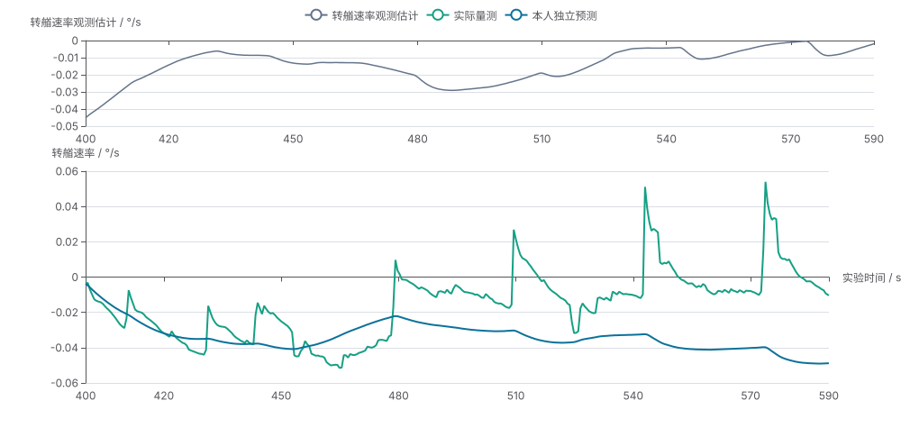

# 实验06 雪龙2号吊舱与冰区控制

课程版本 seven-vessel-2026.11.14，指导书版本 2026.11.25。

## 课程卡

船舶与海洋工程、自动化本科高年级，极地船舶控制综合实验

先修知识包括局部系统辨识、饱和和稳定性、反馈与模型失配。

设计用时为预习25分钟、操作分析120分钟、报告35分钟，合计180分钟。

用时为教学设计起点。任课教师结合学校课时长度、课前课后安排和实际试教学记录登记课表。七个实验分别启动、完成和复核，可按课程安排组合使用。

- 辨识吊舱与开水局部响应并检验方向。认知层级为分析，通过第1、2、3、4、5、6步形成证据。
- 解释冰接触与工况模型失配。认知层级为分析与鲁棒设计，通过第7、8、9、10、11、12步形成证据。
- 比较受限推进、调度与航向方案。认知层级为设计与评价，通过第13、14、15、16、17、18步形成证据。
- 依据未见冰况和故障作出停止或继续的判断。认知层级为工程判断，通过第19、20步形成证据。

## 原型、物理对象与参数

双吊舱、有限冰板破坏、浮冰接触、船体反作用与冰接触能量。冰区范围和实际航迹随记录保存。

物理对象保留纵荡、横荡、升沉、横摇、纵摇与艏摇。世界坐标为北、东、下，船体坐标为艏、右舷、下。正航向为俯视顺时针。力矩按实际作用点的叉积计算。

| 默认教学参数 | 数值 | 单位 | 来源等级 |
| --- | --- | --- | --- |
| 教学排水质量 | 14300000.0000 | kg | T / 同一冻结装配 |
| 默认吃水 | 8.3000 | m | T / 同一冻结装配 |
| 默认有效横稳心高 | 1.4000 | m | T / 同一冻结装配 |

P表示公开原型资料，B表示公开基准，D表示计算与校准，T表示教学设定。上表为冻结装配的默认教学值。装载、姿态和工况变化后的参数按本次运行显示并记录。原始数值残差、参数来源和有效域随版本保存。

条带冰板和有限浮冰采用T级低阶教学近似。实际冰场、接触载荷、能量和控制约束可复核，原型定量校准的缺口单独登记。

## 本人理想模型与独立对照

分别建立本人开水和冰区局部转艏模型。带符号时间常数及非稳态初值按实际辨识结果保留，并用独立窗口判断适用域。

本人局部模型用于固定与冰厚调度控制，比较速度PI、功率余量、冰厚/强度、航向补偿与单吊舱卡滞。

三维船体由物理对象的实际受力推进。仪器提供带采样时刻、延迟和质量标志的量测，观测器据此形成状态估计。本人理想模型从所选量测窗口辨识，并独立生成预测曲线。

A模式以实际执行器量测检验局部模型。B模式使用指令和声明的执行器模型，或已包含执行器的联合模型。C模式以本人模型的独立反馈预测闭环。每种对照均保存模型版本、输入通道、单位和窗口，训练与独立验证分别取证。

图1采用同课程版本的软件验收记录，并保留原始预测偏差。图中量测、观测估计及预测按各自标签读取。

## 二十步目录

| 步骤 | 名称 | 页码 |
| --- | --- | --- |
| 1 | [认识双吊舱通道](#icebreaker-step-1) | 3 |
| 2 | [测量吊舱伺服](#icebreaker-step-2) | 4 |
| 3 | [辨识开水局部模型](#icebreaker-step-3) | 5 |
| 4 | [独立验证开水模型](#icebreaker-step-4) | 6 |
| 5 | [设计开水航向控制](#icebreaker-step-5) | 7 |
| 6 | [比较低速能力](#icebreaker-step-6) | 8 |
| 7 | [选择波浪噪声滤波](#icebreaker-step-7) | 9 |
| 8 | [标注首次冰接触](#icebreaker-step-8) | 10 |
| 9 | [核对接触断裂与功](#icebreaker-step-9) | 11 |
| 10 | [检验入冰模型失配](#icebreaker-step-10) | 12 |
| 11 | [辨识冰区局部模型](#icebreaker-step-11) | 13 |
| 12 | [比较冰厚影响](#icebreaker-step-12) | 14 |
| 13 | [比较冰强度影响](#icebreaker-step-13) | 16 |
| 14 | [比较两工况调度](#icebreaker-step-14) | 17 |
| 15 | [选择转向参考斜坡](#icebreaker-step-15) | 18 |
| 16 | [比较冰区推进速度](#icebreaker-step-16) | 19 |
| 17 | [形成综合策略](#icebreaker-step-17) | 20 |
| 18 | [比较第二策略](#icebreaker-step-18) | 21 |
| 19 | [验证未见冰况与故障](#icebreaker-step-19) | 22 |
| 20 | [完成实验报告](#icebreaker-step-20) | 23 |

## 二十步操作、证据与评价

### 第1步 认识双吊舱通道

| 项目 | 本步要求 |
| --- | --- |
| 目标与认知 | 辨识双全回转吊舱的矢量推力方向、转艏力臂与六自由度耦合通道，明确其与传统舵船及功率/推力量纲的边界。（分析） |
| 能力证据 | 辨识吊舱与开水局部响应并检验方向 |
| 初态与条件 | 平静无风浪流开阔水域，无测量附加噪声，初始对水航速 4.0 m/s 零偏转直航 60 秒。（初始对水航速 / m/s 4） |
| 本步启用因素 | P0、N0 |
| 合同参数范围 | 比例增益相对本人模型建议值 0.2-3倍 |
| 三阶段操作流程 | 1. 运行前在预测区选择双吊舱转向原理及与传统单舵船的本质区别。 2. 点击控制区「开始」运行 60 秒平静开阔水域直航，观察左侧推进器实时读数与航行姿态。 3. 在下方通道配对卡依次完成 6 项物理量归类，填写物理依据后提交。 |
| 阶段一 · 运行前预测 | 定向选择判断：双全回转吊舱破冰船与传统舵桨船相比，在推进与航向转向通道上的核心结构差异是什么？；候选项：无传统独立舵叶，由左右双全回转吊舱转向带动推力矢量偏转，兼顾推进与转艏并伴随六自由度耦合；吊舱只负责纵向推动，转向完全靠艉部独立的被动平板舵完成；吊舱偏转仅改变纯转艏力矩，推力与机械功率单位可以互相直接等价替换 |
| 阶段二 · 观测与提取 | 通道物理角色配对：对照左侧推进器状态面板与实时曲线，将下列 6 个核心物理量匹配至正确的通道定义：；配对项目：左舷吊舱偏转 (°)、右舷吊舱偏转 (°)、单机推力 (kN)、正机械功率 (MW)、实际等效偏转 (°)、横摇与纵摇 (°) |
| 阶段三 · 解释核对 | 1. 明确区分单机推力 (kN) 与正机械功率 (MW) 2. 说明无传统独立舵叶的双吊舱一体化机理 3. 解释吊舱偏心推力引发多自由度耦合的成因 |
| 评估工作台要点 | 评估工作台：按本船教学流程依次完成物理激励采样、局部模型冻结与独立验证对照。 |
| 事件与操作 | 开阔水60s |
| 时长与结束 | 60s，运行至60s |
| 量测与统计窗 | 左吊舱偏转、右吊舱偏转、左轴转速、右轴转速、航向、转艏速率、对水航速、北向位置、东向位置，0-60s |
| 最少运行 | 1组实际记录 |
| 训练与验证 | 训练或方案设计 |
| 提交工件 | 运行前预测、实际运行记录、证据解释 |
| 评价 | 预测0.9分，证据1.2分，性能0分，解释0.9分，推进/转向一体化，kW与kN区别 |
| 观察问题 | 标注双吊舱推力方向、力臂、6DOF及无传统舵 |
| 常见误判与核对 | 把冰阻、推进器实际功率、速度降低、偏转变化和模型失配串联到同一份证据。到达、走廊和能耗资格逐项核对。 |

先完成阶段一预测（含必需的坐标轴多模态手绘），再运行仿真并用阶段二结构化观测/一键提取记录实测证据，最后按阶段三核对清单解释差异。实际未达目标、缺测或保护退出的记录与分析继续保存。

### 第2步 测量吊舱伺服

| 项目 | 本步要求 |
| --- | --- |
| 目标与认知 | 实测双吊舱对 ±3° 等效偏转阶跃指令的跟随响应，估计伺服滞后与转向速率限制，并辨识冻结吊舱伺服模型。（分析） |
| 能力证据 | 辨识吊舱与开水局部响应并检验方向 |
| 初态与条件 | 平静无风浪流开阔水域，无测量噪声，初始航速 4.0 m/s，t=20 s 起依次施加 +3°、-3°、0° 等效偏转指令，总时长 180 秒。（初始对水航速 / m/s 4） |
| 本步启用因素 | P0、N0 |
| 合同参数范围 | 比例增益相对本人模型建议值 0.2-3倍 |
| 三阶段操作流程 | 1. 运行前判断吊舱执行器面对阶跃方位指令时是否受限于惯性滞后与最大转向速率。 2. 点击「开始」完成 180 秒阶跃运行（t=20 s 偏转 +3°、t=80 s 切至 -3°、t=140 s 回 0°）。 3. 前往「评估」页签选择「等效偏转指令 → 实际偏转」与一阶惯性与时延结构，框选 15-150 s 辨识并冻结伺服模型，再回填下方读数。 |
| 阶段一 · 运行前预测 | 定向选择判断：当控制指令要求双吊舱方位在 t=20 s 从 0° 瞬时阶跃至 +3° 时，实际等效偏转角如何变化？；候选项：受伺服机械惯性与最大转向角速率约束，实际等效偏转呈带斜坡与滞后的平滑过渡，无法瞬时跳变；实际等效偏转角在 0 秒内立即精确跳变到 +3° 并保持不变；吊舱会先向 -3° 反向偏转再回到 0° |
| 阶段二 · 观测与提取 | 结构化指标读数（支持从曲线一键提取）：在「评估」页签冻结伺服模型后，从曲线读取实际等效偏转峰值并填入冻结伺服参数：；读数指标：实际等效偏转峰值(°)、180 s 末态等效偏转(°)、冻结伺服静态增益 K(°/°)、冻结伺服时间常数 T(s)、伺服纯时延 L 与速率印象(s) |
| 阶段三 · 解释核对 | 1. 报告冻结伺服模型的 K、T、L 与拟合残差 2. 说明执行器角度不能瞬时跳变的速率限制约束 3. 指出未计及伺服滞后对高速航向闭环稳定裕度的影响 |
| 评估工作台要点 | 第 2 步评估目标：在 ±3° 偏转阶跃窗口辨识并冻结「等效偏转指令 → 实际偏转」吊舱伺服模型。 开放通道：等效偏转指令 → 实际偏转 |
| 事件与操作 | U0=4，吊舱±3°阶跃，180s |
| 时长与结束 | 180s，运行至180s |
| 量测与统计窗 | 左吊舱偏转、右吊舱偏转、左轴转速、右轴转速、航向、转艏速率、对水航速、北向位置、东向位置，0-180s |
| 最少运行 | 1组实际记录 |
| 训练与验证 | 训练或方案设计 |
| 提交工件 | 运行前预测、实际运行记录、证据解释 |
| 评价 | 预测0.9分，证据1.2分，性能0分，解释0.9分，执行器状态不能直接跳变 |
| 观察问题 | 比较指令/实际角度，估计伺服与速率限制 |
| 常见误判与核对 | 把冰阻、推进器实际功率、速度降低、偏转变化和模型失配串联到同一份证据。到达、走廊和能耗资格逐项核对。 |

先完成阶段一预测（含必需的坐标轴多模态手绘），再运行仿真并用阶段二结构化观测/一键提取记录实测证据，最后按阶段三核对清单解释差异。实际未达目标、缺测或保护退出的记录与分析继续保存。

### 第3步 辨识开水局部模型

| 项目 | 本步要求 |
| --- | --- |
| 目标与认知 | 在开阔水域 +3° 等效偏转阶跃下，手绘转艏速率响应预期并辨识冻结「双吊舱等效偏转 → 转艏速率」开水局部模型。（分析） |
| 能力证据 | 辨识吊舱与开水局部响应并检验方向 |
| 初态与条件 | 平静无风浪流开阔水域，无测量噪声，初始航速 4.0 m/s，t=20 s 自动施加 +3° 双吊舱等效偏转阶跃，总时长 300 秒。（初始对水航速 / m/s 4） |
| 本步启用因素 | P0、N0 |
| 合同参数范围 | 比例增益相对本人模型建议值 0.2-3倍 |
| 三阶段操作流程 | 1. 运行前输入预估稳态转艏速率，并在坐标系手绘板绘制 t=20 s 等效偏转 +3° 后的转艏速率曲线。 2. 点击「开始」完成 300 秒开水阶跃运行，并在手绘板核对自动叠加的实测转艏速率曲线。 3. 前往「评估」页签选「双吊舱等效偏转 → 转艏速率」与一阶模型，框选阶跃响应段（如 0-120 s）点击「辨识并冻结模型」，返回本栏引用摘要。 |
| 阶段一 · 运行前预测 | 定量数值预估：预估 4.0 m/s 开水工况下施加 +3° 等效偏转后转艏速率的近似稳态值 (°/s)，并在坐标系手绘响应曲线：；坐标轴多模态手绘板「运行前手绘预测：t=20 s 等效偏转 +3° 后的转艏速率响应」：在 0-300 s、-0.2 至 1.5 °/s 坐标系中从 0 起笔，于 t=20 s 蓝色虚线后画出转艏速率爬升至稳态的曲线。 |
| 阶段二 · 观测与提取 | 模型或独立对照作品绑定：在「评估」页签冻结开水一阶转向模型后，点击下方按钮一键引用局部模型 K、T 与训练残差摘要：；绑定工件：冻结局部模型 |
| 阶段三 · 解释核对 | 1. 报告冻结开水模型的 K、T 与残差 2. 阐明以实际等效偏转作输入的原因 3. 说明转向伴随的横移与横摇耦合效应 |
| 评估工作台要点 | 第 3 步评估目标：辨识并冻结开阔水域「双吊舱等效偏转 → 转艏速率」航向局部模型。 开放通道：双吊舱等效偏转 → 转艏速率 |
| 事件与操作 | U0=4，等效偏转+3°，300s |
| 时长与结束 | 300s，运行至300s |
| 量测与统计窗 | 左吊舱偏转、右吊舱偏转、左轴转速、右轴转速、航向、转艏速率、对水航速、北向位置、东向位置，0-300s |
| 最少运行 | 1组实际记录 |
| 训练与验证 | 训练或方案设计 |
| 提交工件 | 运行前预测、实际运行记录、证据解释 |
| 评价 | 预测0.9分，证据1.2分，性能0分，解释0.9分，实际输入定义、横移/艏摇耦合 |
| 观察问题 | 选窗口辨识航向局部K/T |
| 常见误判与核对 | 把冰阻、推进器实际功率、速度降低、偏转变化和模型失配串联到同一份证据。到达、走廊和能耗资格逐项核对。 |

先完成阶段一预测（含必需的坐标轴多模态手绘），再运行仿真并用阶段二结构化观测/一键提取记录实测证据，最后按阶段三核对清单解释差异。实际未达目标、缺测或保护退出的记录与分析继续保存。

### 第4步 独立验证开水模型

| 项目 | 本步要求 |
| --- | --- |
| 目标与认知 | 在不重拟合的前提下，以第 3 步冻结的开水模型独立验证 -2° 反向阶跃新运行，检验小信号外推精度与非对称残差。（分析） |
| 能力证据 | 辨识吊舱与开水局部响应并检验方向 |
| 初态与条件 | 平静无风浪流开阔水域，无测量噪声，初始航速 4.0 m/s，t=20 s 自动施加 -2° 等效偏转反向阶跃（独立留出验证），总时长 300 秒。（初始对水航速 / m/s 4） |
| 本步启用因素 | P0、N0 |
| 合同参数范围 | 比例增益相对本人模型建议值 0.2-3倍 |
| 三阶段操作流程 | 1. 运行前判断基于 +3° 辨识的开水模型直接预测 -2° 反向偏转新运行时的误差特征。 2. 点击「开始」完成 300 秒 -2° 反向偏转开水运行。 3. 前往「评估」页签选中第 3 步开水模型执行独立对照（严禁重新辨识），回到本栏一键引用验证 RMSE 与 FIT。 |
| 阶段一 · 运行前预测 | 定向选择判断：用第 3 步 +3° 数据冻结的开水线性模型，直接预测本步 -2° 反向新运行的转艏速率响应，结果最可能如何？；候选项：整体趋势与稳态符号吻合且 FIT 较高，仅因幅值降速与水动力非线性存在轻微外推残差；独立验证集残差严格等于零且与实测曲线完全重合；模型预测转艏速率的符号会与实测完全相反 |
| 阶段二 · 观测与提取 | 模型或独立对照作品绑定：在「评估」页签以第 3 步冻结模型运行独立对照后，点击一键引用留出验证集的 RMSE 与 FIT 摘要：；绑定工件：独立对照曲线与指标 |
| 阶段三 · 解释核对 | 1. 对比第 3 步训练残差与第 4 步独立验证误差 2. 解释水动力阻尼与减速耦合引发的残差来源 3. 明确开水局部模型在小幅值转向内的适用边界 |
| 评估工作台要点 | 第 4 步评估目标：直接选用第 3 步冻结模型对 -2° 开水运行执行独立留出对照。 开放通道：双吊舱等效偏转 → 转艏速率 |
| 事件与操作 | 新run，-2°，300s |
| 时长与结束 | 300s，运行至300s |
| 量测与统计窗 | 左吊舱偏转、右吊舱偏转、左轴转速、右轴转速、航向、转艏速率、对水航速、北向位置、东向位置，0-300s |
| 最少运行 | 1组实际记录 |
| 训练与验证 | 独立验证 |
| 提交工件 | 运行前预测、实际运行记录、证据解释 |
| 评价 | 预测0.9分，证据1.2分，性能0分，解释0.9分，独立验证，不使用同一训练序列自证 |
| 观察问题 | 冻结模型叠加预测与实际响应 |
| 常见误判与核对 | 把冰阻、推进器实际功率、速度降低、偏转变化和模型失配串联到同一份证据。到达、走廊和能耗资格逐项核对。 |

先完成阶段一预测（含必需的坐标轴多模态手绘），再运行仿真并用阶段二结构化观测/一键提取记录实测证据，最后按阶段三核对清单解释差异。实际未达目标、缺测或保护退出的记录与分析继续保存。

### 第5步 设计开水航向控制

| 项目 | 本步要求 |
| --- | --- |
| 目标与认知 | 基于本人冻结开水模型设计并比较两组不同增益的航向闭环控制器，对比理想模型闭环预测与双吊舱受限实船响应。（设计） |
| 能力证据 | 辨识吊舱与开水局部响应并检验方向 |
| 初态与条件 | 平静无风浪流开阔水域，无测量噪声，初始航速 4.0 m/s，t=20 s 起 10 秒斜坡转向 +10°，航速 PI 开启，对比两组不同增益方案各 400 秒。（初始对水航速 / m/s 4） |
| 本步启用因素 | P0、N0 |
| 合同参数范围 | 比例增益相对本人模型建议值 0.2-3倍 |
| 三阶段操作流程 | 1. 运行前判断调高比例增益倍率对 10° 航向阶跃响应速度、超调量及双吊舱动作幅度的影响。 2. 保持控制模式一致（推荐均关闭积分），先以基准倍率（Kp=1.0、Kd=1.0）点击「冻结独立航向预测」后运行 400 秒。 3. 点击「重置」，调整 Kp 或 Kd 倍率（如 Kp=1.8），再次冻结预测并运行 400 秒，随后在下方两槽分别提取实测读数。 |
| 阶段一 · 运行前预测 | 定向选择判断：保持同一冻结开水模型与阻尼结构，显著增大比例增益倍率 Kp 时，开阔水域 10° 航向阶跃闭环通常如何变化？；候选项：起步转向加快、调节时间缩短，但超调量增大且易触发吊舱转向速率或偏角限幅，甚至加剧理想预测与实船差异；增大 Kp 会使吊舱偏转角变得更小、航向收敛明显变慢；无论增益多大，双吊舱实船曲线与理想线性闭环预测始终丝毫不差 |
| 阶段二 · 观测与提取 | 多工况槽位对比读数（支持分槽位一键提取）：完成两组不同增益倍率的 400 秒闭环运行后，点击各工况槽「一键提取本工况读数」采集实测对比指标：；工况槽位：第一组：基准增益设计 (1.0×)[增益配置、航向峰值(°)、等效偏转峰值(°)、末态航向(°)]；第二组：调整增益对照[增益配置、航向峰值(°)、等效偏转峰值(°)、末态航向(°)] |
| 阶段三 · 解释核对 | 1. 定量对比两组增益的超调量与等效偏转峰值 2. 分析理想预测与双吊舱受限实际闭环的差异 3. 确定兼具响应速度与阻尼余量的稳健增益 |
| 评估工作台要点 | 评估工作台：按本船教学流程依次完成物理激励采样、局部模型冻结与独立验证对照。 |
| 事件与操作 | 开阔水10°航向阶跃，400s |
| 时长与结束 | 400s，运行至400s |
| 量测与统计窗 | 左吊舱偏转、右吊舱偏转、左轴转速、右轴转速、航向、转艏速率、对水航速、北向位置、东向位置，0-400s |
| 最少运行 | 2组实际记录 |
| 训练与验证 | 训练或方案设计 |
| 提交工件 | 运行前预测、实际运行记录、证据解释 |
| 评价 | 预测1.2分，证据1.6分，性能0分，解释1.2分，理想闭环与实际双吊舱闭环 |
| 观察问题 | 设计并比较两组PD/PID |
| 常见误判与核对 | 把冰阻、推进器实际功率、速度降低、偏转变化和模型失配串联到同一份证据。到达、走廊和能耗资格逐项核对。 |

先完成阶段一预测（含必需的坐标轴多模态手绘），再运行仿真并用阶段二结构化观测/一键提取记录实测证据，最后按阶段三核对清单解释差异。实际未达目标、缺测或保护退出的记录与分析继续保存。

### 第6步 比较低速能力

| 项目 | 本步要求 |
| --- | --- |
| 目标与认知 | 在 0.5 m/s 极低速与 4.0 m/s 巡航初速下检验开阔水域航向控制能力，对比双吊舱矢量推进与传统舵船低速操控机理差异。（设计） |
| 能力证据 | 辨识吊舱与开水局部响应并检验方向 |
| 初态与条件 | 平静无风浪流开阔水域，无测量噪声，t=20 s 起 10 秒斜坡转向 +10°，固定控制器分别测试 0.5 m/s 与 4.0 m/s 初始航速各 400 秒。（初始对水航速 / m/s 4） |
| 本步启用因素 | P0、N0 |
| 合同参数范围 | 比例增益相对本人模型建议值 0.2-3倍 |
| 三阶段操作流程 | 1. 运行前判断双吊舱在 0.5 m/s 极低速下的转艏控制能力，以及沿用 4.0 m/s 开水模型进行预测可能出现的误差。 2. 固定第 5 步控制器增益与模型，依次选择初始航速 4.0 m/s 与 0.5 m/s，每次先点击「冻结独立航向预测」再完成 400 秒运行。 3. 在下方两档航速槽一键提取航向峰值、末态航向与等效偏转，结合机理阐明低速控制特性。 |
| 阶段一 · 运行前预测 | 定向选择判断：当初始航速从 4.0 m/s 降至 0.5 m/s 极低速时，双全回转吊舱控制与传统平板舵船相比最突出的区别是什么？；候选项：双吊舱靠螺旋桨射流矢量转向，0.5 m/s 下仍具备强控制能力，而传统舵船舵效按来流速度平方锐减；但局部模型 K/T 仍随工况变化；双吊舱与传统平板舵完全相同，0.5 m/s 时会彻底丧失转艏力矩；4.0 m/s 与 0.5 m/s 两个工作点的转向增益 K 与时间常数 T 完全一致 |
| 阶段二 · 观测与提取 | 多工况槽位对比读数（支持分槽位一键提取）：完成 4.0 m/s 与 0.5 m/s 两次 400 秒运行后，一键提取各自航向控制表现：；工况槽位：4.0 m/s 巡航基准工况[初始航速(m/s)、航向峰值(°)、等效偏转峰值(°)、末态航向(°)]；0.5 m/s 极低速工况[初始航速(m/s)、航向峰值(°)、等效偏转峰值(°)、末态航向(°)] |
| 阶段三 · 解释核对 | 1. 验证双吊舱在 0.5 m/s 低速下仍能有效转向 2. 说明低速响应与 4.0 m/s 模型预测之间的工作点偏差 3. 对比双吊舱矢量推进与常规舵船的工程适用边界 |
| 评估工作台要点 | 评估工作台：按本船教学流程依次完成物理激励采样、局部模型冻结与独立验证对照。 |
| 事件与操作 | U0=.5/4两工况，400s |
| 时长与结束 | 400s，运行至400s |
| 量测与统计窗 | 左吊舱偏转、右吊舱偏转、左轴转速、右轴转速、航向、转艏速率、对水航速、北向位置、东向位置，0-400s |
| 最少运行 | 2组实际记录 |
| 训练与验证 | 训练或方案设计 |
| 提交工件 | 运行前预测、实际运行记录、证据解释 |
| 评价 | 预测1.2分，证据1.6分，性能0分，解释1.2分，低速控制能力与舵船差异 |
| 观察问题 | 原模型预测，再观察/辨识低速响应 |
| 常见误判与核对 | 把冰阻、推进器实际功率、速度降低、偏转变化和模型失配串联到同一份证据。到达、走廊和能耗资格逐项核对。 |

先完成阶段一预测（含必需的坐标轴多模态手绘），再运行仿真并用阶段二结构化观测/一键提取记录实测证据，最后按阶段三核对清单解释差异。实际未达目标、缺测或保护退出的记录与分析继续保存。

### 第7步 选择波浪噪声滤波

| 项目 | 本步要求 |
| --- | --- |
| 目标与认知 | 在开阔水域波浪与测量噪声下对比不同微分滤波时间常数，权衡控制抖动抑制、相位滞后与回转速率平滑度。（设计） |
| 能力证据 | 解释冰接触与工况模型失配 |
| 初态与条件 | 开阔水域轻度不规则波浪干扰并叠加测量噪声，初始航速 4.0 m/s，t=20 s 起 10 秒斜坡转向 +10°，固定控制器对比至少两档微分滤波时间常数各 600 秒。（初始对水航速 / m/s 4） |
| 本步启用因素 | V1、N1 |
| 合同参数范围 | 比例增益相对本人模型建议值 0.2-3倍 |
| 三阶段操作流程 | 1. 运行前判断增大测量微分滤波时间常数对吊舱高频摆动幅度、转艏平稳性及响应滞后的双面效应。 2. 保持模型、增益与航速完全不变，先以 0.2 s 滤波时间常数点击「冻结独立航向预测」并运行 600 秒。 3. 点击「重置」，切换至 1.0 s 或 3.0 s 滤波时间常数，重新冻结预测并运行 600 秒，提取两档实测对照。 |
| 阶段一 · 运行前预测 | 定向选择判断：面对叠加波浪扰动与传感器高频噪声的航向量测，把微分滤波时间常数由 0.2 s 增大至 3.0 s 会带来什么权衡？；候选项：有效滤除波频与噪声引发的吊舱高频摆动与机械磨耗，但引入显著相位滞后可能放大超调或拖慢调节；既彻底消除全部吊舱抖动，又没有任何相位延迟或超调变化；滤波时间常数越大，微分环节放大的高频传感器噪声反而越剧烈 |
| 阶段二 · 观测与提取 | 多工况槽位对比读数（支持分槽位一键提取）：完成至少两档滤波时间常数的 600 秒运行后，一键提取各自等效偏转峰值、转艏速率与稳态航向：；工况槽位：弱滤波档（0 或 0.2 s）[滤波时间常数(s)、等效偏转峰值(°)、转艏速率峰值(°/s)、末态航向(°)]；强滤波档（1.0 或 3.0 s）[滤波时间常数(s)、等效偏转峰值(°)、转艏速率峰值(°/s)、末态航向(°)] |
| 阶段三 · 解释核对 | 1. 对比两档滤波下等效偏转抖动幅度与稳态航向 2. 阐明噪声抑制与控制相位滞后的物理权衡 3. 给出平衡执行器疲劳与航向精度的选型结论 |
| 评估工作台要点 | 评估工作台：按本船教学流程依次完成物理激励采样、局部模型冻结与独立验证对照。 |
| 事件与操作 | V1+N1开阔水，600s |
| 时长与结束 | 600s，运行至600s |
| 量测与统计窗 | 左吊舱偏转、右吊舱偏转、左轴转速、右轴转速、航向、转艏速率、对水航速、北向位置、东向位置，0-600s |
| 最少运行 | 2组实际记录 |
| 训练与验证 | 训练或方案设计 |
| 提交工件 | 运行前预测、实际运行记录、证据解释 |
| 评价 | 预测1.2分，证据1.6分，性能0分，解释1.2分，波浪/测量噪声/回转速率权衡 |
| 观察问题 | 比较滤波tau及控制动作 |
| 常见误判与核对 | 把冰阻、推进器实际功率、速度降低、偏转变化和模型失配串联到同一份证据。到达、走廊和能耗资格逐项核对。 |

先完成阶段一预测（含必需的坐标轴多模态手绘），再运行仿真并用阶段二结构化观测/一键提取记录实测证据，最后按阶段三核对清单解释差异。实际未达目标、缺测或保护退出的记录与分析继续保存。

### 第8步 标注首次冰接触

| 项目 | 本步要求 |
| --- | --- |
| 目标与认知 | 在 0.30 m 平整冰区开展直航入冰试验，手绘预测冰接触纵向阻力历程，标定首次冰接触时刻并核对六自由度动力学响应。（设计） |
| 能力证据 | 解释冰接触与工况模型失配 |
| 初态与条件 | 无风浪流、无测量噪声平整冰区（北向 200-700 m，冰厚 0.30 m、抗弯强度 0.50 MPa），初始航速 1.0 m/s 直航，最长 1200 秒或抵达 800 m。（初始对水航速 / m/s 1） |
| 本步启用因素 | P0、N0 |
| 合同参数范围 | 比例增益相对本人模型建议值 0.2-3倍 |
| 三阶段操作流程 | 1. 运行前在预测区选择入冰后多通道耦合响应判断，并在下方坐标系手绘 0-1200 秒冰接触纵向阻力预期曲线。 2. 点击「开始」以 1.0 m/s 初速直航入冰完成运行（到达北向 800 m 或 1200 s 结束），观察手绘板自动叠合的实测阻力曲线。 3. 前往「评估」页签点击「定位首次接触前后1秒」读取首次接触时刻，回填阻力峰值、航速及横纵摇读数。 |
| 阶段一 · 运行前预测 | 定向选择判断：当破冰船以 1.0 m/s 从开阔水驶入 0.30 m 平整冰区发生首次船冰接触时，船体各通道将呈现何种响应？；候选项：冰接触纵向阻力陡增并伴有锯齿脉动，使对水航速迅速下降，同时船艏倾斜挤压激发纵摇与横摇多自由度响应；仅转向模型的系数符号微变，航速、横摇与纵摇在入冰前后全程保持完全恒定；冰板挤压反作用力会推动船体加速前进，使航速高于 1.0 m/s；坐标轴多模态手绘板「运行前手绘预测：入冰过程冰接触纵向阻力历程 (0-1200 s)」：在 0-1200 s、-50 至 2500 kN 坐标系中画出入冰前 0 kN 平直段，以及入冰接触过渡区起始后锯齿上升与离冰回落趋势。 |
| 阶段二 · 观测与提取 | 结构化指标读数（支持从曲线一键提取）：运行结束后前往「评估」页签点击「定位首次接触前后1秒」读取接触时刻，并从曲线读取阻力、航速与横纵摇指标：；读数指标：首次冰接触时刻(s)、冰接触纵向阻力峰值(kN)、入冰通行末态航速(m/s)、入冰过程横摇峰值(°)、入冰过程纵摇峰值(°) |
| 阶段三 · 解释核对 | 1. 标明实测首次接触时刻与入冰前后航速变化 2. 分析冰力引起的纵摇、横摇与纵向减速六自由度特征 3. 对照手绘曲线阐述实际锯齿冰阻与开水阻力的机理差异 |
| 评估工作台要点 | 冰接触证据分析：运行入冰记录并定位首次破冰接触时刻，核对六维接触载荷。 |
| 事件与操作 | h=.30m，入冰1m/s |
| 时长与结束 | 1200s，抵达北向800m或运行至1200s，保留停滞与未完成结果 |
| 量测与统计窗 | 左吊舱偏转、右吊舱偏转、左轴转速、右轴转速、航向、转艏速率、对水航速、北向位置、东向位置，0-1200s |
| 最少运行 | 1组实际记录 |
| 训练与验证 | 训练或方案设计 |
| 提交工件 | 运行前预测、实际运行记录、证据解释 |
| 评价 | 预测1.2分，证据1.6分，性能0分，解释1.2分，冰力作用于6DOF，不是仅K/T变色 |
| 观察问题 | 预测入冰后速度、横摇/纵摇变化，运行并标注首次接触 |
| 常见误判与核对 | 把冰阻、推进器实际功率、速度降低、偏转变化和模型失配串联到同一份证据。到达、走廊和能耗资格逐项核对。 |

先完成阶段一预测（含必需的坐标轴多模态手绘），再运行仿真并用阶段二结构化观测/一键提取记录实测证据，最后按阶段三核对清单解释差异。实际未达目标、缺测或保护退出的记录与分析继续保存。

### 第9步 核对接触断裂与功

| 项目 | 本步要求 |
| --- | --- |
| 目标与认知 | 复用第 8 步入冰高采样记录，展开一次压碎-弯折-滑移事件并核对接触力、力矩与各类耗散功守恒。（综合设计） |
| 能力证据 | 解释冰接触与工况模型失配 |
| 初态与条件 | 复用第 8 步 0.30 m 平整冰区实测记录开展离线接触事件与能量核对（本步为分析步，无需启动新仿真）。（初始对水航速 / m/s 1） |
| 本步启用因素 | P0、N0 |
| 合同参数范围 | 比例增益相对本人模型建议值 0.2-3倍 |
| 三阶段操作流程 | 1. 运行前先在预测区判断高频冰阻力脉冲与多类耗散功产生的力学因果链。 2. 前往右侧「评估」页签打开第 8 步运行记录，点击「定位首次接触前后1秒」，依次切换「接触力真值」「接触力矩真值」与「累计功与耗散真值」。 3. 在下方引用关联证据摘要并在备注栏记录压碎、弯折、摩擦、水阻耗散与船体/浮冰接触功读数后提交（本步无需新运行）。 |
| 阶段一 · 运行前预测 | 定向选择判断：第 8 步入冰过程中观测到的锯齿状高频力脉冲与能量消耗，其真实力学来源是什么？；候选项：船体与冰缘间周期性的挤压压碎-弯折断裂-碎冰滑移清排过程，伴随压碎、弯折、摩擦与浮冰水阻耗散做功；后台在固定时间戳随机叠加的伪脉冲序列，与船舶位置及冰参数无关；破冰过程属于完全弹性碰撞，所有接触功在离冰后全额返还船体动能 |
| 阶段二 · 观测与提取 | 模型或独立对照作品绑定：在「评估」页签核对第 8 步首次接触窗的力/力矩峰值及压碎、弯折、摩擦、水阻耗散与接触功后，可引用已有对比摘要并在备注中逐项记下实际能量与力读数：；绑定工件：受限控制与能力包络 |
| 阶段三 · 解释核对 | 1. 还原一次压碎-弯折-滑移事件中力与力矩变化顺序 2. 写出压碎、弯折、摩擦、浮冰水阻与接触功的量级关系 3. 证明接触载荷脉动源自真实破冰力学而非人工随机脚本 |
| 评估工作台要点 | 冰接触证据分析：打开第 8 步含冰接触记录，展开压碎-弯折-滑移事件并核对力与功。 |
| 事件与操作 | 整理本人已有证据 |
| 时长与结束 | 分析步骤，引用本人记录完成六部分报告 |
| 量测与统计窗 | 左吊舱偏转、右吊舱偏转、左轴转速、右轴转速、航向、转艏速率、对水航速、北向位置、东向位置，0-1200s |
| 最少运行 | 0组已有证据，按本步工件要求引用 |
| 训练与验证 | 汇总分析 |
| 提交工件 | 至少六组本人运行、冻结模型、独立验证、六部分报告 |
| 评价 | 预测1.5分，证据1分，性能1分，解释1.5分，断裂与耗散，脉冲来自接触而非随机脚本 |
| 观察问题 | 在评估页签复用本人第8步记录，选择首次接触窗口，切换冰接触力、力矩与能量通道。 |
| 常见误判与核对 | 把冰阻、推进器实际功率、速度降低、偏转变化和模型失配串联到同一份证据。到达、走廊和能耗资格逐项核对。 |

先完成阶段一预测（含必需的坐标轴多模态手绘），再运行仿真并用阶段二结构化观测/一键提取记录实测证据，最后按阶段三核对清单解释差异。实际未达目标、缺测或保护退出的记录与分析继续保存。

### 第10步 检验入冰模型失配

| 项目 | 本步要求 |
| --- | --- |
| 目标与认知 | 在 0.60 m 平整冰区沿用第 3 步开水模型执行闭环运行与独立对照，定位模型失配时间段并手绘分析航向响应偏差机理。（设计） |
| 能力证据 | 解释冰接触与工况模型失配 |
| 初态与条件 | 无风浪流、无测量噪声平整冰区（冰厚 0.60 m、抗弯强度 0.50 MPa），初始航速 1.0 m/s，闭环沿用第 3 步开水模型（无速度 PI），最长 1200 秒。（初始对水航速 / m/s 1） |
| 本步启用因素 | P0、N0 |
| 合同参数范围 | 比例增益相对本人模型建议值 0.2-3倍 |
| 三阶段操作流程 | 1. 运行前在预测区判断开水冻结模型迁移到 0.60 m 冰区后发生失配的时段特征。 2. 选中第 3 步开水航向模型，点击「冻结独立航向预测」后运行 0.60 m 冰区试验（最长 1200 s 或抵达 800 m）。 3. 前往「评估」页签选用第 3 步开水模型运行本步独立对照（严禁重拟合），在下方指标卡填写失配时刻与 RMSE/FIT，并在「分析对照手绘板」完成轨迹对比标注。 |
| 阶段一 · 运行前预测 | 定向选择判断：把第 3 步 4.0 m/s 开阔水域辨识的航向模型直接用于 0.60 m 平整冰区独立对照时，误差最可能在何时显著放大？；候选项：开水推进段偏差较小，一旦船艏接触 0.60 m 冰板且航速、冰阻与接触力矩剧变，模型预测与实船迅速出现显著失配；因为双吊舱本身未更换，开水模型在 0.60 m 冰区下的 FIT 依然接近 100%；仅在开水起步前 10 秒有误差，进入厚冰区后模型反而变得无比精确；坐标轴多模态手绘板「分析对照手绘：本人冻结模型预测 vs 0.60 m 冰区实测航向响应对比」：坐标系横轴 0-1200 s、纵轴航向响应 -10° 至 +25°（标注 t=20 s 参考）。请对比绘制开水冻结模型预期（主笔）与入冰后实测偏移/失配走势（对比笔），完成后点击「识图核验」叠加模型解析参考。 |
| 阶段二 · 观测与提取 | 结构化指标读数（支持从曲线一键提取）：在「评估」页签以第 3 步开水模型完成独立对照后，记录失配起始时刻与验证误差，并从曲线读取冰阻、航速与航向：；读数指标：显著失配起始时刻(s)、开水模型独立对照 RMSE(°/s)、开水模型独立对照 FIT(%)、冰接触纵向阻力峰值(kN)、末态对水航速(m/s)、末态航向量测(°) |
| 阶段三 · 解释核对 | 1. 定位并定量描述开水模型失配时间段 2. 给出独立对照的 RMSE/FIT 与实测航速降幅 3. 论证工况改变导致原局部模型有效域失效的因果机制 |
| 评估工作台要点 | 第 10 步评估目标：使用开水冻结模型对照 0.60 m 冰区运行，定位模型失配时段与冰接触载荷。 开放通道：双吊舱等效偏转 → 转艏速率 |
| 事件与操作 | h=.60m，冻结开阔水模型 |
| 时长与结束 | 1200s，抵达北向800m或运行至1200s，保留停滞与未完成结果 |
| 量测与统计窗 | 左吊舱偏转、右吊舱偏转、左轴转速、右轴转速、航向、转艏速率、对水航速、北向位置、东向位置，0-1200s |
| 最少运行 | 1组实际记录 |
| 训练与验证 | 训练或方案设计 |
| 提交工件 | 运行前预测、实际运行记录、证据解释 |
| 评价 | 预测1.5分，证据1分，性能1分，解释1.5分，工况改变导致模型有效域失效 |
| 观察问题 | 对比实际与预测航向/速度，定位失配时间段 |
| 常见误判与核对 | 把冰阻、推进器实际功率、速度降低、偏转变化和模型失配串联到同一份证据。到达、走廊和能耗资格逐项核对。 |

先完成阶段一预测（含必需的坐标轴多模态手绘），再运行仿真并用阶段二结构化观测/一键提取记录实测证据，最后按阶段三核对清单解释差异。实际未达目标、缺测或保护退出的记录与分析继续保存。

### 第11步 辨识冰区局部模型

| 项目 | 本步要求 |
| --- | --- |
| 目标与认知 | 在 0.60 m 冰区 ±5° 航向转向激励下划定互不重叠的训练窗与验证窗，辨识冻结冰区局部航向模型并量化不确定性。（设计） |
| 能力证据 | 解释冰接触与工况模型失配 |
| 初态与条件 | 无风浪流、无测量噪声平整冰区（冰厚 0.60 m、抗弯强度 0.50 MPa），初始航速 1.0 m/s，t=20 s 转 +5°、t=300 s 转 -5°，航速 PI 开启，总时长 600 秒。（初始对水航速 / m/s 1） |
| 本步启用因素 | P0、N0 |
| 合同参数范围 | 比例增益相对本人模型建议值 0.2-3倍 |
| 三阶段操作流程 | 1. 运行前判断在 0.60 m 冰区辨识得到的局部模型与第 3 步开水模型在增益、时间常数及拟合残差上的差异。 2. 选中第 3 步开水模型并点击「冻结独立航向预测」，运行 600 秒冰区小转向（t=20 s 转 +5°、t=300 s 转 -5°）。 3. 前往「评估」页签先选定入冰前半段窗口（如 180-360 s）辨识并冻结冰区局部模型；再切换至不重叠的后半段窗口（如 360-580 s）以该冰区模型运行独立对照，最后回到本栏一键引用摘要。 |
| 阶段一 · 运行前预测 | 定向选择判断：相比第 3 步开阔水域局部模型，在 0.60 m 冰区辨识得到的局部转艏模型通常具有什么特征？；候选项：冰接触随机断冰与降速耦合使局部等效增益与时间常数显著改变，拟合残差增大且仅在入冰激励窗口邻域有效；冰区模型参数 K、T 及残差与开阔水域模型完全相同；因为冰层平整，辨识出的冰区线性模型拟合度将严格达到 100% |
| 阶段二 · 观测与提取 | 模型或独立对照作品绑定：在「评估」页签完成冰区局部模型冻结与非重叠独立窗口对照保存后，点击下方按钮一键引用冰区模型参数与独立验证摘要：；绑定工件：冻结局部模型 |
| 阶段三 · 解释核对 | 1. 记录冻结冰区模型 K、T 与训练残差 2. 汇报非重叠验证窗口的独立验证 RMSE 与 FIT 3. 讨论局部线性模型在时变冰接触下的适用域与不确定性 |
| 评估工作台要点 | 第 11 步评估目标：在冰区记录上划定互不重叠的训练窗与验证窗，辨识冰区模型并核对载荷。 开放通道：双吊舱等效偏转 → 转艏速率 |
| 事件与操作 | 冰区小参考±5°，600s |
| 时长与结束 | 600s，抵达北向800m或运行至600s，保留停滞与未完成结果 |
| 量测与统计窗 | 左吊舱偏转、右吊舱偏转、左轴转速、右轴转速、航向、转艏速率、对水航速、北向位置、东向位置，0-600s |
| 最少运行 | 1组实际记录 |
| 训练与验证 | 训练或方案设计 |
| 提交工件 | 运行前预测、实际运行记录、证据解释 |
| 评价 | 预测1.5分，证据1分，性能1分，解释1.5分，时变/非线性下局部模型及不确定性 |
| 观察问题 | 选非重叠训练/验证窗，辨识冰区局部模型 |
| 常见误判与核对 | 把冰阻、推进器实际功率、速度降低、偏转变化和模型失配串联到同一份证据。到达、走廊和能耗资格逐项核对。 |

先完成阶段一预测（含必需的坐标轴多模态手绘），再运行仿真并用阶段二结构化观测/一键提取记录实测证据，最后按阶段三核对清单解释差异。实际未达目标、缺测或保护退出的记录与分析继续保存。

### 第12步 比较冰厚影响

| 项目 | 本步要求 |
| --- | --- |
| 目标与认知 | 保持相同推进计划对比 0.30 m、0.60 m 与 0.90 m 三档平整冰厚，量化冰厚对冰阻、通过速度、功率负荷与停滞时间的非线性作用。（设计） |
| 能力证据 | 解释冰接触与工况模型失配 |
| 初态与条件 | 无风浪流、无测量噪声平整冰区（抗弯强度固定 0.50 MPa），初始航速 1.0 m/s 零航向直行（无速度 PI），分别测试 0.30 m、0.60 m 与 0.90 m 冰厚，最长 1200 秒。（初始对水航速 / m/s 1） |
| 本步启用因素 | P0、N0 |
| 合同参数范围 | 比例增益相对本人模型建议值 0.2-3倍 |
| 三阶段操作流程 | 1. 运行前在预测区按纵向冰接触阻力从小到大排定三档冰厚顺序，并评估厚冰下出现低速停滞的风险。 2. 固定控制模型与增益不变，依次选择平整冰厚 0.30 m、0.60 m 与 0.90 m，每次先点击「冻结独立航向预测」再完成运行。 3. 每组结束后在下方对应冰厚槽一键提取通行耗时、阻力峰值、末态航速与机械功率，对照分析非线性增阻机理。 |
| 阶段一 · 运行前预测 | 因果/性能排序：在相同推进计划下，按预期平均冰接触阻力从小到大（通行能力由易到难）排列三种平整冰厚：；排序对象：0.30 m 薄冰（抗弯破坏门槛较低，可较顺畅破冰保持前进航速）、0.60 m 中等平整冰（阻力与功率显著抬升，航速明显受压）、0.90 m 厚冰（弯曲破坏载荷按厚度的超线性尺度剧增，极易逼近推力上限并发生停滞） |
| 阶段二 · 观测与提取 | 多工况槽位对比读数（支持分槽位一键提取）：完成 0.30 m、0.60 m 与 0.90 m 三档冰厚运行后，分别点击各冰厚槽「一键提取本工况读数」采集定量指标：；工况槽位：平整冰厚 0.30 m[平整冰厚(m)、通行/结束时刻(s)、冰接触纵向阻力峰值(kN)、末态对水航速(m/s)、末态正机械功率(MW)]；平整冰厚 0.60 m[平整冰厚(m)、通行/结束时刻(s)、冰接触纵向阻力峰值(kN)、末态对水航速(m/s)、末态正机械功率(MW)]；平整冰厚 0.90 m[平整冰厚(m)、通行/结束时刻(s)、冰接触纵向阻力峰值(kN)、末态对水航速(m/s)、末态正机械功率(MW)] |
| 阶段三 · 解释核对 | 1. 对比 0.30/0.60/0.90 m 的通行时刻、阻力峰值、航速与功率 2. 解释厚冰致阻的超线性力学依据与停滞阈值 3. 论证冰厚作用为何不能简化为控制器里的任意增益倍数 |
| 评估工作台要点 | 评估工作台：按本船教学流程依次完成物理激励采样、局部模型冻结与独立验证对照。 |
| 事件与操作 | h=.30/.60/.90，同推进计划 |
| 时长与结束 | 1200s，抵达北向800m或运行至1200s，保留停滞与未完成结果 |
| 量测与统计窗 | 左吊舱偏转、右吊舱偏转、左轴转速、右轴转速、航向、转艏速率、对水航速、北向位置、东向位置，0-1200s |
| 最少运行 | 3组实际记录 |
| 训练与验证 | 训练或方案设计 |
| 提交工件 | 运行前预测、实际运行记录、证据解释 |
| 评价 | 预测1.5分，证据1分，性能1分，解释1.5分，冰厚作用不能写成任意增益倍数 |
| 观察问题 | 比较平均冰力、通过速度、功率和卡滞时间 |
| 常见误判与核对 | 把冰阻、推进器实际功率、速度降低、偏转变化和模型失配串联到同一份证据。到达、走廊和能耗资格逐项核对。 |

先完成阶段一预测（含必需的坐标轴多模态手绘），再运行仿真并用阶段二结构化观测/一键提取记录实测证据，最后按阶段三核对清单解释差异。实际未达目标、缺测或保护退出的记录与分析继续保存。

### 第13步 比较冰强度影响

| 项目 | 本步要求 |
| --- | --- |
| 目标与认知 | 固定冰厚 0.60 m 并对比 0.35 MPa 与 0.65 MPa 两种抗弯强度，厘清材料强度敏感性与几何冰厚敏感性不可互换的物理机理。（设计） |
| 能力证据 | 比较受限推进、调度与航向方案 |
| 初态与条件 | 无风浪流、无测量噪声平整冰区（冰厚固定 0.60 m），初始航速 1.0 m/s 零航向直行（无速度 PI），分别对比 0.35 MPa 与 0.65 MPa 抗弯强度，最长 1200 秒。（初始对水航速 / m/s 1） |
| 本步启用因素 | P0、N0 |
| 合同参数范围 | 比例增益相对本人模型建议值 0.2-3倍 |
| 三阶段操作流程 | 1. 运行前先预测抗弯强度从 0.35 MPa 增至 0.65 MPa 对单次破冰断裂载荷、航速衰减与通行时间的影响方向。 2. 固定 0.60 m 冰厚与控制器参数，依次选择抗弯强度 0.35 MPa 与 0.65 MPa，每次先冻结独立航向预测再完成运行。 3. 在下方两档强度槽一键提取实测阻力峰值与末速，对比第 12 步冰厚敏感性总结物理差异。 |
| 阶段一 · 运行前预测 | 定向选择判断：保持冰厚 0.60 m 不变，将冰抗弯强度由 0.35 MPa 提高到 0.65 MPa 时，破冰力学响应最符合哪项规律？；候选项：冰板断裂所需垂直弯矩升高，导致单次破碎阻力峰增大、航速衰减加剧，但其作用幂次与清排惯性不同于冰厚变化；抗弯强度翻倍产生的结果在所有通道上与冰厚翻倍严格完全等效；抗弯强度越高，冰板越脆越容易瞬间碎裂，从而使冰阻力大幅减小 |
| 阶段二 · 观测与提取 | 多工况槽位对比读数（支持分槽位一键提取）：完成 0.35 MPa 与 0.65 MPa 两次同冰厚运行后，点击各槽一键提取强度、时长、阻力峰值与末态航速：；工况槽位：抗弯强度 0.35 MPa[抗弯强度(MPa)、通行/结束时刻(s)、冰接触纵向阻力峰值(kN)、末态对水航速(m/s)]；抗弯强度 0.65 MPa[抗弯强度(MPa)、通行/结束时刻(s)、冰接触纵向阻力峰值(kN)、末态对水航速(m/s)] |
| 阶段三 · 解释核对 | 1. 记录 0.35 与 0.65 MPa 下的阻力峰值与通行表现差异 2. 对比第 12 步冰厚变化，阐明厚度与强度作用机理不可互换 3. 说明冰体力学特性不确定性对固定控制方案的挑战 |
| 评估工作台要点 | 评估工作台：按本船教学流程依次完成物理激励采样、局部模型冻结与独立验证对照。 |
| 事件与操作 | 同h=.60，sigma_f=.35/.65MPa |
| 时长与结束 | 1200s，抵达北向800m或运行至1200s，保留停滞与未完成结果 |
| 量测与统计窗 | 左吊舱偏转、右吊舱偏转、左轴转速、右轴转速、航向、转艏速率、对水航速、北向位置、东向位置，0-1200s |
| 最少运行 | 2组实际记录 |
| 训练与验证 | 训练或方案设计 |
| 提交工件 | 运行前预测、实际运行记录、证据解释 |
| 评价 | 预测1.8分，证据1.2分，性能1.2分，解释1.8分，参数敏感性与机理解释 |
| 观察问题 | 先预测再运行，分析强度与厚度不能互换 |
| 常见误判与核对 | 把冰阻、推进器实际功率、速度降低、偏转变化和模型失配串联到同一份证据。到达、走廊和能耗资格逐项核对。 |

先完成阶段一预测（含必需的坐标轴多模态手绘），再运行仿真并用阶段二结构化观测/一键提取记录实测证据，最后按阶段三核对清单解释差异。实际未达目标、缺测或保护退出的记录与分析继续保存。

### 第14步 比较两工况调度

| 项目 | 本步要求 |
| --- | --- |
| 目标与认知 | 在 0.60 m 冰区转向中对比固定控制器与基于本人双模型的两工况调度律，评估调度跟踪收益、切换平滑度与物理不变性。（设计） |
| 能力证据 | 比较受限推进、调度与航向方案 |
| 初态与条件 | 无风浪流、无测量噪声平整冰区（冰厚 0.60 m、抗弯强度 0.50 MPa），初始航速 1.0 m/s，t=20 s 起 10 秒斜坡转向 +5°，航速 PI 开启，对比固定与两工况调度。（初始对水航速 / m/s 1） |
| 本步启用因素 | P0、N0 |
| 合同参数范围 | 比例增益相对本人模型建议值 0.2-3倍 |
| 三阶段操作流程 | 1. 运行前判断启用开水/冰区双模型增益调度相比固定单一模型控制器对航向跟踪与偏转动作的影响。 2. 固定主模型、Kp/Kd 倍率与积分开关，先在「按已声明冰厚调度」关闭下冻结预测并运行 1 次（固定控制器）。 3. 点击「重置」，开启「按已声明冰厚调度」并在下拉框选中第 11 步冰区局部模型，重新冻结预测并运行第 2 次，在下方提取对照指标。 |
| 阶段一 · 运行前预测 | 定向选择判断：对比第 3 步开水模型固定控制器与结合第 11 步冰区模型的两工况增益调度，在 0.60 m 冰区转向任务中最合理的预期是？；候选项：调度律在入冰后依声明冰厚过渡到匹配冰区阻尼的增益组，改善转向跟踪裕度；后台船冰物理模型不会被调度开关改写；开启调度开关会直接把仿真器里的冰厚阻力减半以降低控制难度；开启两工况调度后输出的双吊舱控制增益与固定控制器毫无区别 |
| 阶段二 · 观测与提取 | 多工况槽位对比读数（支持分槽位一键提取）：完成固定控制器与两工况调度两次同工况对比运行后，分别一键提取状态与实测曲线指标：；工况槽位：固定控制器（关闭调度）[调度模式、航向峰值(°)、等效偏转峰值(°)、末态航向(°)]；两工况增益调度（开启调度）[调度模式、航向峰值(°)、等效偏转峰值(°)、末态航向(°)] |
| 阶段三 · 解释核对 | 1. 对比固定与两工况调度下的航向峰值与末态精度 2. 评估入冰切换点是否出现等效偏转切换冲击 3. 说明控制器调度仅改变增益且不篡改物理参数 |
| 评估工作台要点 | 评估工作台：按本船教学流程依次完成物理激励采样、局部模型冻结与独立验证对照。 |
| 事件与操作 | h=.60，同参考 |
| 时长与结束 | 1200s，抵达北向800m或运行至1200s，保留停滞与未完成结果 |
| 量测与统计窗 | 左吊舱偏转、右吊舱偏转、左轴转速、右轴转速、航向、转艏速率、对水航速、北向位置、东向位置，0-1200s |
| 最少运行 | 2组实际记录 |
| 训练与验证 | 训练或方案设计 |
| 提交工件 | 运行前预测、实际运行记录、证据解释 |
| 评价 | 预测1.8分，证据1.2分，性能1.2分，解释1.8分，调度收益/切换冲击，后台参数不随模式被改写 |
| 观察问题 | 比较固定控制器与两工况调度 |
| 常见误判与核对 | 把冰阻、推进器实际功率、速度降低、偏转变化和模型失配串联到同一份证据。到达、走廊和能耗资格逐项核对。 |

先完成阶段一预测（含必需的坐标轴多模态手绘），再运行仿真并用阶段二结构化观测/一键提取记录实测证据，最后按阶段三核对清单解释差异。实际未达目标、缺测或保护退出的记录与分析继续保存。

### 第15步 选择转向参考斜坡

| 项目 | 本步要求 |
| --- | --- |
| 目标与认知 | 保持冰区 0°→15° 终值转向目标一致，对比 10 s 陡斜坡与 60 s 平缓参考斜坡对吊舱速率饱和与积分抗饱和的抑制作用。（设计） |
| 能力证据 | 比较受限推进、调度与航向方案 |
| 初态与条件 | 无风浪流、无测量噪声平整冰区（冰厚 0.60 m、抗弯强度 0.50 MPa），初始航速 1.0 m/s，t=20 s 起由 0° 转向 +15°，航速 PI 开启，对比 10 s 与 60 s 参考斜坡各 600 秒。（初始对水航速 / m/s 1） |
| 本步启用因素 | P0、N0 |
| 合同参数范围 | 比例增益相对本人模型建议值 0.2-3倍 |
| 三阶段操作流程 | 1. 运行前判断将转向参考斜坡从 10 s 延长至 60 s 对吊舱偏转峰值、饱和持续时间与航向超调的影响。 2. 保持控制器、模型与调度设置完全一致，依次选用 10 s 与 60 s 参考斜坡，每次先冻结预测再运行 600 秒。 3. 在下方两档斜坡槽提取等效偏转峰值、转艏速率峰值与末态航向，论证参考整形在受限执行器下的价值。 |
| 阶段一 · 运行前预测 | 定向选择判断：冰区大角度 15° 转向时，把参考航向斜坡从 10 s 放缓至 60 s 对双吊舱执行器与闭环响应有何主要改善？；候选项：显著降低转向初期瞬间航向误差，抑制吊舱偏转触及速率/角度饱和与积分过冲，代价是到位时间略有后移；60 s 慢斜坡会造成比 10 s 陡斜坡更大的初始偏转角峰值与更严重饱和；参考斜坡时间长短只影响前 5 秒，不会改变吊舱饱和持续时间 |
| 阶段二 · 观测与提取 | 多工况槽位对比读数（支持分槽位一键提取）：完成 10 s 与 60 s 两档转向斜坡 600 秒运行后，一键提取各自斜坡时间、偏转峰值、转艏峰值与末态航向：；工况槽位：转向斜坡 10 s[参考斜坡(s)、等效偏转峰值(°)、转艏速率峰值(°/s)、末态航向(°)]；转向斜坡 60 s[参考斜坡(s)、等效偏转峰值(°)、转艏速率峰值(°/s)、末态航向(°)] |
| 阶段三 · 解释核对 | 1. 对比 10 s 与 60 s 下等效偏转峰值及饱和程度 2. 阐明参考整形与积分跟踪协同抗饱和的机理 3. 权衡冰区通道敏捷转向与执行器余量保护 |
| 评估工作台要点 | 评估工作台：按本船教学流程依次完成物理激励采样、局部模型冻结与独立验证对照。 |
| 事件与操作 | h=.60，参考航向0→15°，600s |
| 时长与结束 | 600s，抵达北向800m或运行至600s，保留停滞与未完成结果 |
| 量测与统计窗 | 左吊舱偏转、右吊舱偏转、左轴转速、右轴转速、航向、转艏速率、对水航速、北向位置、东向位置，0-600s |
| 最少运行 | 2组实际记录 |
| 训练与验证 | 训练或方案设计 |
| 提交工件 | 运行前预测、实际运行记录、证据解释 |
| 评价 | 预测1.8分，证据1.2分，性能1.2分，解释1.8分，受限执行器与抗饱和 |
| 观察问题 | 改参考斜坡10/60s，比较吊舱速率和饱和 |
| 常见误判与核对 | 把冰阻、推进器实际功率、速度降低、偏转变化和模型失配串联到同一份证据。到达、走廊和能耗资格逐项核对。 |

先完成阶段一预测（含必需的坐标轴多模态手绘），再运行仿真并用阶段二结构化观测/一键提取记录实测证据，最后按阶段三核对清单解释差异。实际未达目标、缺测或保护退出的记录与分析继续保存。

### 第16步 比较冰区推进速度

| 项目 | 本步要求 |
| --- | --- |
| 目标与认知 | 在冰区叠加风流扰动与测量噪声下比较 0.5、1.0 与 1.5 m/s 三档推进初速，评估通行进度、峰值功率与航向控制余量权衡。（设计） |
| 能力证据 | 比较受限推进、调度与航向方案 |
| 初态与条件 | 冰厚 0.60 m、抗弯强度 0.50 MPa，叠加风与海流外扰及传感器测量噪声，航向与航速 PI 开启，对比 0.5、1.0 与 1.5 m/s 三档初始推进速度，最长 1200 秒。（初始对水航速 / m/s 1） |
| 本步启用因素 | W1、C1、N1 |
| 合同参数范围 | 比例增益相对本人模型建议值 0.2-3倍 |
| 三阶段操作流程 | 1. 运行前在预测区按各档速度在能耗、抗偏漂与峰值负荷上的特点排序（切勿预设越快越好）。 2. 固定控制模型、增益与调度等其余参数，依次选择初始航速 0.5、1.0 与 1.5 m/s，每次先冻结独立预测再完成运行。 3. 在下方三档航速槽分别提取通行耗时、冰阻力峰值、正机械功率峰值与末态航速，客观比较三者得失。 |
| 阶段一 · 运行前预测 | 因果/性能排序：在风流扰动与 0.60 m 平整冰区下，按预期所需峰值正机械功率从高到低排列三种推进速度（由功耗冲击最大到最小）：；排序对象：1.5 m/s 较高推进速度（冲击冰缘动能大、阻力峰值高，推进功率余量明显收紧）、1.0 m/s 适中推进速度（兼顾通道推进节奏与功率及转向余量均衡）、0.5 m/s 低速推进（瞬时功率峰较低，但暴露时间长且在风流外扰下更易产生横偏漂移） |
| 阶段二 · 观测与提取 | 多工况槽位对比读数（支持分槽位一键提取）：完成 0.5、1.0 与 1.5 m/s 三档运行后，分别一键提取通行耗时、阻力峰值、正机械功率峰值与末态航速：；工况槽位：推进初速 0.5 m/s[初始航速(m/s)、通行/结束时刻(s)、冰接触纵向阻力峰值(kN)、正机械功率峰值(MW)、末态对水航速(m/s)]；推进初速 1.0 m/s[初始航速(m/s)、通行/结束时刻(s)、冰接触纵向阻力峰值(kN)、正机械功率峰值(MW)、末态对水航速(m/s)]；推进初速 1.5 m/s[初始航速(m/s)、通行/结束时刻(s)、冰接触纵向阻力峰值(kN)、正机械功率峰值(MW)、末态对水航速(m/s)] |
| 阶段三 · 解释核对 | 1. 列举 0.5/1.0/1.5 m/s 三组的通行时间、阻力峰值与功率峰值 2. 分析推进节奏与功率/转向控制余量的冲突 3. 指出受风流漂移与冰阻约束下的合理推进速度区间 |
| 评估工作台要点 | 评估工作台：按本船教学流程依次完成物理激励采样、局部模型冻结与独立验证对照。 |
| 事件与操作 | h=.60，W1+C1+N1 |
| 时长与结束 | 1200s，抵达北向800m或运行至1200s，保留停滞与未完成结果 |
| 量测与统计窗 | 左吊舱偏转、右吊舱偏转、左轴转速、右轴转速、航向、转艏速率、对水航速、北向位置、东向位置，0-1200s |
| 最少运行 | 3组实际记录 |
| 训练与验证 | 训练或方案设计 |
| 提交工件 | 运行前预测、实际运行记录、证据解释 |
| 评价 | 预测1.8分，证据1.2分，性能1.2分，解释1.8分，进度与控制余量，不预设越快越好 |
| 观察问题 | 选择速度.5/1/1.5m/s并比较航迹/能耗 |
| 常见误判与核对 | 把冰阻、推进器实际功率、速度降低、偏转变化和模型失配串联到同一份证据。到达、走廊和能耗资格逐项核对。 |

先完成阶段一预测（含必需的坐标轴多模态手绘），再运行仿真并用阶段二结构化观测/一键提取记录实测证据，最后按阶段三核对清单解释差异。实际未达目标、缺测或保护退出的记录与分析继续保存。

### 第17步 形成综合策略

| 项目 | 本步要求 |
| --- | --- |
| 目标与认知 | 在风流冰全要素干扰与测量噪声下联合配置航向增益、两工况调度、测量滤波、航速参考与迎流航向补偿，形成第一套综合控制策略。（评价） |
| 能力证据 | 比较受限推进、调度与航向方案 |
| 初态与条件 | 冰厚 0.60 m、抗弯强度 0.50 MPa，叠加海面风与海流外扰及传感器测量噪声，初始航速 1.0 m/s，执行北向 800 m 通道任务（允许横偏 ±25 m，最长 1200 秒）。（初始对水航速 / m/s 1） |
| 本步启用因素 | W1、C1、N1 |
| 合同参数范围 | 比例增益相对本人模型建议值 0.2-3倍 |
| 三阶段操作流程 | 1. 运行前输入本综合策略预期维持的冰区稳态对水航速目标值，并简述各模块参数协同整定依据。 2. 在控制区配置本人模型、增益、启用两工况调度并选入冰区模型、选定滤波时间常数、航速参考与航向参考补偿（抵消风流漂移），点击「冻结独立航向预测」后运行。 3. 运行完成后使用下方指标卡提取通行耗时、末态航速、末态航向、功率峰值与阻力峰值，核查 ±25 m 横偏走廊达标情况。 |
| 阶段一 · 运行前预测 | 定量数值预估：基于你设定的对水航速参考、调度增益与迎流航向补偿，预估穿越 0.60 m 风流冰通道时的稳态对水航速 (m/s)： |
| 阶段二 · 观测与提取 | 结构化指标读数（支持从曲线一键提取）：运行完成后记录通道实际耗时（或是否停滞），并一键从曲线读取末态航速、航向、功率峰值与阻力峰值：；读数指标：通道通行耗时 / 结束时刻(s)、末态对水航速(m/s)、末态航向量测(°)、正机械功率峰值(MW)、冰接触纵向阻力峰值(kN) |
| 阶段三 · 解释核对 | 1. 逐项核查 800 m 到达完成度、±25 m 横偏走廊与功率余量 2. 解释航向补偿与两工况调度在风流冰耦合下的协同作用 3. 指出可作为第 18 步第二方案对比的待优化维度 |
| 评估工作台要点 | 评估工作台：按本船教学流程依次完成物理激励采样、局部模型冻结与独立验证对照。 |
| 事件与操作 | 同场景 |
| 时长与结束 | 1200s，抵达北向800m或运行至1200s，保留停滞与未完成结果 |
| 量测与统计窗 | 左吊舱偏转、右吊舱偏转、左轴转速、右轴转速、航向、转艏速率、对水航速、北向位置、东向位置，0-1200s |
| 最少运行 | 1组实际记录 |
| 训练与验证 | 训练或方案设计 |
| 提交工件 | 运行前预测、实际运行记录、证据解释 |
| 评价 | 预测1.8分，证据1.2分，性能1.2分，解释1.8分，走廊完成、实际出力及模型适用性 |
| 观察问题 | 设计第一综合航向/推进/滤波策略 |
| 常见误判与核对 | 把冰阻、推进器实际功率、速度降低、偏转变化和模型失配串联到同一份证据。到达、走廊和能耗资格逐项核对。 |

先完成阶段一预测（含必需的坐标轴多模态手绘），再运行仿真并用阶段二结构化观测/一键提取记录实测证据，最后按阶段三核对清单解释差异。实际未达目标、缺测或保护退出的记录与分析继续保存。

### 第18步 比较第二策略

| 项目 | 本步要求 |
| --- | --- |
| 目标与认知 | 基于第 17 步冻结综合策略有依据地调整策略参数形成第二方案，在同一风流冰工况下开展跟踪精度、能耗与停滞风险的公平对照。（评价） |
| 能力证据 | 比较受限推进、调度与航向方案 |
| 初态与条件 | 与第 17 步完全相同的风流冰复合环境与测量噪声（冰厚 0.60 m、抗弯强度 0.50 MPa），基于第 17 步已完成方案构造第二套控制策略。（初始对水航速 / m/s 1） |
| 本步启用因素 | W1、C1、N1 |
| 合同参数范围 | 比例增益相对本人模型建议值 0.2-3倍 |
| 三阶段操作流程 | 1. 运行前选择准备在第二策略中调整的关键维度及其对跟踪误差、机械功与功率余量的预期取舍。 2. 在控制区「引用本人综合方案」导入第 17 步已完成方案，有依据地修正策略参数（如优化航向补偿角、航速参考或滤波/调度增益），冻结预测并完成运行。 3. 在下方两槽中对照记录方案一（第 17 步）与自动提取方案二（本步）配置与实测指标，客观评判两方案优劣。 |
| 阶段一 · 运行前预测 | 定向选择判断：基于第 17 步完整方案修订一个策略维度形成第二方案时，三类指标（跟踪误差、功耗成本、推进速度）通常体现何种工程关系？；候选项：存在明显的多目标权衡：压低航偏误差或加快推进往往提升功率峰值与执行器动作代价，需结合走廊约束与功耗余量综合取舍；任意修改控制参数都会使航偏、能耗、峰值功率与时间同时变小至零；在冰区环境下调整航向补偿、调度或滤波都不会改变实际航迹和功耗 |
| 阶段二 · 观测与提取 | 多工况槽位对比读数（支持分槽位一键提取）：在第一槽对照补记第 17 步方案一实测读数，并在第二槽一键提取本步方案二参数摘要与实测性能：；工况槽位：方案一（第 17 步基线实测记录）[方案一耗时(s)、方案一末态航速(m/s)、方案一功率峰值(MW)]；方案二（本步修正策略实测）[方案二参数摘要、运行结果、末态对水航速(m/s)、末态航向量测(°)、正机械功率峰值(MW)] |
| 阶段三 · 解释核对 | 1. 明确写明方案二相比方案一改动了哪项参数及改变量 2. 公平对比两方案在跟踪误差、能耗、耗时与停滞风险的差异 3. 确定并冻结用于第 19 步未见冰况盲测的最终胜出方案 |
| 评估工作台要点 | 评估工作台：按本船教学流程依次完成物理激励采样、局部模型冻结与独立验证对照。 |
| 事件与操作 | 同seed另一策略 |
| 时长与结束 | 1200s，抵达北向800m或运行至1200s，保留停滞与未完成结果 |
| 量测与统计窗 | 左吊舱偏转、右吊舱偏转、左轴转速、右轴转速、航向、转艏速率、对水航速、北向位置、东向位置，0-1200s |
| 最少运行 | 1组实际记录 |
| 训练与验证 | 训练或方案设计 |
| 提交工件 | 运行前预测、实际运行记录、证据解释 |
| 评价 | 预测1.8分，证据1.2分，性能1.2分，解释1.8分，跟踪误差/耗能/卡滞的公平对照 |
| 观察问题 | 调整一个维度形成第二方案 |
| 常见误判与核对 | 把冰阻、推进器实际功率、速度降低、偏转变化和模型失配串联到同一份证据。到达、走廊和能耗资格逐项核对。 |

先完成阶段一预测（含必需的坐标轴多模态手绘），再运行仿真并用阶段二结构化观测/一键提取记录实测证据，最后按阶段三核对清单解释差异。实际未达目标、缺测或保护退出的记录与分析继续保存。

### 第19步 验证未见冰况与故障

| 项目 | 本步要求 |
| --- | --- |
| 目标与认知 | 锁定第 17 或第 18 步已保存综合策略不变，在两套未见冰况与 t=180 s 单吊舱方位卡滞故障下检验泛化边界，手绘预测并据实决定继续或停止。（评价） |
| 能力证据 | 依据未见冰况和故障作出停止或继续的判断 |
| 初态与条件 | 风流外扰与测量噪声冰区：①未见薄冰工况甲（0.45 m / 0.35 MPa）；②未见厚冰工况乙（0.75 m / 0.65 MPa）；③t=180 s 注入单吊舱方位卡滞故障（可设卡滞后停桨）。（初始对水航速 / m/s 1） |
| 本步启用因素 | W1、C1、N1 |
| 合同参数范围 | 比例增益相对本人模型建议值 0.2-3倍 |
| 三阶段操作流程 | 1. 运行前选择未见冰况与单吊舱卡滞故障的行为预估，并在坐标画板（带 t=180 s 红色标尺）手绘航向量测预期曲线。 2. 在「引用本人综合方案」导入第 17 或第 18 步已选策略（保持参数锁死不变且关闭卡滞），分别选择「未见薄冰工况甲」与「未见厚冰工况乙」各冻结预测并运行。 3. 点击「重置」并开启「180秒单吊舱卡滞」（建议开启「卡滞后停桨」），冻结预测并运行；t≥180 s 可观察或点击「按实际时刻结束故障观察」，最后提取三槽读数并叠合画板核对。 |
| 阶段一 · 运行前预测 | 定向选择判断：将冻结的第 17/18 步控制方案投入未见厚冰与 t=180 s 单吊舱方位卡滞工况时，哪种工程判断态度最科学稳健？；候选项：未见冰厚/强度改变会压缩控制与推力余量，t=180 s 单吊舱卡滞将大幅损失对称转向能力；若推进或走廊余量不足应及时降速停桨而非硬闯；只要第 17 步调好了参数，无论未见多厚的冰或单吊舱卡滞都能 100% 原速直线通过 800 m 走廊；发现未见厚冰跑不过去时应立刻重改控制增益和模型以保证曲线好看；坐标轴多模态手绘板「运行前手绘预测：未见冰况及 t=180 s 单吊舱卡滞下的航向量测 (0-1200 s)」：在 0-1200 s、-25° 至 +25° 坐标系中画出未见工况的航向保持区间，并重点标注 t=180 s 红虚线单吊舱卡滞触发后的偏航走势或停桨稳态。 |
| 阶段二 · 观测与提取 | 多工况槽位对比读数（支持分槽位一键提取）：分别完成未见薄冰工况甲、未见厚冰工况乙与 t=180 s 单吊舱卡滞三次运行后，点击各槽「一键提取本工况读数」汇总实证数据：；工况槽位：未见薄冰工况甲（0.45 m / 0.35 MPa）[实测冰况、运行结果、末态航向量测(°)、末态对水航速(m/s)]；未见厚冰工况乙（0.75 m / 0.65 MPa）[实测冰况、运行结果、末态航向量测(°)、末态对水航速(m/s)]；t=180 s 单吊舱方位卡滞故障[故障处置模式、故障运行结果、航向偏差峰值(°)、末态对水航速(m/s)] |
| 阶段三 · 解释核对 | 1. 如实汇报未见薄冰甲与厚冰乙的通行或停滞/出界表现 2. 分析 t=180 s 单吊舱卡滞与停桨选择对航向和能量的影响 3. 给出面向极地作业“继续航行或安全停止”的明确工程边界判据 |
| 评估工作台要点 | 评估工作台：按本船教学流程依次完成物理激励采样、局部模型冻结与独立验证对照。 |
| 事件与操作 | seed17/29，h=.45/.75及sigma_f变化 |
| 时长与结束 | 1200s，抵达北向800m或运行至1200s，保留停滞与未完成结果 |
| 量测与统计窗 | 左吊舱偏转、右吊舱偏转、左轴转速、右轴转速、航向、转艏速率、对水航速、北向位置、东向位置，0-1200s |
| 最少运行 | 3组实际记录 |
| 训练与验证 | 独立验证 |
| 提交工件 | 运行前预测、实际运行记录、证据解释 |
| 评价 | 预测1.8分，证据1.2分，性能1.2分，解释1.8分，未见冰况和失效；允许减速/停止，禁止强求必能通过 |
| 观察问题 | 冻结方案验证；另设一次吊舱t180方位卡滞 |
| 常见误判与核对 | 把冰阻、推进器实际功率、速度降低、偏转变化和模型失配串联到同一份证据。到达、走廊和能耗资格逐项核对。 |

先完成阶段一预测（含必需的坐标轴多模态手绘），再运行仿真并用阶段二结构化观测/一键提取记录实测证据，最后按阶段三核对清单解释差异。实际未达目标、缺测或保护退出的记录与分析继续保存。

### 第20步 完成实验报告

| 项目 | 本步要求 |
| --- | --- |
| 目标与认知 | 整合开水/冰区局部模型辨识、船冰接触断裂能耗、两工况调度与未见冰况故障实证，完成严谨的六部分极地控制实验报告。（综合设计） |
| 能力证据 | 依据未见冰况和故障作出停止或继续的判断 |
| 初态与条件 | 综合实验总结与报告归档阶段（无需启动新仿真），须引用至少 6 次本人完整运行、已冻结模型与独立验证对照记录。（初始对水航速 / m/s 1） |
| 本步启用因素 | W1、C1、N1 |
| 合同参数范围 | 比例增益相对本人模型建议值 0.2-3倍 |
| 三阶段操作流程 | 1. 在右侧「控制」页签的「报告引用的本人运行」勾选至少 6 次涵盖建模、冰接触、比较与故障盲测的本人完整运行。 2. 使用下方「步 1-19 实测证据胶囊」将本人冻结模型、独立对照误差与关键工况实测数据一键插入相应报告章节，确认四维量规预检全部达标。 3. 逐章撰写入冰模型失配、接触力学因果、两方案权衡及未见故障处理结论，并明确声明教学结果不能当作实船冰级认证或结构强度安全鉴定。 4. 点击「提交本步」生成归档报告，可通过「查看实验报告」检查完整排版与各项记录。 |
| 阶段三 · 解释核对 | 1. 勾选并引用至少 6 次涵盖开水、冰区与故障验证的本人完整运行 2. 覆盖开水与冰区模型对照、冰接触断裂能耗与多工况策略比较 3. 明确声明教学近似边界，不把教学结果当作实船冰级或结构安全鉴定 |
| 评估工作台要点 | 第 20 步实验报告：本步无需重新拟合或对照，请在报告页签引用至少 6 次本人运行。 |
| 事件与操作 | 整理本人已有证据 |
| 时长与结束 | 分析步骤，引用本人记录完成六部分报告 |
| 量测与统计窗 | 左吊舱偏转、右吊舱偏转、左轴转速、右轴转速、航向、转艏速率、对水航速、北向位置、东向位置，0-1200s |
| 最少运行 | 6组已有证据，按本步工件要求引用 |
| 训练与验证 | 汇总分析 |
| 提交工件 | 至少六组本人运行、冻结模型、独立验证、六部分报告 |
| 评价 | 模型假设3分，本人证据3分，方案比较2分，适用边界2分，不把教学结果当实船冰级或结构安全鉴定 |
| 观察问题 | 报告开水/冰区模型对照、物理因果、鲁棒策略 |
| 常见误判与核对 | 把冰阻、推进器实际功率、速度降低、偏转变化和模型失配串联到同一份证据。到达、走廊和能耗资格逐项核对。 |

先完成阶段一预测（含必需的坐标轴多模态手绘），再运行仿真并用阶段二结构化观测/一键提取记录实测证据，最后按阶段三核对清单解释差异。实际未达目标、缺测或保护退出的记录与分析继续保存。

## 现实因素与操作权限

物理后台持续支持执行器、六自由度、风、浪、流和观测链。本步启用情况由课程预置条件和实际开关回执确定，学生在解锁控件的范围内调整参数。

| 步骤 | 启用因素 | 合同调整项 | 固定条件 |
| --- | --- | --- | --- |
| 1 | P0、N0 | 比例增益相对本人模型建议值 | 船型、参数包和本步预置事件 |
| 2 | P0、N0 | 比例增益相对本人模型建议值 | 船型、参数包和本步预置事件 |
| 3 | P0、N0 | 比例增益相对本人模型建议值 | 船型、参数包和本步预置事件 |
| 4 | P0、N0 | 比例增益相对本人模型建议值 | 船型、参数包和本步预置事件 |
| 5 | P0、N0 | 比例增益相对本人模型建议值 | 船型、参数包和本步预置事件 |
| 6 | P0、N0 | 比例增益相对本人模型建议值 | 船型、参数包和本步预置事件 |
| 7 | V1、N1 | 比例增益相对本人模型建议值 | 船型、参数包和本步预置事件 |
| 8 | P0、N0 | 比例增益相对本人模型建议值 | 船型、参数包和本步预置事件 |
| 9 | P0、N0 | 比例增益相对本人模型建议值 | 船型、参数包和本步预置事件 |
| 10 | P0、N0 | 比例增益相对本人模型建议值 | 船型、参数包和本步预置事件 |
| 11 | P0、N0 | 比例增益相对本人模型建议值 | 船型、参数包和本步预置事件 |
| 12 | P0、N0 | 比例增益相对本人模型建议值 | 船型、参数包和本步预置事件 |
| 13 | P0、N0 | 比例增益相对本人模型建议值 | 船型、参数包和本步预置事件 |
| 14 | P0、N0 | 比例增益相对本人模型建议值 | 船型、参数包和本步预置事件 |
| 15 | P0、N0 | 比例增益相对本人模型建议值 | 船型、参数包和本步预置事件 |
| 16 | W1、C1、N1 | 比例增益相对本人模型建议值 | 船型、参数包和本步预置事件 |
| 17 | W1、C1、N1 | 比例增益相对本人模型建议值 | 船型、参数包和本步预置事件 |
| 18 | W1、C1、N1 | 比例增益相对本人模型建议值 | 船型、参数包和本步预置事件 |
| 19 | W1、C1、N1 | 比例增益相对本人模型建议值 | 船型、参数包和本步预置事件 |
| 20 | W1、C1、N1 | 比例增益相对本人模型建议值 | 船型、参数包和本步预置事件 |

P0表示平静环境，N0表示理想仪器等级。W表示风，V表示波浪，C表示流，E表示组合环境，N1/N2表示相应噪声与时延等级。冰区和专项机构按本步工况独立记录。

## 评分与六部分报告

右侧任务区采用「运行前预测（含坐标轴多模态手绘） → 仿真控制与结构化观测（支持一键提取与实测叠合） → 因果解释核对」三阶段交互工作台；控制区按当前步骤仅开放合同允许的参数，评估页签按步骤切换辨识通道并在跨步及刷新后持久保存已冻结模型与对照状态。

每个实验满分100分，二十步分值依次为3、3、3、3、4、4、4、4、5、5、5、5、6、6、6、6、6、6、6、10分。前19步的预测占30%、操作与证据占40%、解释占30%。设计步骤将40%分为证据与性能各20%。

第20步按模型假设3分、本人证据3分、方案比较2分和适用边界2分复核。缺证据、数值无效、模型失配、性能不足和解释错误分别记录。

1. 问题与限制。引用本人运行、模型、独立对照和修改依据。
2. 局部模型。引用本人运行、模型、独立对照和修改依据。
3. 独立验证。引用本人运行、模型、独立对照和修改依据。
4. 控制方案与比较。引用本人运行、模型、独立对照和修改依据。
5. 修改及迁移。引用本人运行、模型、独立对照和修改依据。
6. 工程结论与边界。引用本人运行、模型、独立对照和修改依据。

报告按步骤序号升序整理本人运行汇总表与单次详情，汇总表以「仿真时长 (s)」标明物理仿真秒数，与实验空间记录的学生操作用时相区分；报告内附冻结模型公式、实测与预测曲线及教师分步量规表。报告比较至少两种方案，并保留独立验证与未见工况。教师依据固定量规查看尝试、反馈、退回修改并确认最终成绩。

## 设备准备、恢复与数据

使用支持硬件加速的现代桌面浏览器，先完成页面中的网络与图形检查。三维场景就绪后开始，按需要暂停、折叠面板、调整视图和运行速率。图形接口与质量档由页面统一管理。

普通平台账号和实验空间入口均将实验保存到当前账号。实验空间核验身份后建立专用来源账号并绑定本轮记录，控灵使用同一账号及本页步骤。刷新、重新打开或更换设备后核对原轮次、草稿与运行时间，再继续实验。

网络失败时保留本机结果并按页面入口继续上传。教师确认最终成绩后按实验空间规则回传：实验名称自动拼接当前船型标题，20个步骤名称自动加注船型短标签前缀（如`[055舰]`、`[LNG船]`、`[集装箱]`、`[邮轮]`、`[981平台]`、`[雪龙2]`、`[天鲸号]`），步骤操作用时依据各步首次保存提交时刻计算，便于教师与学生在多船共用入口中准确区分各船过程记录与HTML附件。附件重试复用已成功成绩，新的独立实验轮次通过“重新开始新一轮实验”建立，历史结果分别保留。

控灵提供本步机理与有来源的观察提示。学生保留本人预测、量测和解释，报告引用实际作品。账号资料、原始答案和私有运行记录按平台访问权限保存，公开示例采用脱敏的软件验收数据。

## 旧版迁移与教学证据

原雪龙号教学名称更新为雪龙2号。旧吊舱/冰阻观察扩展为实际冰接触、本人两工况模型、约束航程和故障判断。

旧步骤的操作背景与新能力目标按本册二十步重新对应，旧成绩保留其原课程版本。新版报告固定引用本次材料版本。旧版PDF可由历史发布标签追溯。

下表按旧、新编号核对替换位置，当前教学目标和需提交的证据以本册各步为准。

| 编号 | 原操作版 | 当前步骤 | 迁移处理 |
| --- | --- | --- | --- |
| 1 | 吊舱角度 | 认识双吊舱通道 | 替换并增加当前能力证据 |
| 2 | 航向有没有跟上 | 测量吊舱伺服 | 替换并增加当前能力证据 |
| 3 | 转艏速率 | 辨识开水局部模型 | 替换并增加当前能力证据 |
| 4 | 开阔水航速 | 独立验证开水模型 | 替换并增加当前能力证据 |
| 5 | 冰区航速 | 设计开水航向控制 | 替换并增加当前能力证据 |
| 6 | 冰阻力 | 比较低速能力 | 替换并增加当前能力证据 |
| 7 | 冰区吊舱 | 选择波浪噪声滤波 | 替换并增加当前能力证据 |
| 8 | 冰区航向 | 标注首次冰接触 | 替换并增加当前能力证据 |
| 9 | 冰区里的航速 | 核对接触断裂与功 | 替换并增加当前能力证据 |
| 10 | 开阔水航向 | 检验入冰模型失配 | 替换并增加当前能力证据 |
| 11 | 冰阻力读数 | 辨识冰区局部模型 | 替换并增加当前能力证据 |
| 12 | 冰阻力判断 | 比较冰厚影响 | 替换并增加当前能力证据 |
| 13 | 开阔水航向判断 | 比较冰强度影响 | 替换并增加当前能力证据 |
| 14 | 吊舱零位 | 比较两工况调度 | 替换并增加当前能力证据 |
| 15 | 冰区航速判断 | 选择转向参考斜坡 | 替换并增加当前能力证据 |
| 16 | 开阔水航速 | 比较冰区推进速度 | 替换并增加当前能力证据 |
| 17 | 开阔水转艏 | 形成综合策略 | 替换并增加当前能力证据 |
| 18 | 无冰判断 | 比较第二策略 | 替换并增加当前能力证据 |
| 19 | 手绘图识别 | 验证未见冰况与故障 | 替换并增加当前能力证据 |
| 20 | 确认记录 | 完成实验报告 | 替换并增加当前能力证据 |

当前图例和脚本记录用于软件验收。正式教学需另外登记实际课表、学生用时、低中高水平报告样例、独立迁移任务、教师交叉评分与改进反馈，相关证据以教学证据索引核验。

## 参考资料

- 雪龙2号设计方原型资料。[查看来源](https://railotech.fi/references/xue-long-2/)
- 船冰接触公开研究。[查看来源](https://doi.org/10.1016/j.coldregions.2013.03.006)

参数与步骤的详细来源、校准误差和本课程适用域由同版本参数清单及本步运行报告共同保留。
