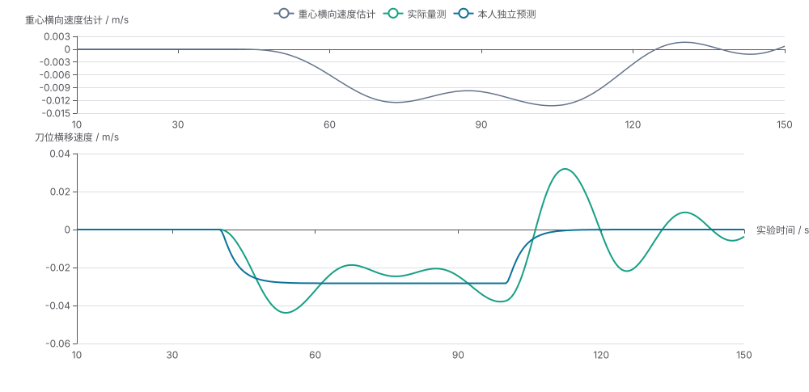

# 实验07 天鲸号工况切换与作业定位

课程版本 seven-vessel-2026.11.14，指导书版本 2026.11.16。

## 课程卡

船舶与海洋工程、自动化本科高年级，工况切换与约束综合设计实验

先修知识包括反馈控制、基本状态机、执行器与安全约束。

设计用时为预习25分钟、操作分析120分钟、报告35分钟，合计180分钟。

用时为教学设计起点。任课教师结合学校课时长度、课前课后安排和实际试教学记录登记课表。七个实验分别启动、完成和复核，可按课程安排组合使用。

- 解释钢桩、锚缆、桥架与自航受力。认知层级为分析，通过第1、2、3、4步形成证据。
- 建立本人局部模型并独立验证。认知层级为分析与设计，通过第5、6、7、8步形成证据。
- 比较土层、横移PI、模式切换与实际能耗。认知层级为综合设计与评价，通过第9、10、11、12、13、14、15、16、17步形成证据。
- 依据断缆和未见土层检验安全方案。认知层级为工程判断，通过第18、19、20步形成证据。

## 原型、物理对象与参数

自航双桨双舵、钢桩有限支承、两条单向受拉弹性锚缆、实际绞车、桥架与绞刀。载荷回到同一六自由度船体，产量累计新移除床面体积。

物理对象保留纵荡、横荡、升沉、横摇、纵摇与艏摇。世界坐标为北、东、下，船体坐标为艏、右舷、下。正航向为俯视顺时针。力矩按实际作用点的叉积计算。

| 默认教学参数 | 数值 | 单位 | 来源等级 |
| --- | --- | --- | --- |
| 教学排水质量 | 12000000.0000 | kg | T / 同一冻结装配 |
| 默认吃水 | 6.0000 | m | T / 同一冻结装配 |
| 默认有效横稳心高 | 2.0000 | m | T / 同一冻结装配 |

P表示公开原型资料，B表示公开基准，D表示计算与校准，T表示教学设定。上表为冻结装配的默认教学值。装载、姿态和工况变化后的参数按本次运行显示并记录。原始数值残差、参数来源和有效域随版本保存。

均质饱和砂和黏土采用Miedema局部条带近似，准静态缆适用于低速横移。机械能耗覆盖绞刀、横移绞车与推进轴系。

## 本人理想模型与独立对照

固定钢桩保持或横移切削模式，分别以实际绞车速度、绞车指令辨识局部横移一阶或二阶模型。K为无量纲，时间常数单位为s。

本人联合模型生成横移PI初值，选择换向斜坡、进入条件、保持时间、提前中止阈值和积分跟踪方式。

三维船体由物理对象的实际受力推进。仪器提供带采样时刻、延迟和质量标志的量测，观测器据此形成状态估计。本人理想模型从所选量测窗口辨识，并独立生成预测曲线。

A模式以实际执行器量测检验局部模型。B模式使用指令和声明的执行器模型，或已包含执行器的联合模型。C模式以本人模型的独立反馈预测闭环。每种对照均保存模型版本、输入通道、单位和窗口，训练与独立验证分别取证。

图1采用同课程版本的软件验收记录，并保留原始预测偏差。图中量测、观测估计及预测按各自标签读取。

## 二十步目录

| 步骤 | 名称 | 页码 |
| --- | --- | --- |
| 1 | [认识作业受力链](#dredger-step-1) | 3 |
| 2 | [检验自航与横漂](#dredger-step-2) | 4 |
| 3 | [观察钢桩反力建立](#dredger-step-3) | 4 |
| 4 | [比较单侧绞车作用](#dredger-step-4) | 5 |
| 5 | [辨识小横移模型](#dredger-step-5) | 5 |
| 6 | [独立反向验证](#dredger-step-6) | 6 |
| 7 | [调节桥架深度](#dredger-step-7) | 7 |
| 8 | [观察绞刀空载](#dredger-step-8) | 7 |
| 9 | [建立砂层切削](#dredger-step-9) | 8 |
| 10 | [设计横移PI](#dredger-step-10) | 8 |
| 11 | [检验土层模型失配](#dredger-step-11) | 9 |
| 12 | [比较受限切削能力](#dredger-step-12) | 10 |
| 13 | [设计平滑换向](#dredger-step-13) | 10 |
| 14 | [比较模式积分跟踪](#dredger-step-14) | 11 |
| 15 | [检验风流作业负载](#dredger-step-15) | 11 |
| 16 | [观察波浪切厚](#dredger-step-16) | 12 |
| 17 | [选择滤波与保持时间](#dredger-step-17) | 13 |
| 18 | [执行断缆安全退出](#dredger-step-18) | 13 |
| 19 | [验证综合作业方案](#dredger-step-19) | 14 |
| 20 | [完成实验报告](#dredger-step-20) | 14 |

## 二十步操作、证据与评价

### 第1步 认识作业受力链

| 项目 | 本步要求 |
| --- | --- |
| 目标与认知 | 作业定位与推进器DP不同，分析 |
| 能力证据 | 解释钢桩、锚缆、桥架与自航受力 |
| 初态与条件 | 初始对水航速 / m/s 0 |
| 本步启用因素 | P0、N0 |
| 合同参数范围 | 横移速度参考 0.03-0.15m/s |
| 事件与操作 | 静水停船，120s |
| 时长与结束 | 120s，运行至120s，保留安全退出与未达结果 |
| 量测与统计窗 | 刀位包络深度、刀位横移速度、绞刀转速、左锚缆张力、右锚缆张力、钢桩反力，0-120s |
| 最少运行 | 1组实际记录 |
| 训练与验证 | 训练或方案设计 |
| 提交工件 | 运行前预测、实际运行记录、证据解释 |
| 评价 | 预测0.9分，证据1.2分，性能0分，解释0.9分，作业定位与推进器DP不同 |
| 观察问题 | 在受力/执行器图标注双桨舵、钢桩、两绞车、桥架、绞刀 |
| 常见误判与核对 | 按真实作业模式解释局部模型失配。断缆实验先核验故障前已进入切削，再依据实际停刀、抬刀与支承余量判断安全退出。 |

先记录自己的预测，再操作、读数并解释差异。实际未达目标、缺测或保护退出的记录与分析继续保存。

### 第2步 检验自航与横漂

| 项目 | 本步要求 |
| --- | --- |
| 目标与认知 | 欠驱动、低速舵效、对地/对水区别，分析 |
| 能力证据 | 解释钢桩、锚缆、桥架与自航受力 |
| 初态与条件 | 初始对水航速 / m/s 0 |
| 本步启用因素 | C1、N0 |
| 合同参数范围 | 横移速度参考 0.03-0.15m/s |
| 事件与操作 | 自航模式，C1，300s |
| 时长与结束 | 300s，运行至300s，保留安全退出与未达结果 |
| 量测与统计窗 | 刀位包络深度、刀位横移速度、绞刀转速、左锚缆张力、右锚缆张力、钢桩反力，0-300s |
| 最少运行 | 1组实际记录 |
| 训练与验证 | 训练或方案设计 |
| 提交工件 | 运行前预测、实际运行记录、证据解释 |
| 评价 | 预测0.9分，证据1.2分，性能0分，解释0.9分，欠驱动、低速舵效、对地/对水区别 |
| 观察问题 | 维持航向后观察横漂，再预测仅靠舵能否零速守位 |
| 常见误判与核对 | 按真实作业模式解释局部模型失配。断缆实验先核验故障前已进入切削，再依据实际停刀、抬刀与支承余量判断安全退出。 |

先记录自己的预测，再操作、读数并解释差异。实际未达目标、缺测或保护退出的记录与分析继续保存。

### 第3步 观察钢桩反力建立

| 项目 | 本步要求 |
| --- | --- |
| 目标与认知 | 有限刚度接触而非瞬移固定，分析 |
| 能力证据 | 解释钢桩、锚缆、桥架与自航受力 |
| 初态与条件 | 初始对水航速 / m/s 0 |
| 本步启用因素 | P0、N0 |
| 合同参数范围 | 横移速度参考 0.03-0.15m/s |
| 事件与操作 | Prepare→SpudHold，P0，300s |
| 时长与结束 | 300s，运行至300s，保留安全退出与未达结果 |
| 量测与统计窗 | 刀位包络深度、刀位横移速度、绞刀转速、左锚缆张力、右锚缆张力、钢桩反力，0-300s |
| 最少运行 | 1组实际记录 |
| 训练与验证 | 训练或方案设计 |
| 提交工件 | 运行前预测、实际运行记录、证据解释 |
| 评价 | 预测0.9分，证据1.2分，性能0分，解释0.9分，有限刚度接触而非瞬移固定 |
| 观察问题 | 下达落桩，观察反力建立与船体运动 |
| 常见误判与核对 | 按真实作业模式解释局部模型失配。断缆实验先核验故障前已进入切削，再依据实际停刀、抬刀与支承余量判断安全退出。 |

先记录自己的预测，再操作、读数并解释差异。实际未达目标、缺测或保护退出的记录与分析继续保存。

### 第4步 比较单侧绞车作用

| 项目 | 本步要求 |
| --- | --- |
| 目标与认知 | 只承拉、张力/长度/几何关系，分析 |
| 能力证据 | 解释钢桩、锚缆、桥架与自航受力 |
| 初态与条件 | 初始对水航速 / m/s 0 |
| 本步启用因素 | P0、N0 |
| 合同参数范围 | 横移速度参考 0.03-0.15m/s |
| 事件与操作 | SpudHold，两缆，300s |
| 时长与结束 | 300s，运行至300s，保留安全退出与未达结果 |
| 量测与统计窗 | 刀位包络深度、刀位横移速度、绞刀转速、左锚缆张力、右锚缆张力、钢桩反力，0-300s |
| 最少运行 | 2组实际记录 |
| 训练与验证 | 训练或方案设计 |
| 提交工件 | 运行前预测、实际运行记录、证据解释 |
| 评价 | 预测0.9分，证据1.2分，性能0分，解释0.9分，只承拉、张力/长度/几何关系 |
| 观察问题 | 分别收/放一条缆，预测力与转向方向 |
| 常见误判与核对 | 按真实作业模式解释局部模型失配。断缆实验先核验故障前已进入切削，再依据实际停刀、抬刀与支承余量判断安全退出。 |

先记录自己的预测，再操作、读数并解释差异。实际未达目标、缺测或保护退出的记录与分析继续保存。

### 第5步 辨识小横移模型

| 项目 | 本步要求 |
| --- | --- |
| 目标与认知 | 执行器-缆-船体耦合的低阶近似，分析 |
| 能力证据 | 建立本人局部模型并独立验证 |
| 初态与条件 | 初始对水航速 / m/s 0 |
| 本步启用因素 | P0、N0 |
| 合同参数范围 | 横移速度参考 0.03-0.15m/s |
| 事件与操作 | 无切削小横移±2°，300s |
| 时长与结束 | 300s，运行至300s，保留安全退出与未达结果 |
| 量测与统计窗 | 刀位包络深度、刀位横移速度、绞刀转速、左锚缆张力、右锚缆张力、钢桩反力，0-300s |
| 最少运行 | 1组实际记录 |
| 训练与验证 | 训练或方案设计 |
| 提交工件 | 运行前预测、实际运行记录、证据解释 |
| 评价 | 预测1.2分，证据1.6分，性能0分，解释1.2分，执行器-缆-船体耦合的低阶近似 |
| 观察问题 | 施加小绞车速度阶跃并辨识局部响应 |
| 常见误判与核对 | 按真实作业模式解释局部模型失配。断缆实验先核验故障前已进入切削，再依据实际停刀、抬刀与支承余量判断安全退出。 |

先记录自己的预测，再操作、读数并解释差异。实际未达目标、缺测或保护退出的记录与分析继续保存。

### 第6步 独立反向验证

| 项目 | 本步要求 |
| --- | --- |
| 目标与认知 | 独立验证、缆松弛导致非线性，分析 |
| 能力证据 | 建立本人局部模型并独立验证 |
| 初态与条件 | 初始对水航速 / m/s 0 |
| 本步启用因素 | P0、N0 |
| 合同参数范围 | 横移速度参考 0.03-0.15m/s |
| 事件与操作 | 新run反向小横移，300s |
| 时长与结束 | 300s，运行至300s，保留安全退出与未达结果 |
| 量测与统计窗 | 刀位包络深度、刀位横移速度、绞刀转速、左锚缆张力、右锚缆张力、钢桩反力，0-300s |
| 最少运行 | 1组实际记录 |
| 训练与验证 | 独立验证 |
| 提交工件 | 运行前预测、实际运行记录、证据解释 |
| 评价 | 预测1.2分，证据1.6分，性能0分，解释1.2分，独立验证、缆松弛导致非线性 |
| 观察问题 | 冻结辨识模型叠加预测/实际 |
| 常见误判与核对 | 按真实作业模式解释局部模型失配。断缆实验先核验故障前已进入切削，再依据实际停刀、抬刀与支承余量判断安全退出。 |

先记录自己的预测，再操作、读数并解释差异。实际未达目标、缺测或保护退出的记录与分析继续保存。

### 第7步 调节桥架深度

| 项目 | 本步要求 |
| --- | --- |
| 目标与认知 | 桥架重力浮力反力、海面参考与床面，分析 |
| 能力证据 | 建立本人局部模型并独立验证 |
| 初态与条件 | 初始对水航速 / m/s 0 |
| 本步启用因素 | P0、N0 |
| 合同参数范围 | 横移速度参考 0.03-0.15m/s |
| 事件与操作 | SpudHold，桥架目标20.3m，300s |
| 时长与结束 | 300s，运行至300s，保留安全退出与未达结果 |
| 量测与统计窗 | 刀位包络深度、刀位横移速度、绞刀转速、左锚缆张力、右锚缆张力、钢桩反力，0-300s |
| 最少运行 | 1组实际记录 |
| 训练与验证 | 训练或方案设计 |
| 提交工件 | 运行前预测、实际运行记录、证据解释 |
| 评价 | 预测1.2分，证据1.6分，性能0分，解释1.2分，桥架重力浮力反力、海面参考与床面 |
| 观察问题 | 调桥架目标/斜坡，记录6DOF和深度 |
| 常见误判与核对 | 按真实作业模式解释局部模型失配。断缆实验先核验故障前已进入切削，再依据实际停刀、抬刀与支承余量判断安全退出。 |

先记录自己的预测，再操作、读数并解释差异。实际未达目标、缺测或保护退出的记录与分析继续保存。

### 第8步 观察绞刀空载

| 项目 | 本步要求 |
| --- | --- |
| 目标与认知 | 空载不等于产土，轴惯性与功率，分析 |
| 能力证据 | 建立本人局部模型并独立验证 |
| 初态与条件 | 初始对水航速 / m/s 0 |
| 本步启用因素 | P0、N0 |
| 合同参数范围 | 横移速度参考 0.03-0.15m/s |
| 事件与操作 | 绞刀离床.5m，300s |
| 时长与结束 | 300s，运行至300s，保留安全退出与未达结果 |
| 量测与统计窗 | 刀位包络深度、刀位横移速度、绞刀转速、左锚缆张力、右锚缆张力、钢桩反力，0-300s |
| 最少运行 | 1组实际记录 |
| 训练与验证 | 训练或方案设计 |
| 提交工件 | 运行前预测、实际运行记录、证据解释 |
| 评价 | 预测1.2分，证据1.6分，性能0分，解释1.2分，空载不等于产土，轴惯性与功率 |
| 观察问题 | 开刀至30rpm并测实际扭矩/转速 |
| 常见误判与核对 | 按真实作业模式解释局部模型失配。断缆实验先核验故障前已进入切削，再依据实际停刀、抬刀与支承余量判断安全退出。 |

先记录自己的预测，再操作、读数并解释差异。实际未达目标、缺测或保护退出的记录与分析继续保存。

### 第9步 建立砂层切削

| 项目 | 本步要求 |
| --- | --- |
| 目标与认知 | 切削负载与产量由土体/运动生成，设计 |
| 能力证据 | 比较土层、横移PI、模式切换与实际能耗 |
| 初态与条件 | 初始对水航速 / m/s 0 |
| 本步启用因素 | P0、N0 |
| 合同参数范围 | 横移速度参考 0.03-0.15m/s |
| 事件与操作 | 饱和砂，切厚.3m，600s |
| 时长与结束 | 600s，运行至600s，保留安全退出与未达结果 |
| 量测与统计窗 | 刀位包络深度、刀位横移速度、绞刀转速、左锚缆张力、右锚缆张力、钢桩反力，0-600s |
| 最少运行 | 1组实际记录 |
| 训练与验证 | 训练或方案设计 |
| 提交工件 | 运行前预测、实际运行记录、证据解释 |
| 评价 | 预测1.5分，证据1分，性能1分，解释1.5分，切削负载与产量由土体/运动生成 |
| 观察问题 | 降刀接触并开启横移.08m/s，观察载荷 |
| 常见误判与核对 | 按真实作业模式解释局部模型失配。断缆实验先核验故障前已进入切削，再依据实际停刀、抬刀与支承余量判断安全退出。 |

先记录自己的预测，再操作、读数并解释差异。实际未达目标、缺测或保护退出的记录与分析继续保存。

### 第10步 设计横移PI

| 项目 | 本步要求 |
| --- | --- |
| 目标与认知 | 速度跟踪、张力/桩反力与控制代价，设计 |
| 能力证据 | 比较土层、横移PI、模式切换与实际能耗 |
| 初态与条件 | 初始对水航速 / m/s 0 |
| 本步启用因素 | P0、N0 |
| 合同参数范围 | 横移速度参考 0.03-0.15m/s |
| 事件与操作 | 同砂层 |
| 时长与结束 | 600s，运行至600s，保留安全退出与未达结果 |
| 量测与统计窗 | 刀位包络深度、刀位横移速度、绞刀转速、左锚缆张力、右锚缆张力、钢桩反力，0-600s |
| 最少运行 | 2组实际记录 |
| 训练与验证 | 训练或方案设计 |
| 提交工件 | 运行前预测、实际运行记录、证据解释 |
| 评价 | 预测1.5分，证据1分，性能1分，解释1.5分，速度跟踪、张力/桩反力与控制代价 |
| 观察问题 | 设计横移PI，比较两组增益 |
| 常见误判与核对 | 按真实作业模式解释局部模型失配。断缆实验先核验故障前已进入切削，再依据实际停刀、抬刀与支承余量判断安全退出。 |

先记录自己的预测，再操作、读数并解释差异。实际未达目标、缺测或保护退出的记录与分析继续保存。

### 第11步 检验土层模型失配

| 项目 | 本步要求 |
| --- | --- |
| 目标与认知 | 土质变化导致模型失配，不固定“控制必失败”，设计 |
| 能力证据 | 比较土层、横移PI、模式切换与实际能耗 |
| 初态与条件 | 初始对水航速 / m/s 0 |
| 本步启用因素 | P0、N0 |
| 合同参数范围 | 横移速度参考 0.03-0.15m/s |
| 事件与操作 | 相同计划改黏土，600s |
| 时长与结束 | 600s，运行至600s，保留安全退出与未达结果 |
| 量测与统计窗 | 刀位包络深度、刀位横移速度、绞刀转速、左锚缆张力、右锚缆张力、钢桩反力，0-600s |
| 最少运行 | 1组实际记录 |
| 训练与验证 | 训练或方案设计 |
| 提交工件 | 运行前预测、实际运行记录、证据解释 |
| 评价 | 预测1.5分，证据1分，性能1分，解释1.5分，土质变化导致模型失配，不固定“控制必失败” |
| 观察问题 | 使用砂层模型预测后实跑，再重新辨识 |
| 常见误判与核对 | 按真实作业模式解释局部模型失配。断缆实验先核验故障前已进入切削，再依据实际停刀、抬刀与支承余量判断安全退出。 |

先记录自己的预测，再操作、读数并解释差异。实际未达目标、缺测或保护退出的记录与分析继续保存。

### 第12步 比较受限切削能力

| 项目 | 本步要求 |
| --- | --- |
| 目标与认知 | 受限切削能力、单位实际产量能耗，设计 |
| 能力证据 | 比较土层、横移PI、模式切换与实际能耗 |
| 初态与条件 | 初始对水航速 / m/s 0 |
| 本步启用因素 | P0、N0 |
| 合同参数范围 | 横移速度参考 0.03-0.15m/s |
| 事件与操作 | 黏土、切厚.3/.5m对照 |
| 时长与结束 | 600s，运行至600s，保留安全退出与未达结果 |
| 量测与统计窗 | 刀位包络深度、刀位横移速度、绞刀转速、左锚缆张力、右锚缆张力、钢桩反力，0-600s |
| 最少运行 | 2组实际记录 |
| 训练与验证 | 训练或方案设计 |
| 提交工件 | 运行前预测、实际运行记录、证据解释 |
| 评价 | 预测1.5分，证据1分，性能1分，解释1.5分，受限切削能力、单位实际产量能耗 |
| 观察问题 | 调横移速度/刀速，不得改变硬功率上限 |
| 常见误判与核对 | 按真实作业模式解释局部模型失配。断缆实验先核验故障前已进入切削，再依据实际停刀、抬刀与支承余量判断安全退出。 |

先记录自己的预测，再操作、读数并解释差异。实际未达目标、缺测或保护退出的记录与分析继续保存。

### 第13步 设计平滑换向

| 项目 | 本步要求 |
| --- | --- |
| 目标与认知 | 模式/参考切换的冲击与平滑性，设计 |
| 能力证据 | 比较土层、横移PI、模式切换与实际能耗 |
| 初态与条件 | 初始对水航速 / m/s 0 |
| 本步启用因素 | P0、N0 |
| 合同参数范围 | 横移速度参考 0.03-0.15m/s |
| 事件与操作 | CutSwing换向，600s |
| 时长与结束 | 600s，运行至600s，保留安全退出与未达结果 |
| 量测与统计窗 | 刀位包络深度、刀位横移速度、绞刀转速、左锚缆张力、右锚缆张力、钢桩反力，0-600s |
| 最少运行 | 3组实际记录 |
| 训练与验证 | 训练或方案设计 |
| 提交工件 | 运行前预测、实际运行记录、证据解释 |
| 评价 | 预测1.8分，证据1.2分，性能1.2分，解释1.8分，模式/参考切换的冲击与平滑性 |
| 观察问题 | 选择换向斜坡5/15/30s，比较张力峰值 |
| 常见误判与核对 | 按真实作业模式解释局部模型失配。断缆实验先核验故障前已进入切削，再依据实际停刀、抬刀与支承余量判断安全退出。 |

先记录自己的预测，再操作、读数并解释差异。实际未达目标、缺测或保护退出的记录与分析继续保存。

### 第14步 比较模式积分跟踪

| 项目 | 本步要求 |
| --- | --- |
| 目标与认知 | 状态连续、反复切换与积分累积，设计 |
| 能力证据 | 比较土层、横移PI、模式切换与实际能耗 |
| 初态与条件 | 初始对水航速 / m/s 0 |
| 本步启用因素 | P0、N0 |
| 合同参数范围 | 横移速度参考 0.03-0.15m/s |
| 事件与操作 | SpudHold↔CutSwing，600s |
| 时长与结束 | 600s，运行至600s，保留安全退出与未达结果 |
| 量测与统计窗 | 刀位包络深度、刀位横移速度、绞刀转速、左锚缆张力、右锚缆张力、钢桩反力，0-600s |
| 最少运行 | 2组实际记录 |
| 训练与验证 | 训练或方案设计 |
| 提交工件 | 运行前预测、实际运行记录、证据解释 |
| 评价 | 预测1.8分，证据1.2分，性能1.2分，解释1.8分，状态连续、反复切换与积分累积 |
| 观察问题 | 比较积分重置与跟踪，再设防抖保持时间 |
| 常见误判与核对 | 按真实作业模式解释局部模型失配。断缆实验先核验故障前已进入切削，再依据实际停刀、抬刀与支承余量判断安全退出。 |

先记录自己的预测，再操作、读数并解释差异。实际未达目标、缺测或保护退出的记录与分析继续保存。

### 第15步 检验风流作业负载

| 项目 | 本步要求 |
| --- | --- |
| 目标与认知 | 环境力、钢桩/缆负载余量，评价 |
| 能力证据 | 比较土层、横移PI、模式切换与实际能耗 |
| 初态与条件 | 初始对水航速 / m/s 0 |
| 本步启用因素 | W1、C1、N0 |
| 合同参数范围 | 横移速度参考 0.03-0.15m/s |
| 事件与操作 | W1+C1，砂层，600s |
| 时长与结束 | 600s，运行至600s，保留安全退出与未达结果 |
| 量测与统计窗 | 刀位包络深度、刀位横移速度、绞刀转速、左锚缆张力、右锚缆张力、钢桩反力，0-600s |
| 最少运行 | 2组实际记录 |
| 训练与验证 | 训练或方案设计 |
| 提交工件 | 运行前预测、实际运行记录、证据解释 |
| 评价 | 预测1.8分，证据1.2分，性能1.2分，解释1.8分，环境力、钢桩/缆负载余量 |
| 观察问题 | 冻结静水方案运行，再改一项策略 |
| 常见误判与核对 | 按真实作业模式解释局部模型失配。断缆实验先核验故障前已进入切削，再依据实际停刀、抬刀与支承余量判断安全退出。 |

先记录自己的预测，再操作、读数并解释差异。实际未达目标、缺测或保护退出的记录与分析继续保存。

### 第16步 观察波浪切厚

| 项目 | 本步要求 |
| --- | --- |
| 目标与认知 | 波浪影响实际刀位/切削，不只船身摇晃，评价 |
| 能力证据 | 比较土层、横移PI、模式切换与实际能耗 |
| 初态与条件 | 初始对水航速 / m/s 0 |
| 本步启用因素 | W1、C1、V1、N0 |
| 合同参数范围 | 横移速度参考 0.03-0.15m/s |
| 事件与操作 | Hs=.5m,Tp6s横浪，20m水深，600s |
| 时长与结束 | 600s，运行至600s，保留安全退出与未达结果 |
| 量测与统计窗 | 刀位包络深度、刀位横移速度、绞刀转速、左锚缆张力、右锚缆张力、钢桩反力，0-600s |
| 最少运行 | 2组实际记录 |
| 训练与验证 | 训练或方案设计 |
| 提交工件 | 运行前预测、实际运行记录、证据解释 |
| 评价 | 预测1.8分，证据1.2分，性能1.2分，解释1.8分，波浪影响实际刀位/切削，不只船身摇晃 |
| 观察问题 | 比较无浪/有浪桥架深度与切厚；调深度滤波 |
| 常见误判与核对 | 按真实作业模式解释局部模型失配。断缆实验先核验故障前已进入切削，再依据实际停刀、抬刀与支承余量判断安全退出。 |

先记录自己的预测，再操作、读数并解释差异。实际未达目标、缺测或保护退出的记录与分析继续保存。

### 第17步 选择滤波与保持时间

| 项目 | 本步要求 |
| --- | --- |
| 目标与认知 | 噪声/时延导致误触发，反应速度与稳定性，评价 |
| 能力证据 | 比较土层、横移PI、模式切换与实际能耗 |
| 初态与条件 | 初始对水航速 / m/s 0 |
| 本步启用因素 | W1、C1、V1、N1 |
| 合同参数范围 | 横移速度参考 0.03-0.15m/s |
| 事件与操作 | 上述波浪+N1，600s |
| 时长与结束 | 600s，运行至600s，保留安全退出与未达结果 |
| 量测与统计窗 | 刀位包络深度、刀位横移速度、绞刀转速、左锚缆张力、右锚缆张力、钢桩反力，0-600s |
| 最少运行 | 3组实际记录 |
| 训练与验证 | 训练或方案设计 |
| 提交工件 | 运行前预测、实际运行记录、证据解释 |
| 评价 | 预测1.8分，证据1.2分，性能1.2分，解释1.8分，噪声/时延导致误触发，反应速度与稳定性 |
| 观察问题 | 调阈值保持5/10/20s及过滤 |
| 常见误判与核对 | 按真实作业模式解释局部模型失配。断缆实验先核验故障前已进入切削，再依据实际停刀、抬刀与支承余量判断安全退出。 |

先记录自己的预测，再操作、读数并解释差异。实际未达目标、缺测或保护退出的记录与分析继续保存。

### 第18步 执行断缆安全退出

| 项目 | 本步要求 |
| --- | --- |
| 目标与认知 | 失效改变受力，不能只改状态标签，评价 |
| 能力证据 | 依据断缆和未见土层检验安全方案 |
| 初态与条件 | 初始对水航速 / m/s 0 |
| 本步启用因素 | W1、C1、V1、N1 |
| 合同参数范围 | 横移速度参考 0.03-0.15m/s |
| 事件与操作 | 作业中t180一侧断缆，600s |
| 时长与结束 | 600s，运行至600s，保留安全退出与未达结果 |
| 量测与统计窗 | 刀位包络深度、刀位横移速度、绞刀转速、左锚缆张力、右锚缆张力、钢桩反力，0-600s |
| 最少运行 | 1组实际记录 |
| 训练与验证 | 训练或方案设计 |
| 提交工件 | 运行前预测、实际运行记录、证据解释 |
| 评价 | 预测1.8分，证据1.2分，性能1.2分，解释1.8分，失效改变受力，不能只改状态标签 |
| 观察问题 | 执行PauseCut→抬刀→安全保持/退出动作 |
| 常见误判与核对 | 按真实作业模式解释局部模型失配。断缆实验先核验故障前已进入切削，再依据实际停刀、抬刀与支承余量判断安全退出。 |

先记录自己的预测，再操作、读数并解释差异。实际未达目标、缺测或保护退出的记录与分析继续保存。

### 第19步 验证综合作业方案

| 项目 | 本步要求 |
| --- | --- |
| 目标与认知 | 综合负载/环境适应与安全切换；失败分析可得分，评价 |
| 能力证据 | 依据断缆和未见土层检验安全方案 |
| 初态与条件 | 初始对水航速 / m/s 0 |
| 本步启用因素 | W1、C1、V1、N1 |
| 合同参数范围 | 横移速度参考 0.03-0.15m/s |
| 事件与操作 | seed17/29、砂/黏土与W1+C1+N1 |
| 时长与结束 | 600s，运行至600s，保留安全退出与未达结果 |
| 量测与统计窗 | 刀位包络深度、刀位横移速度、绞刀转速、左锚缆张力、右锚缆张力、钢桩反力，0-600s |
| 最少运行 | 2组实际记录 |
| 训练与验证 | 独立验证 |
| 提交工件 | 运行前预测、实际运行记录、证据解释 |
| 评价 | 预测1.8分，证据1.2分，性能1.2分，解释1.8分，综合负载/环境适应与安全切换；失败分析可得分 |
| 观察问题 | 冻结完整模式图和控制参数做验证 |
| 常见误判与核对 | 按真实作业模式解释局部模型失配。断缆实验先核验故障前已进入切削，再依据实际停刀、抬刀与支承余量判断安全退出。 |

先记录自己的预测，再操作、读数并解释差异。实际未达目标、缺测或保护退出的记录与分析继续保存。

### 第20步 完成实验报告

| 项目 | 本步要求 |
| --- | --- |
| 目标与认知 | 结果解释与范围，不宣称实际工程产能/结构许可，综合设计 |
| 能力证据 | 依据断缆和未见土层检验安全方案 |
| 初态与条件 | 初始对水航速 / m/s 0 |
| 本步启用因素 | W1、C1、V1、N1 |
| 合同参数范围 | 横移速度参考 0.03-0.15m/s |
| 事件与操作 | 整理本人已有证据 |
| 时长与结束 | 分析步骤，引用六组本人运行完成报告 |
| 量测与统计窗 | 刀位包络深度、刀位横移速度、绞刀转速、左锚缆张力、右锚缆张力、钢桩反力，0-600s |
| 最少运行 | 6组已有证据，按本步工件要求引用 |
| 训练与验证 | 汇总分析 |
| 提交工件 | 至少六组本人运行、冻结模型、独立验证、六部分报告 |
| 评价 | 模型假设3分，本人证据3分，方案比较2分，适用边界2分，结果解释与范围，不宣称实际工程产能/结构许可 |
| 观察问题 | 提交模式图、辨识对照、负载/切换/故障证据报告 |
| 常见误判与核对 | 按真实作业模式解释局部模型失配。断缆实验先核验故障前已进入切削，再依据实际停刀、抬刀与支承余量判断安全退出。 |

先记录自己的预测，再操作、读数并解释差异。实际未达目标、缺测或保护退出的记录与分析继续保存。

## 现实因素与操作权限

物理后台持续支持执行器、六自由度、风、浪、流和观测链。本步启用情况由课程预置条件和实际开关回执确定，学生在解锁控件的范围内调整参数。

| 步骤 | 启用因素 | 合同调整项 | 固定条件 |
| --- | --- | --- | --- |
| 1 | P0、N0 | 横移速度参考 | 船型、参数包和本步预置事件 |
| 2 | C1、N0 | 横移速度参考 | 船型、参数包和本步预置事件 |
| 3 | P0、N0 | 横移速度参考 | 船型、参数包和本步预置事件 |
| 4 | P0、N0 | 横移速度参考 | 船型、参数包和本步预置事件 |
| 5 | P0、N0 | 横移速度参考 | 船型、参数包和本步预置事件 |
| 6 | P0、N0 | 横移速度参考 | 船型、参数包和本步预置事件 |
| 7 | P0、N0 | 横移速度参考 | 船型、参数包和本步预置事件 |
| 8 | P0、N0 | 横移速度参考 | 船型、参数包和本步预置事件 |
| 9 | P0、N0 | 横移速度参考 | 船型、参数包和本步预置事件 |
| 10 | P0、N0 | 横移速度参考 | 船型、参数包和本步预置事件 |
| 11 | P0、N0 | 横移速度参考 | 船型、参数包和本步预置事件 |
| 12 | P0、N0 | 横移速度参考 | 船型、参数包和本步预置事件 |
| 13 | P0、N0 | 横移速度参考 | 船型、参数包和本步预置事件 |
| 14 | P0、N0 | 横移速度参考 | 船型、参数包和本步预置事件 |
| 15 | W1、C1、N0 | 横移速度参考 | 船型、参数包和本步预置事件 |
| 16 | W1、C1、V1、N0 | 横移速度参考 | 船型、参数包和本步预置事件 |
| 17 | W1、C1、V1、N1 | 横移速度参考 | 船型、参数包和本步预置事件 |
| 18 | W1、C1、V1、N1 | 横移速度参考 | 船型、参数包和本步预置事件 |
| 19 | W1、C1、V1、N1 | 横移速度参考 | 船型、参数包和本步预置事件 |
| 20 | W1、C1、V1、N1 | 横移速度参考 | 船型、参数包和本步预置事件 |

P0表示平静环境，N0表示理想仪器等级。W表示风，V表示波浪，C表示流，E表示组合环境，N1/N2表示相应噪声与时延等级。冰区和专项机构按本步工况独立记录。

## 评分与六部分报告

每个实验满分100分，二十步分值依次为3、3、3、3、4、4、4、4、5、5、5、5、6、6、6、6、6、6、6、10分。前19步的预测占30%、操作与证据占40%、解释占30%。设计步骤将40%分为证据与性能各20%。

第20步按模型假设3分、本人证据3分、方案比较2分和适用边界2分复核。缺证据、数值无效、模型失配、性能不足和解释错误分别记录。

1. 问题与限制。引用本人运行、模型、独立对照和修改依据。
2. 局部模型。引用本人运行、模型、独立对照和修改依据。
3. 独立验证。引用本人运行、模型、独立对照和修改依据。
4. 控制方案与比较。引用本人运行、模型、独立对照和修改依据。
5. 修改及迁移。引用本人运行、模型、独立对照和修改依据。
6. 工程结论与边界。引用本人运行、模型、独立对照和修改依据。

报告比较至少两种方案，并保留独立验证与未见工况。页面过程状态帮助检查完整性，教师依据固定量规查看尝试、反馈、退回修改并确认最终成绩。

## 设备准备、恢复与数据

使用支持硬件加速的现代桌面浏览器，先完成页面中的网络与图形检查。三维场景就绪后开始，按需要暂停、折叠面板、调整视图和运行速率。图形接口与质量档由页面统一管理。

普通平台账号和实验空间入口均将实验保存到当前账号。实验空间核验身份后建立专用来源账号并绑定本轮记录，控灵使用同一账号及本页步骤。刷新、重新打开或更换设备后核对原轮次、草稿与运行时间，再继续实验。

网络失败时保留本机结果并按页面入口继续上传。教师确认最终成绩后按实验空间规则回传，附件重试复用已成功成绩。新的独立实验轮次通过“重新开始新一轮实验”建立，历史结果分别保留。

控灵提供本步机理与有来源的观察提示。学生保留本人预测、量测和解释，报告引用实际作品。账号资料、原始答案和私有运行记录按平台访问权限保存，公开示例采用脱敏的软件验收数据。

## 旧版迁移与教学证据

原挖泥船动力定位教学页更新为钢桩、锚缆与横移切削。旧定位开关观察扩展为真实机构、局部模型、模式和安全退出。

旧步骤的操作背景与新能力目标按本册二十步重新对应，旧成绩保留其原课程版本。新版报告固定引用本次材料版本。旧版PDF可由历史发布标签追溯。

下表按旧、新编号核对替换位置，当前教学目标和需提交的证据以本册各步为准。

| 编号 | 原操作版 | 当前步骤 | 迁移处理 |
| --- | --- | --- | --- |
| 1 | 定点读数 | 认识作业受力链 | 替换并增加当前能力证据 |
| 2 | 疏浚中守点 | 检验自航与横漂 | 替换并增加当前能力证据 |
| 3 | 退出定位 | 观察钢桩反力建立 | 替换并增加当前能力证据 |
| 4 | 拉不回来 | 比较单侧绞车作用 | 替换并增加当前能力证据 |
| 5 | 疏浚仍能守住 | 辨识小横移模型 | 替换并增加当前能力证据 |
| 6 | 被流带离 | 独立反向验证 | 替换并增加当前能力证据 |
| 7 | 定位模式 | 调节桥架深度 | 替换并增加当前能力证据 |
| 8 | 航向读数 | 观察绞刀空载 | 替换并增加当前能力证据 |
| 9 | 工况结论 | 建立砂层切削 | 替换并增加当前能力证据 |
| 10 | 守点复核 | 设计横移PI | 替换并增加当前能力证据 |
| 11 | 漂离读数 | 检验土层模型失配 | 替换并增加当前能力证据 |
| 12 | 定位判断 | 比较受限切削能力 | 替换并增加当前能力证据 |
| 13 | 疏浚守点 | 设计平滑换向 | 替换并增加当前能力证据 |
| 14 | 航向复核 | 比较模式积分跟踪 | 替换并增加当前能力证据 |
| 15 | 漂离判断 | 检验风流作业负载 | 替换并增加当前能力证据 |
| 16 | 守点航速 | 观察波浪切厚 | 替换并增加当前能力证据 |
| 17 | 疏浚标志 | 选择滤波与保持时间 | 替换并增加当前能力证据 |
| 18 | 远处判断 | 执行断缆安全退出 | 替换并增加当前能力证据 |
| 19 | 手绘图识别 | 验证综合作业方案 | 替换并增加当前能力证据 |
| 20 | 确认记录 | 完成实验报告 | 替换并增加当前能力证据 |

当前图例和脚本记录用于软件验收。正式教学需另外登记实际课表、学生用时、低中高水平报告样例、独立迁移任务、教师交叉评分与改进反馈，相关证据以教学证据索引核验。

## 参考资料

- 船东天鲸号资料。[查看来源](https://www.tjhdj.com/tjhdj/contents/2100/288.html)
- Miedema切削模型。[查看来源](https://doi.org/10.5074/t.2019.001)

参数与步骤的详细来源、校准误差和本课程适用域由同版本参数清单及本步运行报告共同保留。
